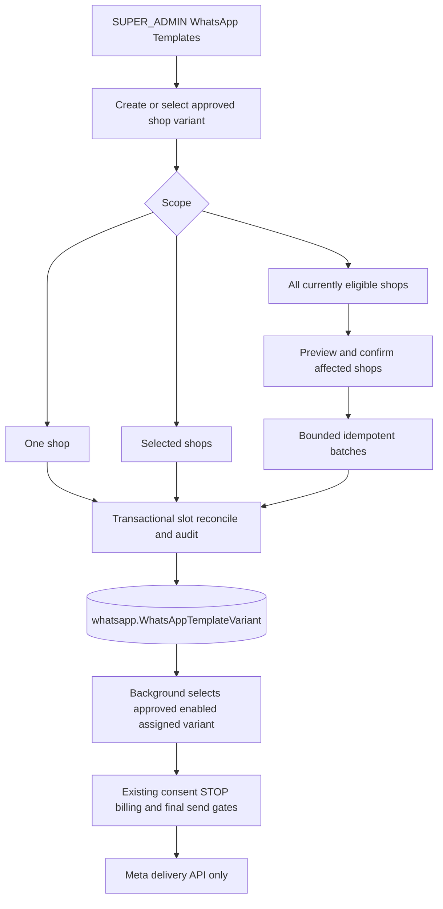

# ARCH-047 — Admin-managed WhatsApp template catalogue and merchant assignments

## Status

Agreed architecture; **portable task definitions, not materialised implementation worktrees**. This initiative is separate from ARCH-045/046 customer-consent work and the previously completed ARCH-045-BACKGROUND-004 implementation. There are no assumed runtime commits, published changes or deployment approvals under ARCH-047 yet.

## Problem

`whatsapp.WhatsAppTemplateVariant` already stores a separate shop-scoped template row (`shopId`, `providerAccountId`, `purpose`, locale/name/ID, `status`, `enabled`), but the inspected Admin repository has no dedicated WhatsApp template management screen. Background's current merged implementation calls Meta's template-listing/metadata API to verify `verifiedCategory === "MARKETING"` at initial recovery, automated follow-up and selected human/outbound paths. This turns template metadata availability into a live sending dependency even when an approved and enabled assignment is already stored in PostgreSQL.

The platform administrator needs to create and edit these **existing shop-scoped records**, assign them to a merchant or multiple merchants, apply them to **all currently eligible shops**, and update all assignments for a specific purpose/language as well as an individual shop's assignment.

## Goals

1. Admin is the sole management boundary for the Moda-side WhatsApp template catalogue. A privileged administrator registers metadata for an externally approved Meta template and marks its local status/availability. This task **does not create templates at Meta** or ask runtime services to confirm Meta approval/category.
2. The existing `WhatsAppTemplateVariant` rows remain the operational source of truth. Background and merchant-facing recovery commands select a row assigned to the correct shop and configured sender WABA where `status=APPROVED` and `enabled=true`; there is **no Meta template-list/category preflight call** in initial outreach, automated follow-ups, merchant post-window templates or final dispatch.
3. Admin supports individual assignment/update/enable/disable, selected shops, **Assign to all shops**, **Update for all shops**, and per-shop overrides. A deliberate Update for all overwrites individual overrides **in the selected template slot** after impact confirmation.
4. Prevent duplicate selectable variants for a shop/WABA/purpose/canonical-language slot despite the existing database uniqueness being keyed by name and language; expose conflicts rather than silently sending an arbitrary variant.
5. Preserve customer consent, STOP/no-contact, moderation, billing/credit, send fencing, shop eligibility, template language fallback, Meta delivery failure, idempotency and tenant security as independent safeguards.

## Non-Goals

- No new global-template or shop-assignment table; no `metaCategory`/`verifiedCategory` field, no provider metadata/category caching, and no automatic Meta template registration/approval API.
- No changes to ARCH-045/046 consent semantics or their already accepted implementation history. No change to Meta's actual **send** API: delivery errors and failures still use existing operational handling.
- No automatic assignment to *future* shops. “All shops” takes a bounded, confirmed snapshot of shops eligible at execution time; newly installed shops require a later explicit assignment unless separately designed.
- No merchant-facing template editor, custom WordPress/Shopify template-management API, unrelated billing or conversation refactor.

## Current Architecture — source evidence

Inspected in `moda-interact-workspace(20261023-164023).zip` and verified against current repository sources:

- `moda-interact-database/prisma/schema.prisma`: `WhatsAppTemplateVariant` has `shopId`, `providerAccountId`, `purpose`, `languageTag`, `providerLanguageCode`, `providerTemplateName`, optional `providerTemplateId`, `status`, `enabled`; the existing unique key is `(shopId, providerAccountId, purpose, providerTemplateName, providerLanguageCode)`. It does **not** enforce one selectable template per purpose/canonical language slot.
- `moda-interact-background/src/services/whatsapp-template-selector.service.ts`: currently selects from approved enabled shop rows but calls `verifyCategory` if supplied.
- `moda-interact-background/src/services/whatsapp-template-category.service.ts`: performs Meta `message_templates` reads. Other callers include `checkout-recovery/recovery-initiation.service.ts`, `checkout-recovery/recovery-outreach-follow-up-processor.service.ts`, `recovery-conversation/human-command-dispatcher.service.ts`, and `outbound-whatsapp-admission/outbound-message-delivery.service.ts`.
- `moda-interact/app/services/recoveries/recovery-human-commands.server.ts`: already enforces assigned shop, recovery purpose, approved and enabled records for merchant command selection.
- `moda-interact-admin/src/components/admin/sidebar.tsx`, `src/app/(protected)/system-controls/store-categories/page.tsx`, `src/app/actions/store-categories.ts` and `src/lib/admin/store-categories.ts`: existing platform AdminShell, `SUPER_ADMIN` guard, form/server-action and transactional management patterns that should be reused.
- `CommerceAuditEvent` already supports `actorAdminId`, `shopId`, `operationId`, `reason`, metadata and timestamp but its `CommerceAuditAction` enum has no WhatsApp-template management actions. This is the only approved Database change under this architecture.

## Proposed Architecture

### Existing shop-scoped table as catalogue and assignment

No additional template master/assignment entities. A configured template is persisted as one or more `WhatsAppTemplateVariant` rows, one per shop. An administrator chooses at least one initial shop when creating; a *global catalogue list* is a derived grouping of existing variant metadata and assignment counts, **not an unassigned persistent template**. An Admin operator can select an existing shop assignment as the source when copying to additional shops.

Define the **assignment slot** as:

`(shopId, providerAccountId, purpose, canonical(languageTag))`

Within a slot, at most one row may be simultaneously **enabled AND APPROVED**. Admin uses server-side validation, transactionally locks affected shops in stable order (or a demonstrably equivalent PostgreSQL serialisation) and reconciles the slot before writes. A previous variant is disabled or updated when a new approved template replaces it. Existing ambiguous slots must be identified and corrected deliberately, not silently selected. Keep the existing provider-name/language unique constraint intact. No new uniqueness migration is required for this initial implementation; concurrent-writer tests are mandatory.

`providerAccountId` must match the configured actual outbound WABA. Admin resolves/authorises this value server-side from existing trusted sender configuration and does not display Meta access tokens. No other shop's account may be assigned by arbitrary client input. If more than one WABA becomes supported, selecting it needs an explicit trusted account registry, not arbitrary string acceptance.

Admin is responsible for correct entry of the approved Meta template's name/language/ID/status. `APPROVED` is an **Admin-maintained local assertion**, not a guarantee that Meta will accept an eventual send. Provider reclassification/revocation is handled as a delivery failure and by subsequent Admin correction, not a synchronous Meta metadata query.

### Admin operations

- **Create/Edit/Disable** (`ARCH-047-ADMIN-001`): `SUPER_ADMIN`-only template catalogue page under System Controls. Register at least one shop-scoped template, edit the exact existing row, mark `APPROVED`, disable/enable, list metadata, language/purpose and assigned shops; validate form and shop membership server-side. Display an explicit operator responsibility for keeping Meta template metadata current.
- **Assign/Update all** (`ARCH-047-ADMIN-002`): single, selected or all eligible current shops; preview exact scope and affected count; confirm overwrite of existing individual modifications; use per-shop idempotent transactions and shared operation IDs/audit. Global update targets the **same WABA/purpose/canonical-language slot**, whether each shop's existing template name has been customised or not. Do not rely on mutable template names to find overrides.
- Eligible bulk scope: `commerce.Shop.status = ACTIVE`; when `platform = WOOCOMMERCE`, require the installation to be `ACTIVE`. Both platforms may receive assignments; existing recovery entitlements and shop operation gates remain independent. Noneligible shops are excluded and counted. Scope is an execution-time snapshot, not a standing policy for future shops.
- Bulk writes must not block on one unbounded request/transaction. Use bounded, resumable, idempotent batches with per-shop result recording in the existing audit structure and explicit partial-failure reporting. Overlapping operations against the same shop/slot must be serialised so they cannot leave two selectable records. Updating an individual shop does not modify siblings; explicitly confirmed Update for all replaces the slot in every selected eligible shop, including prior customisations.

### Background read-only catalogue consumption

`ARCH-047-BACKGROUND-001` removes all Meta template metadata-category reads from recovery send entry points. For every business-initiated recovery template, select an existing shop-scoped row from PostgreSQL with `status=APPROVED`, `enabled=true`, correct configured provider account and purpose, and deterministic language choice. Retain a final **database** check that the selected exact assignment still exists and is enabled/approved for the same shop and recipient flow before Meta **send**; that is NOT a provider metadata check. If missing or ambiguous, fail closed and preserve existing no-send/no-credit semantics. No category inference or new Meta `message_templates` call. The existing WhatsApp sending API remains necessary.

### Authentication and audit

Only `SUPER_ADMIN` may create, mutate, bulk assign or disable template rows; both UI route and server action independently enforce this. Existing `CommerceAuditEvent` records immutable admin actor, reason, operation ID, shop, action and bounded before/after metadata for each changed assignment. `ARCH-047-DATABASE-001` extends only the `CommerceAuditAction` enum and corresponding migration/tests. Do not invent a new audit table. Preserve no secrets/customer personal data in change payloads/logs.

## Request / Event Flow

## Repository Responsibilities

| Owner | Repository | Change |
|---|---|---|
| moda_database | moda-interact-database | Add audited WhatsApp-template actions to `CommerceAuditAction`; no new template tables or provider category columns |
| moda_admin | moda-interact-admin | New guarded template catalogue UI/server mutations; merchant scope preview and individual/selected/global assignment |
| moda_background | moda-interact-background | Remove provider metadata verification and consume assigned approved/enabled database records across all business-initiated recovery paths |
| moda_system_test | moda-interact-system-test | Certify single/all-shop assignment, update propagation, no metadata calls, consent/STOP/billing protection |

No Shopify, WooCommerce plugin, Gateway or Shared publication task is currently required. No new public endpoint/deployable/worker is introduced, so there is no Gateway topology change.

## Data Model

- Reuse `whatsapp.WhatsAppTemplateVariant` exactly as it exists; all assignments are shop-scoped rows, not references to a new master template.
- Reuse `commerce.Shop` and `woocommerce.WooCommerceInstallation` for the eligibility scope.
- Reuse `commerce.CommerceAuditEvent` for actor/operation/shop/old-new evidence. Extend only `CommerceAuditAction` via `ARCH-047-DATABASE-001`. This is a narrow, forward-safe enum migration with no template table rebuild.
- Do not create a category column or treat locally assigned `purpose` as a provider-category proof; the operational rule explicitly trusts Admin-approved database records.

## Contracts

- Existing Prisma `WhatsAppTemplateVariant` is the shared database contract: **no new queue schema or Shared package**.
- Admin variant mutation input: explicit intended WABA, `purpose`, canonical language, Meta template name, Meta language and optional template ID, `status`, `enabled`, target shop(s), reason, expected/current version token where applicable. Server resolves permissions/shop scope and rejects ambiguous slots. Do not permit client-supplied environment, actor, arbitrary provider credentials or operation status as trusted.
- Bulk request: source variant/slot, exact target scope (`one`, `selected`, `all-current-eligible`), intended replacement values, impact-preview token/operation ID and confirmation. Server recomputes eligibility/impacts before changes; stale previews are rejected or re-previewed.
- Background uses existing Prisma rows and the already established outbound permit/billing/message contracts; remove rather than replace Meta `verifiedCategory` metadata dependency. Preserve rolling compatibility: Admin records remain readable by preexisting Background during staged rollout; switch Background after Admin data and audit are accepted.

## Consistency and Transactions

Idempotent upserts/updates per target shop and slot; stable row selection; transactional shop-scope lock/CAS; bounded batch sizes for large all-shop operations; durable audit on each committed change; explicit partial failures and safe retries. Do not call Meta/Redis from SQL transactions. Avoid duplicate active approved assignments under concurrent Admin mutations; after each chunk confirm actual status, not merely queued intent.

## Ordering

Admin bulk and individual operations targeting the same shop/slot must serialise at that narrow scope, not globally across all shops. If an Admin changes an assignment while a send is being prepared, the final database fence should refuse a stale/deactivated assignment before provider dispatch, subject to the usual unavoidable SQL-to-provider network boundary.

## Failure Handling

- Wrong template metadata can cause a Meta **delivery** error, handled by the existing provider failure and credit compensation mechanisms; do not query Meta's template-catalogue API as a fallback.
- Admin mutations with ambiguous/duplicate active entries return actionable errors or require an explicit safe replacement operation.
- Bulk operation partial failure returns committed count, failed shop IDs and retry-safe operation scope; no false all-success response or blanket rollback claim.
- Missing template must not consume a recovery credit or create duplicate outreach attempts.

## Scalability

Typical recovery hot path requires indexed/filtered shop-scoped database selection; no added Meta metadata HTTP request. Bulk assignment scans current eligible shops by pages and writes bounded chunks. Avoid an unbounded single Next.js action or one transaction across every shop. No new job queue is required unless actual scale tests show a specific gap; return that to moda_architect before expanding infrastructure.

## Security

Require `SUPER_ADMIN` on every write/read route and server action. Database lookups are shop- and WABA-bound. Never expose access tokens, Meta credentials or cross-tenant/customer data in browser payloads, audits or logs. Existing customer consent, local STOP, billing, moderation, installation eligibility, message-window and send-fence controls remain fully enforced. Template availability is never a substitute for customer consent.

## Observability

Admin emits bounded domain mutation outcomes using `@modainteract/moda-interact-shared/logging` and writes the existing durable audit. Background reuses current provider failure/attempt/credit telemetry rather than adding duplicate HTTP/queue metrics; expose a bounded `template-unavailable`/`ambiguous` outcome as appropriate. Backend monitoring unavailability must not prevent correct business processing. Environment-separated telemetry; no credentials, customer data or template secrets in logs.

## Rollout / Migration

Rollout classification: production-compatible unless a verified pre-production deployment permits otherwise. Sequence: Database enum migration → Admin catalogue/assignment tasks accepted and Admin rows reviewed → Background database-only selection adopted → integrated system test. Do not delete historical template rows. A database row marked `APPROVED` may still be rejected by Meta at delivery; ensure operational correction is available. Rollback may restore the previous Background deployment while keeping enum additions and Admin rows (additive). No automatic future-installation assignments.

## Decisions / Tasks

| Task | Owner | Status | Depends On |
|---|---|---|---|
| ARCH-047-DATABASE-001 | moda_database | Ready | — |
| ARCH-047-ADMIN-001 | moda_admin | Pending | ARCH-047-DATABASE-001 |
| ARCH-047-ADMIN-002 | moda_admin | Pending | ARCH-047-ADMIN-001 |
| ARCH-047-BACKGROUND-001 | moda_background | Pending | ARCH-047-ADMIN-001 |
| ARCH-047-SYSTEM-TEST-001 | moda_system_test | Pending | ARCH-047-ADMIN-002, ARCH-047-BACKGROUND-001 |

## Open Questions

No blocking architectural question for v1. “All shops” means existing eligible active shops at execution; future-shop default assignment is explicitly excluded. Provider template/category changes require Admin maintenance; no runtime Meta template metadata verification. Any newly discovered schema requirement beyond the narrow audit enum must return to moda_architect rather than being implemented opportunistically.

## Change History

- 2026-10-23 — Initial architecture agreed: Admin-owned template approval/assignment, existing shop rows, explicit all-shop overwrite, no runtime Meta metadata validation, focused audit enum extension.
