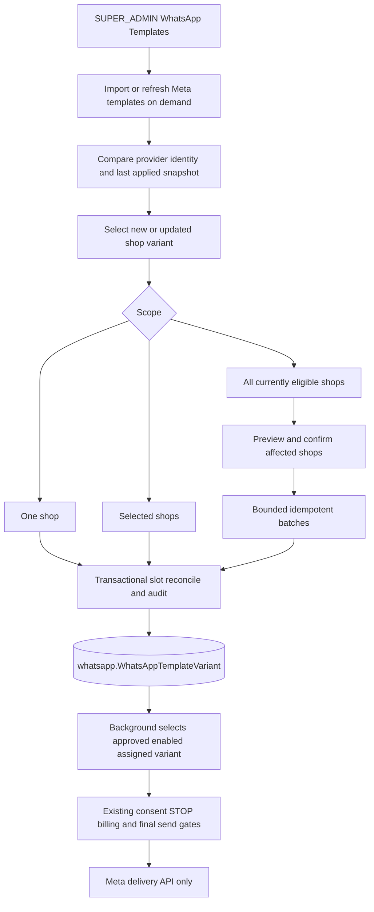

# ARCH-047 — Admin-managed WhatsApp template catalogue and merchant assignments

## Status

Agreed architecture; **portable task definitions, not materialised implementation worktrees**. This initiative is separate from ARCH-045/046 customer-consent work and the previously completed ARCH-045-BACKGROUND-004 implementation. There are no assumed runtime commits, published changes or deployment approvals under ARCH-047 yet.

## Problem

`whatsapp.WhatsAppTemplateVariant` already stores a separate shop-scoped template row (`shopId`, `providerAccountId`, `purpose`, locale/name/ID, `status`, `enabled`), but the inspected Admin repository has no dedicated WhatsApp template management screen. Background's current merged implementation calls Meta's template-listing/metadata API to verify `verifiedCategory === "MARKETING"` at initial recovery, automated follow-up and selected human/outbound paths. This turns template metadata availability into a live sending dependency even when an approved and enabled assignment is already stored in PostgreSQL.

The platform administrator needs to import existing Meta templates into these **shop-scoped records**, distinguish a **new template** from a **changed existing template**, review changes before applying them, assign them to one or multiple merchants (including **all currently eligible shops**), and deliberately update individual or global assignments.

## Goals

1. Admin is the sole management boundary for the Moda-side WhatsApp template catalogue. A privileged administrator registers metadata for an externally approved Meta template and marks its local status/availability. This task **does not create templates at Meta** or ask runtime services to confirm Meta approval/category.
2. The existing `WhatsAppTemplateVariant` rows remain the operational source of truth. Background and merchant-facing recovery commands select a row assigned to the correct shop and configured sender WABA where `status=APPROVED` and `enabled=true`; there is **no Meta template-list/category preflight call** in initial outreach, automated follow-ups, merchant post-window templates or final dispatch.
3. Admin supports individual assignment/update/enable/disable, selected shops, **Assign to all shops**, **Update for all shops**, and per-shop overrides. A deliberate Update for all overwrites individual overrides **in the selected template slot** after impact confirmation.
4. Prevent duplicate selectable variants for a shop/WABA/purpose/canonical-language slot despite the existing database uniqueness being keyed by name and language; expose conflicts rather than silently sending an arbitrary variant.
5. On an Admin-initiated Meta import or refresh, distinguish **NEW**, **UPDATED**, **UNCHANGED**, **UNTRACKED** (pre-existing local variant without an import baseline), **IDENTITY_CONFLICT**, and **MISSING_FROM_META** when the provider listing is complete; never confuse an edit of an existing Meta template with the creation of another shop assignment.
6. Preserve customer consent, STOP/no-contact, moderation, billing/credit, send fencing, shop eligibility, template language fallback, Meta delivery failure, idempotency and tenant security as independent safeguards.

## Non-Goals

- No new global-template or shop-assignment table; no standalone `metaCategory`/`verifiedCategory` eligibility field and no **runtime** provider metadata/category API. One optional Admin-only import snapshot on each existing shop variant is permitted to distinguish template changes; it is **not** a sending eligibility field.
- No automatic background polling or Meta template create/edit/delete operation. A Meta **read** happens only after a `SUPER_ADMIN` explicitly selects Import/Refresh in Admin.
- No changes to ARCH-045/046 consent semantics or their already accepted implementation history. No change to Meta's actual **send** API: delivery errors and failures still use existing operational handling.
- No automatic assignment to *future* shops. “All shops” takes a bounded, confirmed snapshot of shops eligible at execution time; newly installed shops require a later explicit assignment unless separately designed.
- No merchant-facing template editor, custom WordPress/Shopify template-management API, unrelated billing or conversation refactor.

## Current Architecture — source evidence

Inspected in `moda-interact-workspace(20261023-164023).zip` and verified against current repository sources:

- `moda-interact-database/prisma/schema.prisma`: `WhatsAppTemplateVariant` has `shopId`, `providerAccountId`, `purpose`, `languageTag`, `providerLanguageCode`, `providerTemplateName`, optional `providerTemplateId`, `status`, `enabled`; the existing unique key is `(shopId, providerAccountId, purpose, providerTemplateName, providerLanguageCode)`. It does **not** enforce one selectable template per purpose/canonical language slot.
- `moda-interact-background/src/services/whatsapp-template-selector.service.ts`: currently selects from approved enabled shop rows but calls `verifyCategory` if supplied.
- `moda-interact-background/src/services/whatsapp-template-category.service.ts`: performs Meta `message_templates` reads. Other callers include `checkout-recovery/recovery-initiation.service.ts`, `checkout-recovery/recovery-outreach-follow-up-processor.service.ts`, `recovery-conversation/human-command-dispatcher.service.ts`, and `outbound-whatsapp-admission/outbound-message-delivery.service.ts`.
- `moda-interact/app/services/recoveries/recovery-human-commands.server.ts`: already enforces assigned shop, recovery purpose, approved and enabled records for merchant command selection.
- `moda-interact-admin/src/components/admin/sidebar.tsx`, `src/app/(protected)/system-controls/store-categories/page.tsx`, `src/app/actions/store-categories.ts` and `src/lib/admin/store-categories.ts`: existing platform AdminShell, `SUPER_ADMIN` guard, form/server-action and transactional management patterns that should be reused.
- `CommerceAuditEvent` already supports `actorAdminId`, `shopId`, `operationId`, `reason`, metadata and timestamp but its `CommerceAuditAction` enum has no WhatsApp-template management actions. The existing `WhatsAppTemplateVariant` also lacks a snapshot of previously imported Meta **content**: changes to body/buttons with the same template ID/name/language cannot be detected from existing columns. DATABASE-001 therefore owns the audit enum **and one nullable Admin-only import-snapshot column**; no new template table is required.

## Proposed Architecture

### Existing shop-scoped table as catalogue and assignment

No additional template master/assignment entities. A configured template is persisted as one or more `WhatsAppTemplateVariant` rows, one per shop. An administrator chooses at least one initial shop when creating; a *global catalogue list* is a derived grouping of existing variant metadata and assignment counts, **not an unassigned persistent template**. An Admin operator can select an existing shop assignment as the source when copying to additional shops.

Define the **assignment slot** as:

`(shopId, providerAccountId, purpose, canonical(languageTag))`

Within a slot, at most one row may be simultaneously **enabled AND APPROVED**. Admin uses server-side validation, transactionally locks affected shops in stable order (or a demonstrably equivalent PostgreSQL serialisation) and reconciles the slot before writes. A previous variant is disabled or updated when a new approved template replaces it. Existing ambiguous slots must be identified and corrected deliberately, not silently selected. Keep the existing provider-name/language unique constraint intact. No new uniqueness migration is required for this initial implementation; concurrent-writer tests are mandatory.

`providerAccountId` must match the configured actual outbound WABA. Admin resolves/authorises this value server-side from existing trusted sender configuration and does not display Meta access tokens. No other shop's account may be assigned by arbitrary client input. If more than one WABA becomes supported, selecting it needs an explicit trusted account registry, not arbitrary string acceptance.

Admin is responsible for correct entry of the approved Meta template's name/language/ID/status. `APPROVED` is an **Admin-maintained local assertion**, not a guarantee that Meta will accept an eventual send. Provider reclassification/revocation is handled as a delivery failure and by subsequent Admin correction, not a synchronous Meta metadata query.

### Meta import identity and change-detection contract

`ARCH-047-ADMIN-001` fetches `GET /{WABA_ID}/message_templates` with `id,name,language,category,status,components` through a **server-side, authenticated Admin-only** read using the existing secured sender configuration; follow **all pages** with bounded pagination. A failed, partial, cyclic or truncated listing must not be treated as a complete refresh. Do not expose the access token to the browser or logs.

Define identity as `(configured WABA, Meta template ID)` when an ID is present. Reconcile the same `(WABA, name, Meta language)` to detect provider ID replacements and legacy rows without an ID. A different WABA never matches. A changed/replaced ID with the same name/language is **IDENTITY_CONFLICT**, requiring explicit operator resolution; it is not silently imported as NEW or treated as an ordinary content update. Per-shop rows assigned to the same Meta template are **assignments**, not separate new provider templates.

Record on each imported `WhatsAppTemplateVariant` a nullable, bounded `metaImportSnapshot` JSONB value containing a versioned, sanitised projection of the last applied Meta fields (`id`, `name`, `language`, `category`, `status`, relevant `components`) and its deterministic content fingerprint plus import time/WABA. Canonical fingerprint calculation preserves component/button order but normalises JSON object-key order; strip or redact customer-specific example values, secret-looking content and unsupported large payloads. This snapshot is **for Admin change detection only**; Background never reads it for send eligibility. Legacy manually registered variants have `null` and must be classified UNTRACKED, not new or unchanged by assumption.

**Admin comparison presentation contract.** For an **UPDATED** template, ADMIN-001 must show a readable **side-by-side, complete supported-template comparison**, explicitly labelled **Previous — last Meta import applied in Moda** (`metaImportSnapshot`) and **Current — freshly fetched from Meta** (sanitised fetch projection). Show available identity (WABA, ID, name, language), Meta category/status and each supported HEADER, BODY, FOOTER and BUTTONS component, including ordered buttons and variable placeholders. Highlight additions, removals, text/variable changes and reordered/changed buttons; a count or summary of changed fields alone is insufficient. If an optional section is absent on one side, show that absence rather than hiding the difference. Keep local Moda `status`/`enabled` assignment state visually separate from the **provider** status shown in the comparison. On narrow screens the two complete labelled panels may stack without losing the comparison.

For **NEW**, show no previous Meta import; for **UNTRACKED**, state that historical provider content is **unavailable** (local row metadata may appear separately, never masquerading as a prior imported component snapshot); for **MISSING_FROM_META**, state that a current provider version is unavailable; and for **IDENTITY_CONFLICT**, expose the competing identities without presenting the conflict as a normal update. Shop assignments may have different previous snapshots: never imply a single prior version applies to all. ADMIN-002 must reuse the same comparison presentation for each affected shop, comparing **previously applied shop snapshot** to the **proposed already-confirmed source template snapshot**, and clearly label this as a local bulk-assignment comparison, **not a fresh Meta fetch**. Neither comparison path may write or replace a snapshot before explicit confirmation and server-side stale-preview revalidation.

An explicit fresh provider listing is compared with both persisted identity and each existing assignment's last-applied snapshot:

- **NEW:** no established identity in the configured WABA and no conflicting name/language slot; offer **Import and assign** to at least one shop.
- **UPDATED:** same Meta identity, but fingerprint differs (body, buttons/components, provider category or approval status) or identity fields of the matched row legitimately changed; show the previous-versus-current changes and affected shops, including breaking template-variable changes.
- **UNCHANGED:** matched identity and comparable snapshot have the same fingerprint; repeat import is a no-op with no duplicate row or mutation audit.
- **UNTRACKED:** matched local variant has no previous Meta snapshot; offer an explicit baseline/merge confirmation, not an invented provider change.
- **IDENTITY_CONFLICT:** ID/name/language mismatch, multiple candidates or competing local assignment. Block automatic import/update until an administrator resolves the identity and target slot.
- **MISSING_FROM_META:** a previously imported ID is absent from a **fully paginated** response for its WABA. Flag for review; never automatically delete or disable a historical assignment.

Read/compare/preview performs **no write**. Apply new import or update only after explicit admin confirmation and server-side recheck. An update keeps the existing Moda row ID when the assignment identity is unchanged. For a Meta edit applied to several shops, ADMIN-002 previews each shop separately (including locally customised assignments), then applies only the explicitly selected scope; it never silently overwrites every shop. Imported status must reflect the chosen current Meta record; PENDING/REJECTED templates cannot be silently promoted to active approved checkout-recovery assignments. Admin remains the authority for local `status=APPROVED` and `enabled`; the Meta snapshot itself is not a hidden runtime permission check.

### Admin operations

- **Create/Import/Refresh/Edit/Disable** (`ARCH-047-ADMIN-001`): `SUPER_ADMIN`-only catalogue page. Fetch Meta templates on demand, preview NEW/UPDATED/UNCHANGED/UNTRACKED/CONFLICT/MISSING classifications, display the full labelled side-by-side previous-applied versus current-Meta template (including HEADER/BODY/FOOTER/BUTTONS, category/status and highlighted variable/button changes), and register/update at least one shop-scoped row only after confirmation. Keep manual registration and per-shop enable/disable with strict authorisation.
- **Assign/Update all** (`ARCH-047-ADMIN-002`): use the selected **new or updated Meta source template** and its persisted import snapshot for one/selected/all eligible current shops; preview exact per-shop outcomes (new assignment, update available, unchanged, local override, identity conflict), including the full previous-shop versus proposed-confirmed-source template comparison for affected UPDATED/override shops, confirm intentional overwrite of customisations, and use per-shop idempotent transactions and shared operation IDs/audit. Target the **same WABA/purpose/canonical-language slot**, not a mutable provider template name.
- Eligible bulk scope: `commerce.Shop.status = ACTIVE`; when `platform = WOOCOMMERCE`, require the installation to be `ACTIVE`. Both platforms may receive assignments; existing recovery entitlements and shop operation gates remain independent. Noneligible shops are excluded and counted. Scope is an execution-time snapshot, not a standing policy for future shops.
- Bulk writes must not block on one unbounded request/transaction. Use bounded, resumable, idempotent batches with per-shop result recording in the existing audit structure and explicit partial-failure reporting. Overlapping operations against the same shop/slot must be serialised so they cannot leave two selectable records. Updating an individual shop does not modify siblings; explicitly confirmed Update for all replaces the slot in every selected eligible shop, including prior customisations.

### Background read-only catalogue consumption

- `ARCH-047-BACKGROUND-001` removes all Meta template metadata-category reads from recovery send entry points. It must **never** consult `metaImportSnapshot` for authorisation or ask Meta whether an imported snapshot is newer. For every business-initiated recovery template, select an existing shop-scoped row from PostgreSQL with `status=APPROVED`, `enabled=true`, correct configured provider account and purpose, and deterministic language choice. Retain a final **database** check that the selected exact assignment still exists and is enabled/approved for the same shop and recipient flow before Meta **send**; that is NOT a provider metadata check. If missing or ambiguous, fail closed and preserve existing no-send/no-credit semantics. No category inference or new Meta `message_templates` call. The existing WhatsApp sending API remains necessary.

### Authentication and audit

Only `SUPER_ADMIN` may create, mutate, bulk assign or disable template rows; both UI route and server action independently enforce this. Existing `CommerceAuditEvent` records immutable admin actor, reason, operation ID, shop, action and bounded before/after metadata for each changed assignment. `ARCH-047-DATABASE-001` extends the `CommerceAuditAction` enum and adds the one nullable Admin-only import-snapshot column, with migration/tests. Do not invent a new audit table. Preserve no secrets/customer personal data in change payloads/logs.

## Request / Event Flow

## Repository Responsibilities

| Owner | Repository | Change |
|---|---|---|
| moda_database | moda-interact-database | Add audited WhatsApp-template actions to `CommerceAuditAction` and nullable `WhatsAppTemplateVariant.metaImportSnapshot` for Admin-only import comparison; no new template table/provider category eligibility column |
| moda_admin | moda-interact-admin | Meta import/refresh and new-versus-updated diff UI; guarded catalogue mutations; merchant scope preview and individual/selected/global assignment |
| moda_background | moda-interact-background | Remove provider metadata verification and consume assigned approved/enabled database records across all business-initiated recovery paths |
| moda_system_test | moda-interact-system-test | Certify single/all-shop assignment, update propagation, no metadata calls, consent/STOP/billing protection |

No Shopify, WooCommerce plugin, Gateway or Shared publication task is currently required. No new public endpoint/deployable/worker is introduced, so there is no Gateway topology change.

## Data Model

- Reuse existing `whatsapp.WhatsAppTemplateVariant` as the shop-scoped catalogue and assignment. Add only nullable `metaImportSnapshot Json? @db.JsonB` for a bounded Admin-only last-applied Meta metadata snapshot/fingerprint; legacy rows default `null` and remain usable. No new master/assignment table or send-time category field.
- Reuse `commerce.Shop` and `woocommerce.WooCommerceInstallation` for the eligibility scope.
- Reuse `commerce.CommerceAuditEvent` for actor/operation/shop/old-new evidence. Extend `CommerceAuditAction` and add the one nullable snapshot column via `ARCH-047-DATABASE-001`; both are additive, preserving existing assignments and send behaviour.
- Do not create a category column or treat locally assigned `purpose` as a provider-category proof; the operational rule explicitly trusts Admin-approved database records.

## Contracts

- Existing Prisma `WhatsAppTemplateVariant` is the shared database contract: **no new queue schema or Shared package**.
- Admin import/refresh read contract: `GET /{WABA_ID}/message_templates` with all pages, Meta template `id/name/language/category/status/components`, authenticated server-side. Internal Admin-local versioned normalisation and fingerprint compare; no new Shared queue/event schema.
- Admin variant mutation input: explicit intended WABA, `purpose`, canonical language, Meta template name, Meta language and optional template ID, `status`, `enabled`, target shop(s), reason, expected/current import snapshot or version token where applicable. Server resolves permissions/shop scope and rejects ambiguous slots. Do not permit client-supplied environment, actor, arbitrary provider credentials or operation status as trusted.
- Bulk request: source Meta identity and last-applied snapshot/variant slot, exact target scope (`one`, `selected`, `all-current-eligible`), intended replacement values, impact-preview token/operation ID and confirmation, including new-versus-updated per-shop classification. Server recomputes eligibility/impacts before changes; stale previews are rejected or re-previewed.
- Background uses existing Prisma rows and the already established outbound permit/billing/message contracts; remove rather than replace Meta `verifiedCategory` metadata dependency. Preserve rolling compatibility: Admin records remain readable by preexisting Background during staged rollout; switch Background after Admin data and audit are accepted.

## Consistency and Transactions

Import classification and update confirmation compare source fingerprint/identity with the expected stored snapshot. Identical repeat imports are read-only no-ops; changed Meta templates cannot create duplicate active variants. Idempotent upserts/updates per target shop and slot; stable row selection; transactional shop-scope lock/CAS; bounded batch sizes for large all-shop operations; durable audit on each committed change; explicit partial failures and safe retries. Do not call Meta/Redis from SQL transactions. Avoid duplicate active approved assignments under concurrent Admin mutations; after each chunk confirm actual status, not merely queued intent.

## Ordering

Admin bulk and individual operations targeting the same shop/slot must serialise at that narrow scope, not globally across all shops. If an Admin changes an assignment while a send is being prepared, the final database fence should refuse a stale/deactivated assignment before provider dispatch, subject to the usual unavoidable SQL-to-provider network boundary.

## Failure Handling

- Wrong template metadata can cause a Meta **delivery** error, handled by the existing provider failure and credit compensation mechanisms; do not query Meta's template-catalogue API as a fallback.
- Admin mutations with ambiguous/duplicate active entries return actionable errors or require an explicit safe replacement operation.
- Bulk operation partial failure returns committed count, failed shop IDs and retry-safe operation scope; no false all-success response or blanket rollback claim.
- Missing template must not consume a recovery credit or create duplicate outreach attempts.

## Scalability

Typical recovery hot path requires indexed/filtered shop-scoped database selection; no added Meta metadata HTTP request. Bulk assignment scans current eligible shops by pages and writes bounded chunks. Avoid an unbounded single Next.js action or one transaction across every shop. Admin Meta imports follow bounded pagination with explicit incomplete-result failure and no automatic provider polling. No new job queue is required unless actual scale tests show a specific gap; return that to moda_architect before expanding infrastructure.

## Security

Require `SUPER_ADMIN` on every template catalogue, import-preview and mutation route/server action. Meta tokens are accessed server-side through approved secure configuration; only selected template metadata and sanitised change previews reach the browser. Database lookups are shop- and WABA-bound. Never expose access tokens, Meta credentials or cross-tenant/customer data in browser payloads, audits or logs. Existing customer consent, local STOP, billing, moderation, installation eligibility, message-window and send-fence controls remain fully enforced. Template availability is never a substitute for customer consent.

## Observability

Admin emits bounded import-read outcomes (new/updated/unchanged/conflict counts) and domain mutation outcomes using `@modainteract/moda-interact-shared/logging` and writes the existing durable audit **only for actual mutations**. Do not log full components or tokens. Background reuses current provider failure/attempt/credit telemetry rather than adding duplicate HTTP/queue metrics; expose a bounded `template-unavailable`/`ambiguous` outcome as appropriate. Backend monitoring unavailability must not prevent correct business processing. Environment-separated telemetry; no credentials, customer data or template secrets in logs.

## Rollout / Migration

Rollout classification: production-compatible unless a verified pre-production deployment permits otherwise. Sequence: additive Database enum plus nullable import-snapshot migration → Admin import/catalogue task accepted → bulk assignment task and Background database-only selection accepted → integrated system test. Existing manual entries may be UNTRACKED until deliberately baselined; never infer that a null snapshot means a new Meta template. Do not delete historical template rows. A database row marked `APPROVED` may still be rejected by Meta at delivery; ensure operational correction is available. Rollback may restore the previous Background deployment while keeping enum additions and Admin rows (additive). No automatic future-installation assignments.

## Decisions / Tasks

| Task | Owner | Status | Depends On |
|---|---|---|---|
| ARCH-047-DATABASE-001 | moda_database | Ready | — |
| ARCH-047-ADMIN-001 | moda_admin | Pending | ARCH-047-DATABASE-001 |
| ARCH-047-ADMIN-002 | moda_admin | Pending | ARCH-047-ADMIN-001 |
| ARCH-047-BACKGROUND-001 | moda_background | Pending | ARCH-047-ADMIN-001 |
| ARCH-047-SYSTEM-TEST-001 | moda_system_test | Pending | ARCH-047-ADMIN-002, ARCH-047-BACKGROUND-001 |

## Open Questions

No blocking architectural question for v1. “All shops” means existing eligible active shops at execution; future-shop default assignment is explicitly excluded. A provider ID replacement under the same name/language is a **conflict**, not an automatic new template or silent overwrite. Provider template/category changes require Admin maintenance; no runtime Meta template metadata verification. Any newly discovered schema requirement beyond the approved audit enum and nullable import snapshot must return to moda_architect rather than being implemented opportunistically.

## Change History

- 2026-10-23 — Initial architecture agreed: Admin-owned template approval/assignment, existing shop rows, explicit all-shop overwrite, no runtime Meta metadata validation, focused audit enum extension.
- 2026-10-23 — Added explicit on-demand Meta import/refresh, stable provider identity matching, NEW versus UPDATED/UNCHANGED/UNTRACKED/CONFLICT comparison, and one nullable Admin-only import snapshot on each shop variant.
- 2026-10-23 — Made full labelled previous-versus-current Meta component previews (and per-shop previous-versus-proposed bulk previews) explicit Admin acceptance requirements; no new schema or runtime Meta dependency.
