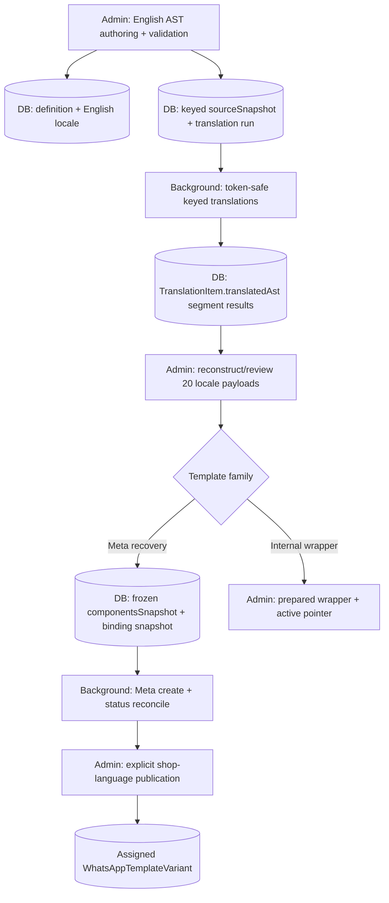
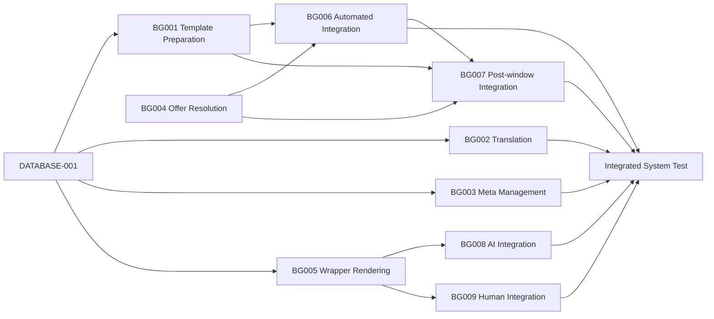

# ARCH-047 — Moda-authored multilingual WhatsApp templates and conversation wrappers

## Status

Agreed direction; **Background module-first task-definition plan revised on 24 October 2026 for Admin-prepared segment translation and runtime payloads**. The consolidated `ARCH-047-DATABASE-001` is a developer-owned, in-progress task (Attempt 1) in the supplied worktree. The revised `ARCH-047-BACKGROUND-001` remains **Pending**. `BACKGROUND-002`–`009` are provided as **portable task definitions in the accompanying task-file patch**; their presence in an archive is not evidence that canonical task branches/worktrees were materialised or implementation claimed. The legacy Admin and System Test task documents still need separate status/scope reconciliation. Do not treat a planned dependency as Complete.

This document supersedes the prior ARCH-047 design permitting externally authored Meta-template imports and shop-to-shop copying as the catalogue master. Do not resume those flows.

## Problem

Moda needs a single controlled way to create recovery WhatsApp templates, translate them, submit each language to Meta, reconcile approval and publish to merchants, plus internally published wrappers around AI- and human-authored checkout conversations. The existing `whatsapp.WhatsAppTemplateVariant` is a shop-assigned operational row, not an English master, multilingual authoring record or provider-submission history. The existing recovery sender has Meta metadata/category verification paths and a shop-scoped selector, but does not yet populate frozen multilingual parameter bindings for the six recovery purposes.

A workflow-stage-only implementation split would scatter template preparation, offer logic and wrapper behaviour across recovery, human handover, AI and final admission services. This amendment defines **five owned Background feature modules** and **four narrow call-site integration tasks**, while preserving existing outbound business-admission authority.

## Goals

1. All Meta recovery templates and internal conversation wrappers are **created exclusively through Moda Admin**. Never import, register, adopt or publish templates authored outside Moda. Provider reads are permitted only to reconcile Moda-authored identities, statuses and drift.
2. Template content is immutable once saved; content corrections, including rejected versions, use **Clone as New** with a new identity. No Meta edit-existing-template API calls. Operational status, review progress and assignment state may change independently.
3. **Admin alone** authors/validates the English AST, extracts keyed text segments (with protected variables), and persists a durable translation request. Background translates the segments and writes keyed results into existing JSONB fields; **Admin reconstructs, reviews and compiles** 20 complete language payloads. Background sends those already-compiled payloads through the Meta create endpoint, reconciles Meta status and Admin **publishes explicitly**. Internal wrappers skip Meta approval and instead use Admin-only activation.
4. Predefine the six recovery purposes: INITIAL/FOLLOW_UP × NO_OFFER/CODE_OFFER/AUTOMATIC_OFFER. The purpose determines typed variables. Resolve and independently validate offer eligibility *before* the prepared template is used; AI is only a read-only offer recommendation mechanism.
5. Keep template-selection/preparation and variable-binding behaviour in one Background module, distinct from offer resolution, Meta catalogue management, translation and conversation wrapping. Existing send flows delegate rather than replicate domain rules.
6. Preserve consent, authoritative STOP, recipient scope, WhatsApp service window, moderation, billing, retries, compensation, one permitted sequence-two follow-up and final send fencing. No new path may bypass them.
7. Support one/selected/all-current-eligible-shop publication with resumable **per-shop/per-language** targets and explicit replacement of overrides, using the existing shop-assignment table.

## Non-Goals

- No merchant-facing authoring or adoption of Meta-created templates; no in-place template edit, no Meta edit API and no provider-template creation on the ordinary send path.
- No AI commerce mutation: no cart additions/removals, quantity changes, coupon application, checkout edits or order placement. Customers edit their own baskets on Shopify/WooCommerce.
- No new ARCH-047 Shared AST/compilation package, generic logger, custom Batch runtime, Background authoring-AST parser or second moderation/send pipeline. Preserve existing Shared internationalisation/logging and explicitly investigate a queue-format contract gap if one is demonstrated.
- No change to ARCH-045/046 consent and STOP authority, historical completed tasks or billing semantics.
- No repository-specific implementation or additional task files in this **module-planning** amendment.

## Current Architecture and Source Evidence

Inspected the uploaded 23 October workspace snapshots and the 24 October `ARCH-047-DATABASE-001` worktree/task amendment:

- `moda-interact-background/src/services/whatsapp-template-selector.service.ts` already owns shop/WABA/purpose/language fallback selection, but currently operates on `WhatsAppTemplateVariant` and exposes legacy metadata-verification state.
- Existing call sites include `checkout-recovery/recovery-initiation.service.ts`, `checkout-recovery/recovery-outreach-follow-up-processor.service.ts`, `recovery-conversation/human-command-dispatcher.service.ts`, `recovery-conversation/outbound-send-fence.service.ts` and `outbound-whatsapp-admission/outbound-message-delivery.service.ts`.
- `src/services/translation-batch-runtime/` supplies reusable Batch provider submission, polling, correlation, result membership, retry/failure and repair mechanics. Domain-specific Merchant Pricing translation orchestration exists separately; it is **not** a drop-in WhatsApp translation service.
- `src/services/recovery-policy.service.ts` has `NONE`, `FIXED` and `AI_BEST_APPLICABLE` policy context, but currently does not provide the complete verified offer-outcome contract for six Meta template purposes.
- The existing outbound and recovery-conversation components own final send eligibility, moderation, STOP, credits and follow-up limits. ARCH-047 modules must remain downstream helpers, not competing admission authorities.
- The amended consolidated DB001 contract specifies **11 new tables** and nullable `WhatsAppTemplateVariant.metaRegistrationId`, without database-enforced template business rules. Its developer-owned implementation has not been accepted as Complete.

Reinspect these paths at implementation start; this is snapshot evidence, not a claim about later Git commits.

## Proposed Architecture

### Authoring, translation and publication

Meta approves or rejects **each submitted language**. Neither approval nor successful submission silently assigns the template to shops. External template IDs not linked to Moda-authored definitions cannot enter the catalogue. A rejected or drifted template is not edited; a new definition must be authored and submitted. For a changing provider status, keep immutable submitted components and binding snapshots while recording current observations/events separately.

### Background module ownership (five modules)

| Module / proposed directory | Primary responsibility and owned data | Not owned |
|---|---|---|
| **A — Template Translation** `src/services/template-translation/` | Claim Admin-prepared keyed text segments from `TranslationRun.sourceSnapshot`, protect and restore placeholders, reuse `translation-batch-runtime`, correlate results and persist keyed translations in `TranslationItem.translatedAst`; never parse/rebuild Admin AST. | Meta creation/approval, shop publication, recovery sending, template selection. |
| **B — Meta Template Management** `src/services/meta-template-management/` | Submit Admin-compiled frozen `MetaRegistration.componentsSnapshot` via Meta **create** endpoint unchanged, reconcile uncertain outcomes, consume queued authenticated status observations, and maintain registration/event/drift history. | Webhook signature verification/ingress, Admin approvals, translations, recovery sending. |
| **C — Recovery Offer Resolution** `src/services/recovery-offers/` | Resolve NONE/FIXED/AI policy against current read-only provider/commerce evidence and return one verified `NO_OFFER`, `CODE_OFFER` or `AUTOMATIC_OFFER` decision. | Meta template selection, message wording, coupon application, cart/checkout mutation. |
| **D — Recovery Template Preparation** `src/services/recovery-template-preparation/` | Resolve the six-purpose slot, locally published and approved shop/WABA/language assignment, safe language fallback, frozen per-language parameter mapping and fully prepared Meta payload; expose a final-checkable assignment identity. | AI selection, Meta catalogue network calls, final outbound admission, sending/billing. |
| **E — Conversation Wrapper Rendering** `src/services/conversation-wrappers/` | Select published SHARED/AI/HUMAN wrapper, consume an **Admin-prepared runtime wrapper projection** (not authoring AST), resolve trusted checkout context, insert the original response exactly once and return composed content. | Generating AI response, human authorship, moderation policy, provider sending, checkout mutation. |

Module boundaries are behavioural, not arbitrary file count. A module may contain small coordinator, repository, provider adapter, mapper and pure helpers; it should expose one clearly typed facade to consumers. Keep BullMQ processors thin, inject external dependencies for testing, and avoid 300+ line catch-all files. Admin owns the source AST, validation, Meta compilation and wrapper-runtime preparation. Background owns keyed-segment translation, runtime variable substitution and prepared wrapper rendering. Existing Shared internationalisation/logging utilities may be reused; no new ARCH-047 Shared AST task is presumed. Existing outbound admission remains the sole final-delivery control.

### Core interfaces and error behaviour

- `TemplateTranslationService.process(runId)` takes a durable run ID and reads Admin-prepared keyed text segments from `TranslationRun.sourceSnapshot`. It restores/validates protected tokens and saves `{schemaVersion,segments:[{key,text}]}` in the existing `TranslationItem.translatedAst` JSONB; Admin subsequently assembles complete locale payloads. Background cannot publish or modify source AST.
- `MetaTemplateManagementService.submit(registrationId)` sends the **already-persisted**, Admin-confirmed, frozen `componentsSnapshot`/`parameterBindingsSnapshot` for that registration without parsing or compiling authoring content, and reconciles unknown creates **before** retrying. `reconcile(event)` operates on trusted WABA/Meta identity and append-only event evidence; it never adopts outside templates or switches merchant assignments.
- `RecoveryOfferResolver.resolve(context)` returns `{kind:'NO_OFFER'}` or one server-verified code/automatic offer with bounded provenance; an AI recommendation is not itself eligibility proof. Inability to verify produces a no-offer outcome without advertising unsupported savings.
- `RecoveryTemplatePreparer.prepare({shopId, senderWabaId, stage, verifiedOffer, languageContext, checkoutContext})` returns a typed `PreparedRecoveryTemplate` (exact assigned variant/registration IDs, purpose, provider language/name and ordered component parameters) or a structured unavailable reason. It performs no provider metadata HTTP request and no outbound send. Final admission separately rechecks assignment/registration status and STOP/consent/send eligibility in its existing transaction/fence.
- `ConversationWrapperRenderer.render({conversationId, source:'AI'|'HUMAN', responseBody, languageContext})` returns a tagged rendered result with wrapper definition/version and source-message identity so callers can avoid double wrapping. Its checkout context is resolved read-only and tenant-scoped; a missing/stale URL is omitted, never guessed. It does **not** choose whether the message is permitted for WhatsApp delivery.

Background-local typed module ports remain local. The Admin-prepared source segment, translated segment, Meta component/binding and wrapper-runtime JSON shapes are versioned persistence interface agreements; the database stores JSONB but does not semantically validate these formats. Reuse existing `@modainteract/moda-interact-shared` internationalisation and logging exports only where applicable. If the installed WhatsApp queue envelope cannot safely carry provider-defined template status observations, return the **minimal** new cross-repo contract gap to the architect instead of independently duplicating schemas.

### Recovery and conversation integrations (four thin integrations)

- **Automated recovery:** Existing initial and scheduled follow-up orchestrators call C for a verified offer, then D for a prepared template and hand the result to the **existing** outbound admission/send path. The integration owns *when* to attempt outreach, not selecting discounts, interpreting AST or calling Meta catalogue APIs.
- **Merchant post-window follow-up:** Existing human recovery command dispatcher passes an eligible sequence-two request through C as necessary and D. It retains the single permitted follow-up, purchase/credit rules and service-window boundary; it must not create another outbound path.
- **AI in-window reply:** Existing AI conversation execution generates its response; E wraps it once; the **complete rendered output** goes through existing moderation and admission. AI prompt guardrails and the independent OpenAI Moderation API are separate mechanisms; neither is replaced by the wrapper.
- **Human in-window reply:** Merchant-authored text is wrapped by E, shown consistently in merchant preview, fully moderated and dispatched through existing admission. Merchant-authored human replies within the valid 24-hour window are not subject to the AI exchange cap, but still obey consent/STOP/moderation and existing delivery policy. Shopify and WooCommerce UI preview integration is owned by their own repositories, not Background.

Common final admission must check the exact assigned version again. To avoid conflicting changes to `outbound-message-delivery.service.ts`/send fence, **BACKGROUND-006 owns the common automated/final-fence adapter**; BACKGROUND-007 consumes that adapter and must not implement an independent final gate. AI/HUMAN wrapper integrations do not modify the generic outbound admission contract except through a separately reviewed narrowly scoped need.

### Flow and lifecycle invariants

1. Save immutable English AST; Admin starts a durable translation request after save. Progress flows `SAVED → TRANSLATION_QUEUED → TRANSLATING → READY_FOR_REVIEW`, with per-language failure/retry state.
2. Meta submission is a separate Admin-confirmed operation. Background uses only provider create/read for Moda-owned IDs, never Meta edit/update-template APIs; `message_template_status_update` is authenticated by Messaging and reconciled by B. Meta status is not merchant publication.
3. An approved 20-language definition may be published to one, selected or all **currently eligible** shops, with per-shop/per-language targets and explicit override impact confirmation. Old shop assignments remain active until Admin chooses replacement; publishing is idempotent/resumable and not automatic for future shops.
4. Template content and frozen binding metadata are not changed in place. Operational status/progress and provider observation fields may change; application services enforce immutability, approval, kind, audience, 20/20 completeness, sender WABA compatibility and shop assignment. PostgreSQL retains technical keys/FKs/indexes only.
5. Six recovery purposes are **INITIAL/FOLLOW_UP × NO_OFFER/CODE_OFFER/AUTOMATIC_OFFER**; the fixed and AI discount modes both feed the same verified-offer result. No unverified code/automatic discount promises. Follow-up must not contradict a now-invalid previous offer.
6. Only approved, enabled, correctly assigned and locally non-revoked Meta records may be prepared. No ordinary send calls provider template-list/category endpoints. Disabling/pausing a provider language can block future sends; later approval does **not** silently reactivate a disabled merchant assignment.
7. AI and human conversation content is related to the checkout, but the template module does not add a CheckoutRecovery row or guarantee checkout identity in the underlying current `Conversation` schema. Missing checkout context must fail safely or omit invalid fields. Enforcing conversation identity more broadly is a separate owning-architecture question.
8. No checkout/cart/discount mutation by CommerceAgent; human/customer basket changes happen on merchant storefronts. No wrapper can reopen the WhatsApp service window or create a second recovery follow-up.

## Repository Responsibilities

| Owner | Repository | Boundary |
|---|---|---|
| moda_database | `moda-interact-database/` | Consolidated `ARCH-047-DATABASE-001` exact 11-table contract, Prisma migration and technical integrity only. |
| moda_shared | `moda-interact-shared/` | Reuse existing internationalisation, logging and WhatsApp transports as appropriate; **no new ARCH-047 Shared AST/compiler task** is planned. Escalate a demonstrable missing canonical cross-repository queue schema before adding a new contract. |
| moda_admin | `moda-interact-admin/` | English AST authoring/validation, Clone as New, **keyed protected-text extraction**, translation request/reconstruction/review, Meta components and binding compilation, explicit provider submission, Meta approval dashboard and shop assignment; separately prepare/publish runtime wrappers. Original external-import ADMIN-001 and shop-to-shop ADMIN-002 workflows are superseded conceptually and must be marked so in their task files before execution. |
| moda_background | `moda-interact-background/` | Five feature modules and four thin integration tasks below; never implement Admin approval or Messaging ingress. |
| moda_messaging | `moda-interact-messaging/` | Verify Meta webhook authenticity and publish a bounded `message_template_status_update` observation to existing BullMQ `whatsapp-events`; **no direct PostgreSQL writes**. |
| moda_app / moda_woocommerce | respective Shopify/Woo repositories | Human response preview and authenticated merchant interface; never duplicate wrapper rendering policy. |
| moda_system_test | `moda-interact-system-test/` | Validate end-to-end flows only after required implementation/publication tasks are Complete. |
| moda_gateway | `moda-interact-gateway/` | No additional Gateway implementation established yet; confirm existing Meta app callback and routing during Messaging handoff. Raise a bounded Gateway task only for a demonstrated missing route/configuration. |

## Data Model

The authoritative proposed persistence specification is the consolidated, developer-owned `ARCH-047-DATABASE-001` **Attempt 7** definition; do not create DATABASE-002–004. It has **11 new tables**, reuses `WhatsAppTemplateVariant` with nullable `metaRegistrationId` and existing `CommerceAuditEvent`, and deliberately has no distinct Release/ReleaseLocale. A `WhatsAppTemplateDefinition` is the content version; its locales, translation run/item/batch history, per-WABA Meta registration and event history, shop-language publication operations/targets and active wrapper pointers remain independently queryable. Admin writes keyed translation requests to `TranslationRun.sourceSnapshot`; Background stores language results (keyed segments) in `TranslationItem.translatedAst` **without creating a completed locale AST**; Admin writes final `localeAst` and precompiled `MetaRegistration.componentsSnapshot`/`parameterBindingsSnapshot` or a prepared wrapper projection into the appropriate existing JSONB records. `parameterBindingsSnapshot` freezes the Meta-facing positional mapping at submission. Meta drift observations do not overwrite the frozen snapshot.

This architecture does **not** instruct Database to enforce business rules via triggers, CHECK constraints, status-dependent unique keys or stored procedures. Application services own all authorization, lifecycle, eligibility, publication and version immutability policies. Preserve historic template rows without silently adopting externally authored ones: the new runtime refuses non-Moda-linked assignments when switched over.

## Contracts

**Admin-owned authoring contracts.** Admin is the only AST reader/compiler. It validates immutable source content on save, persists a versioned `TranslationRun.sourceSnapshot` containing keyed translatable text and an explicit protected-token map, and reconstructs each language after Background returns `{schemaVersion:1,segments:[{key,text}]}` in the existing `TranslationItem.translatedAst` JSONB. Protected variables such as `{{1}}` and `{{2}}` must be losslessly restored and checked by the translation module; no AST parser is required in Background. For Meta, Admin stores **fully compiled** `MetaRegistration.componentsSnapshot` and frozen `parameterBindingsSnapshot`, which BG003 submits without re-compiling. For internal wrappers, Admin stores an explicitly versioned **prepared runtime wrapper projection** in the applicable existing locale JSONB; BG005 interprets it without authoring-AST logic. Exact JSON transport examples belong in producer and consumer task fixtures, not a new Shared AST package.

**Messaging handoff.** Meta `message_template_status_update` is authenticated by Messaging → enqueued to existing BullMQ `whatsapp-events` → consumed/reconciled by Background → persisted in `MetaEvent`/`MetaRegistration`. The current worker supports inbound `message-received` and provider `message-status`; the new event is a **distinct** job and is not parsed as `NormalizedWhatsAppInboundMessage`. Reuse existing queue envelope and Meta's defined WABA fields where safe. If a truly new canonical cross-repository wire contract is required, return that precise gap to the architect; do not independently invent two schemas. No new ARCH-047 Shared task is assumed in the nine Background task dependencies.

**Runtime ports.** BG001 consumes stored compiled parameter maps and trusted customer/checkout values to produce a prepared Meta send. BG004 returns an internal verified offer decision. BG005 consumes the Admin-prepared wrapper projection. Their interfaces are Background-local; final consent/STOP, moderation, billing, service window and send fences remain owned by existing runtime.

## Consistency and Transactions

PostgreSQL is durable state. Workers assume duplicate/out-of-order jobs. Business service operations use transactions/CAS and idempotency keys where required, not DB-owned template lifecycle constraints. No external Meta API, LLM or Redis operation inside a SQL transaction. Unknown Meta create outcomes require provider read/reconciliation before retry. Publication processes bounded targets with **shop-level all-selected-language atomicity or an explicit, reviewed partial policy**. Active shop slots are replaced only after operator confirmation. Frozen `parameterBindingsSnapshot` must correspond to exactly the submitted components; any mismatch makes runtime preparation fail closed. Only the existing final admission path can reserve/settle/compensate credits and commit sends.

## Ordering and Failure Handling

Per-definition translation/review, Meta provider events and per-shop publication use narrow concurrency identities. Provider status, drift, missing template, incomplete locale set or ambiguous shop-language slot is a structured failure, never an arbitrary fallback to an unverified template. If a verified offer is unavailable, C returns `NO_OFFER` instead of allowing invented discounts. Missing checkout URL is not fabricated. An admin's new release never silently replaces older eligible assignments. Duplicate response-wrapper application must be refused or idempotently recognised before sending.

## Scalability

Keep high-volume checkout-event filtering and ordinary send preparation bounded; expensive AI offer evaluation is invoked only for genuinely eligible `AI_BEST_APPLICABLE` outreach, not raw webhook events. Provider translation/Meta template creation run on separate low-throughput control-plane workloads with bounded retries; bulk publication uses paginated targets and does not lock all shops globally. Recovery selection uses indexed local database reads, not provider catalogue fetches. Reuse approved BullMQ/OTel infrastructure; any new queue routing or external API configuration must be justified by inspected capability gaps and assigned to its owner.

## Security

Meta credentials stay server-side. Meta webhooks are authenticated at Messaging ingress. Every lookup and prepared message is shop-, WABA-, conversation-/checkout- and recipient-scoped. Avoid logging sensitive AST samples, customer text, credentials or checkout URLs. Staff Admin operations require `SUPER_ADMIN` authorization. Do not treat an approved provider template as permission to contact a customer; consent, local authoritative STOP, service window, moderation and billing guards are independent. CommerceAgent can only retrieve read-only commerce information.

## Observability

Modules emit bounded business-outcome logs (run/definition IDs, WABA/template IDs where non-secret, status, attempt, cause), through the shared logger. Reuse existing OTel/framework request and BullMQ instrumentation; do not duplicate generic telemetry. Failed or delayed translation, unknown Meta create, stale webhook, provider drift, ambiguous template slot, offer verification refusal and wrapper-application errors must be traceable without customer contents. Provider/observability outages must not turn otherwise ineligible sends into eligible ones.

## Rollout / Migration

Classify production compatibility at implementation time. The 11-table Database migration is additive and preserves existing shop assignments and audit records. Do not introduce a new Shared publication gate merely for Admin ASTs; confirm persisted JSON formats, the existing shared language registry and queue event handoff before Background adoption. Implement and verify feature modules **before** touching caller services. Stage automated recovery integration and its shared final-fence adapter before merchant post-window integration; keep preexisting paths working until explicitly cut over. Deploy Messaging event support and provider management before enabling Meta-authoring submissions. Explicitly publish approved shop assignments; legacy unlinked assignments are not silently treated as Moda-authored. Internal wrapper activation and rollout are independent of recovery-template Meta submission. Run system tests only after all needed implementations are architect-accepted and the developer has performed any desired manual validation.

## Decisions / Tasks

### Existing tasks and work outside Background

| Task | State in supplied source | Required reconciliation |
|---|---|---|
| `ARCH-047-DATABASE-001` | Developer `in_progress`, Attempt 1 (per amended task) | Use consolidated Attempt 7 contract; no DATABASE-002–004. |
| `ARCH-047-ADMIN-001` | Legacy `pending` | Supersede external-import authoring task; no external imports. |
| `ARCH-047-ADMIN-002` | Legacy `pending` | Supersede shop-to-shop source copying; central Admin publication replaces it. |
| `ARCH-047-SYSTEM-TEST-001` | Legacy `pending` | Re-scope to Moda-authored assignments/runtime, remove import tests. |
| ARCH-047 Shared authoring tasks | Previously proposed, not materialised | **Not required** for Admin-only AST/compilation. Reuse existing Shared facilities. Escalate only a proven missing queue transport contract. |
| `ARCH-047-MESSAGING-001` and new Admin tasks | Planned, not defined | Create after architect reconciliation; confirm route and provider event contracts. |

### Module-first Background tasks — proposed final numbering

The revised `BACKGROUND-001` task is Module D. **`BACKGROUND-002`–`009` now have separately provided portable task files in this documentation patch**. No canonical worktree, branch, implementation claim or completion is implied until the developer applies/materialises the definitions.

| Task | Responsibility | Bounded ownership | Planned prerequisites (not yet materialised as tasks) |
|---|---|---|---|
| **BACKGROUND-001** | Module D — Recovery Template Preparation | Local template selection, six-purpose slot, language fallback and frozen Meta parameter binding; no call-site edits or sending | DATABASE-001; the compiled-payload/parameter contract stored under DB001 (Admin-owned authoring). |
| **BACKGROUND-002** | Module A — Template Translation | Durable **keyed-segment** translation in `TranslationItem.translatedAst` using existing Batch runtime; no AST reconstruction or Meta creation | DATABASE-001. |
| **BACKGROUND-003** | Module B — Meta Template Management | Submit **Admin-prepared** Meta components unchanged; consume BullMQ status events, reconcile provider/drift; never ingress verification | DATABASE-001; no new Shared package; Messaging event ingress integrated before end-to-end activation. |
| **BACKGROUND-004** | Module C — Recovery Offer Resolution | Read-only NONE/FIXED/AI policy strategies, one verified decision or no offer; no template work | No ARCH-047 DB prerequisite; existing recovery policy/catalogue contracts. Escalate any Commerce/API read capability gap. |
| **BACKGROUND-005** | Module E — Conversation Wrapper Rendering | Prepared wrapper lookup, read-only checkout context, exactly-once response composition | DATABASE-001. |
| **BACKGROUND-006** | Automated Recovery Integration | Thin initial/sequence-two call-site wiring to BG004 and BG001; common final-fence adapter | BACKGROUND-001; BACKGROUND-004. |
| **BACKGROUND-007** | Merchant Post-Window Integration | Thin human follow-up template branch using shared preparer and common admission adapter | BACKGROUND-001; BACKGROUND-004; BACKGROUND-006 for common adapter. |
| **BACKGROUND-008** | AI Conversation Integration | Thin AI response → wrapper → full-message moderation/admission adapter | BACKGROUND-005; existing AI conversation execution. |
| **BACKGROUND-009** | Human Conversation Integration | Thin human response → wrapper → full-message moderation/admission adapter | BACKGROUND-005; existing human command/in-window admission. |

### Execution dependency view

The graph expresses necessary interfaces, not serial deployment of unrelated modules. `BACKGROUND-002`–`005` may proceed in parallel when prerequisites are met. `BACKGROUND-004` can be investigated without waiting for Meta template authoring. No implementation, Shared publication or Gateway task may depend on a system-test task.

## Open Questions / Gates Before Implementation Handoff

1. **Prepared data contract first:** confirm Admin will write versioned keyed `sourceSnapshot` and read `TranslationItem.translatedAst`, compile immutable Meta components/bindings, and persist a prepared wrapper projection. Check that `translation-batch-runtime` exposes reusable Batch hooks; do not require a new Shared AST publication gate.
2. **Offer evaluation:** verify fixed multi-offer and WooCommerce/Shopify AI candidate eligibility is backed by read-only provider evidence; if not, return the gap to the architect for an owning Commerce/API task rather than fabricating eligibility in Background.
3. **Checkout association:** confirm the existing AI/human conversation path has a reliable tenant-scoped checkout context. If not, define the minimal separate owning task. BG005 must not silently broaden conversation schema.
4. **Provider webhooks:** ensure the relevant Meta app/WABA template-status notifications reach authenticated Messaging ingress; add a narrowly scoped Gateway task only if actual routing/configuration is deficient.
5. **Document frontier:** supersede legacy ADMIN-001/002 task metadata and revise the obsolete SYSTEM-TEST-001 separately. Keep all `docs/decisions/**/_index.md` unchanged until the user declares this architecture session complete.

## Change History

- 2026-10-23 — Initial shop-scoped Admin Meta import/assignment design (now superseded).
- 2026-10-24 — User decisions: Moda Admin-only authoring, immutable new-version templates, English-first 20-language translation, Meta approval then explicit publication, six recovery purposes, checkout-related AI/human wrappers and strictly read-only CommerceAgent.
- 2026-10-24 — Consolidated DATABASE-001 11-table Attempt 7 schema considered the database contract; business lifecycle enforcement remains in services.
- 2026-10-24 — **Module-first Background plan adopted**: five feature modules and four thin integrations; Admin owns AST parsing, compilation and keyed translation preparation, Background consumes prepared data using existing Batch and outbound admission; BG002–BG009 portable task definitions prepared, not materialised.
