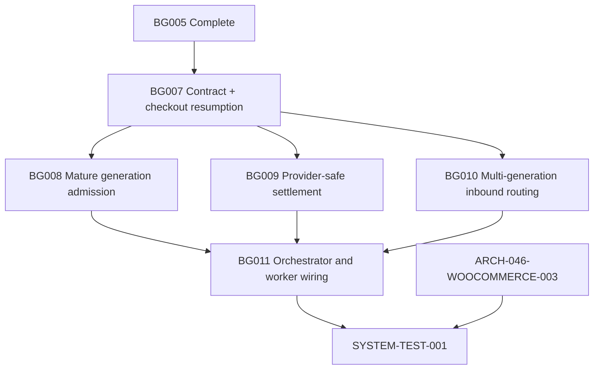

# ARCH-048 — WooCommerce checkout recovery and abandonment generations

## Status

**In Progress — 2026-10-29 generation amendment agreed; current published frontier: BG007–BG011 Complete.** BG001–BG006 and ARCH-048 Woo producer tasks 002/003 are Complete. `ARCH-046-WOOCOMMERCE-003` remains Ready and terminal `ARCH-048-SYSTEM-TEST-001` remains Pending. No integrated deployment, live Woo sending approval or system-test result is implied by this document. Prior 2026-10-23/25 single-generation design is retained only as change history, **not** an authority for new implementation.

## Problem

ARCH-035/048 already deliver Woo checkout and linked-order activity through authenticated `/v1/woocommerce/activity` and BullMQ into the composed Background recovery services. Woo checkout snapshots are current while only a pending delayed candidate exists. Once a `CheckoutRecovery` is inserted, `WooCheckoutActivityService` finds *any* row and records only `lastExternalActivityAt`, while `WooRecoveryAdmissionService` refuses any further row and always writes `generation: 1`. The orchestrator may even retry old initial outreach on a post-recovery checkout edit. Consequently a customer who resumes shopping cannot have a separate subsequent abandonment episode with their updated items and a new eligible initial outreach. The previous architecture explicitly prohibited further generations; that rule is **superseded** by this amendment.

## Goals

1. Treat `CheckoutRecovery` as **one abandonment episode**, not the permanent lifetime of a Woo checkout. Retain one stable authenticated `(shopId, checkoutKey)` lineage, but permit distinct sequential `generation=1,2,3,...` recoveries after genuine checkout resumption and another inactivity delay.
2. Close a previous active recovery when a strictly newer authenticated, meaningful `CHECKOUT_UPDATED` activity is accepted; preserve its frozen basket, conversation, status history, prior messages and confirmed billing. Never update old `lineItems` in place to depict a new episode.
3. Schedule exactly one pending generation after resumption, replacing its complete item snapshot and restarting its timer for further newer updates. Mature **only** that generation and create it once in PostgreSQL after the existing delay/consent/order checks.
4. Permit a newly created generation its **own initial outreach**, even when an earlier generation already sent one. **No arbitrary cross-generation cap, initial-message cooldown or reuse of old sequence-one attempts.** Retain per-recovery idempotency, merchant eligibility, current Woo consent/STOP, MARKETING template and billing rules.
5. Block any *new* old-generation provider permit after closure; settle pre-permit unsent attempts/credits without cancelling an already admitted, confirmed or uncertain provider send.
6. Route inbound WhatsApp replies to current generation when unambiguous; keep replies explicitly referencing old messages in the historical conversation without awakening old recovery automation.
7. Keep Woo/Shopify job source isolation, existing shared logger, queue capacity/observability, bounded retries and task-owned service structure. Roll out only after final integrated system testing and explicit live-send approval.

## Non-Goals

- No WordPress guest-session reader, Background→Woo checkout/order HTTP read, hosted API checkout-state proxy, polling or new public Shared event kind.
- No new PostgreSQL table, migration or duplicate recovery ledger: reuse existing `CheckoutRecovery.generation`, composite unique index, status history and billing/attempt tables. A proven impossibility must be returned to the architect instead of a silent schema expansion.
- No automatic discovery of **never-delivered** Woo checkout/order activity; this remains an event-only safety limitation and live-outbound decision gate.
- No automatic new session merely from reopening a browser tab **without an event**. The current WordPress snapshot fingerprint can suppress unchanged carts; mere page views do not necessarily provide new evidence. Adding active-resume event production requires a separately agreed Woo/API task.
- No Woo follow-ups at this time; the existing Woo initial-send test-only enablement remains. A later approved Woo follow-up would be bounded separately by the per-recovery limit.
- No across-checkout or cross-tenant customer reidentification, no Shopify recovery policy changes, no migration of archived conversations and no production-state deletion.

## Current Architecture (inspected 2026-10-29 source snapshot)

| Boundary | Actual implementation / limitation |
|---|---|
| Woo plugin | `includes/Checkout/CheckoutCapture.php`, `CheckoutSnapshot.php`, `CheckoutActivityPublisher.php` capture material cart/checkout changes, publish complete snapshots via Action Scheduler; empty carts are distinguishable from omitted items. |
| Hosted API | Existing authenticated `POST /v1/woocommerce/activity` normalises/queues `CHECKOUT_UPDATED`, `ORDER_PLACED`, `ORDER_PAID`, `ORDER_CANCELLED`. |
| Woo checkout service | `src/services/woocommerce-recovery/woo-checkout-activity.service.ts`; existing-row branch calls `recordExternalActivity()` and cancels pending candidate rather than rescheduling. |
| Existing-row adapter | `woo-checkout-activity.adapters.ts` currently looks up the **oldest** generation (`asc`) and updates only `lastExternalActivityAt`. |
| Candidate storage | `woo-candidate-queue.service.ts` has one job ID per checkout; `woo-activity-watermark.store.ts` has no generation; checkout index removal can delete a newer mapping unless ownership-checked. |
| Admission | `woo-recovery-admission.service.ts` rejects any prior recovery and INSERTs generation 1. |
| Order reconciliation | `woo-order-reconciliation.service.ts` observes placed/paid/cancelled events and has a bounded Redis terminal-evidence TTL; `ORDER_PLACED` is not payment. |
| Send safety | `woo-recovery-outreach.service.ts`, `woo-initial-send-fence.service.ts`, ARCH-046 final SQL consent/STOP/template permit; Woo outbound production default is disabled, test callback only. |
| Inbound routing | `recovery-routing.service.ts` counts distinct sent conversations across statuses/shops, which becomes ambiguous when multiple generations exist. |
| Durable data | `CheckoutRecovery` has `generation Int @default(1)`, `@@unique([shopId,checkoutToken,generation])`, `CheckoutRecoveryStatusHistory`, attempts, conversation, billing reservations and usage. |

The current source proves code paths; the snapshot does not establish live deployments, actual merchant activity or tests passing in a real LocalWP/Meta/Redis/PostgreSQL stack.

## Proposed Architecture

```mermaid
sequenceDiagram
    autonumber
    participant WC as Woo checkout/plugin
    participant API as Moda API / queues
    participant BG as Woo activity service
    participant DB as PostgreSQL
    participant R as Redis candidate
    participant OUT as Outbound final permit

    WC->>API: CHECKOUT_UPDATED event, full basket A
    API->>BG: Validated captured event
    BG->>R: Schedule generation 1 candidate
    R->>DB: Mature: admission creates recovery G1
    DB->>OUT: Eligible initial G1 (test-only gate)
    WC->>API: Newer CHECKOUT_UPDATED, basket B
    API->>BG: Validated newer event
    BG->>DB: Lock G1; CANCELLED + CHECKOUT_RESUMED history
    BG->>R: Stage/update generation 2 candidate (basket B)
    BG->>OUT: Settle old pre-permit attempts; no new G1 send
    WC->>API: Another newer item edit, basket C
    API->>BG: Validated event
    BG->>R: Replace G2 snapshot, restart inactivity delay
    R->>DB: Mature: create G2 with basket C
    DB->>OUT: Independently eligible initial G2 (test-only gate)
```

### Session lifecycle decisions (authoritative)

| Situation | Required result |
|---|---|
| No persisted recovery | Existing generation-1 candidate scheduling, full snapshots, debounce/delay, consent at admission. |
| Recovery G**N** active; strictly newer eligible checkout activity | Transactionally close only G**N** as `CANCELLED` with history `source="woocommerce.checkout"`, `reason="CHECKOUT_RESUMED"`, metadata `{eventId,nextGeneration}`; never rewrite its basket. |
| Resumption event replay after closure | Repair candidate for the same **N+1**, retry old-attempt settlement; do not close/increment again. |
| Later activity before N+1 maturity | Replace only N+1 full basket and restart delay, not N+2. |
| Explicit empty/unknown/conflicting basket | Empty cancels pending; unknown/ambiguous fails closed; refill starts current next generation's candidate. |
| Candidate N+1 matures | Verify current candidate, latest recovery's resumption history, order/tenant/recipient/consent/STOP/maturity; INSERT recovery N+1 and DETECTED history atomically with metadata `{generation,lastEventId}`. |
| Same candidate/old event replay | Existing row is an enqueue-repair source **only** when exact admission generation/event provenance matches; otherwise no outreach. |
| Observed placed/paid/cancelled order | Cancel pending and prevent send through existing order terminal guards; do not treat placement as payment. Redis-only order-first evidence has a bounded TTL; no false guarantee about events never delivered or retained indefinitely. |
| G1 send already provider-admitted | Cannot unsend/refund it merely because customer resumed. Preserve outcome and settle actual charge; reject *new* old-generation permit. |
| G2 initial eligible | New `recoveryId` and unique `(recoveryId,sequence=1)` attempt/source/credit; no cross-generation message cap/cooldown. Current Woo test-only default-off stays. |
| WhatsApp reply with old outbound context | Persist on historical conversation, do not revive old recovery or enqueue old AI automation. |
| Unreferenced WhatsApp reply | Select latest eligible current recovery **only if globally unambiguous across shops**; otherwise provide guidance. |

## Request / Event Flow

The plugin still captures Woo-supported cart/checkout events, constructs a full bounded basket snapshot, skips unchanged fingerprints and publishes an existing authenticated activity envelope to Moda API. The API stays an ingress/validation/queue boundary; the Background checkout worker dispatches to the Woo activity service. The activity service compares trusted event timestamp/ID against durable latest-generation state and its transient watermark, then closes/reschedules as necessary. Woo delayed maturity runs admission, which creates an immutable new row only after checking candidates, terminal observations and consent. The orchestrator invokes outbound only for an exact newly-created recovery or an exact proven initial-enqueue retry of that **same** generation. Older-generation cleanup and WhatsApp inbound routing are independent Background services, not coupled to the Woo plugin.

## Repository Responsibilities and Task Boundaries

Only `moda-interact-background/` owns the new runtime work. Use separate tasks, no cross-task file edits:

| Task | Owns files / outcome | Do NOT implement there |
|---|---|---|
| `ARCH-048-BACKGROUND-007` | `contracts.ts`; checkout activity/adapters; candidate queue/watermark; narrow index ownership API; close/resume and candidate scheduling | Admission INSERT, Meta/billing, worker wiring, inbound routing |
| `ARCH-048-BACKGROUND-008` | `woo-recovery-admission.service.ts`, `woo-recovery-admission-evidence.ts` | Contract rewrites, closure, outreach, workers |
| `ARCH-048-BACKGROUND-009` | `woo-recovery-outreach.service.ts`/adapters; narrow final permit and reservation settlement | New recovery INSERT, candidate scheduling, shared billing rewrite, routing/worker wiring |
| `ARCH-048-BACKGROUND-010` | `recovery-routing.service.ts`, narrow `whatsapp-inbound-processing.service.ts` consumer changes | Woo capture/admission/outreach/billing, general WhatsApp refactor |
| `ARCH-048-BACKGROUND-011` | `woo-recovery-orchestrator.service.ts`, `woo-recovery-composition.ts`, existing worker routing/entrypoints | Reimplementation of BG007–BG010 business rules |

No new Woo plugin, API, Database, Shared, Gateway or infrastructure task is justified by this **event-delivered update** change. If those ownership boundaries turn out insufficient, stop and report the precise dependency rather than silently modifying another repo. Existing `ARCH-046-WOOCOMMERCE-003` returning-consent work remains a separate prerequisite of integrated system testing.

## Data Model and Contracts

**No migration proposed.** The durable row identity is `(shopId, checkoutToken, generation)`, where `checkoutToken` equals the authenticated Woo `checkoutKey` only within the known shop. `CheckoutRecoveryStatusHistory` records the canonical close reason/source and event evidence, and admission history records the exact candidate `lastEventId` and generation. Previous recovery `lineItems`, `totalPrice`, `currency` and prior conversation remain historical snapshots. Only a newly admitted generation receives the updated basket.

BG007 authors the updated **Background-local** `src/services/woocommerce-recovery/contracts.ts`: generation-aware candidate manager/index semantics, `resumed` and `repair-existing-initial` checkout outcomes, admission `repairInitial` and `WooRecoveryOutreachDispatcher.settleResumed` port. To keep each intermediate repository task compilable, BG007 declares `generation?`, `repairInitial?` and `settleResumed?` **temporarily optional in TypeScript only** while still writing/validating generation for every new candidate. BG008 implements required runtime admission fields; BG009 implements settlement; **BG011 alone tightens all final signatures and removes the temporary generation=1 job-ID parameter default**. No partial BG007–BG010 branch may be deployed or tested as a live integrated Woo pipeline. All five tasks consume this one local contract; the optional staging is not a published compatibility adapter. Existing API-owned `woo.activity.v1` and Shared publication remain unchanged; do not duplicate wire types locally. Existing Shopify/unmarked candidate jobs remain unaffected.

## Consistency and Transactions

- PostgreSQL `CheckoutRecovery` and status history are the durable authority; BullMQ/Redis job existence is never a recovery-existence proof.
- Close current generation and write its exact resumption-event evidence in **one PostgreSQL transaction** under a recovery row lock/CAS. Redis candidate publication follows **outside** that transaction. If this second step fails, the original event retry must repair N+1 without closing twice.
- Candidate job identity includes **source, authenticated shop/checkout and generation**. Its checkout index is only removed by an atomic ownership comparison; old maturity jobs cannot remove current-generation work.
- Mature admission rechecks latest recovery and event provenance under the shared checkout coordinator and transaction row lock; the existing DB unique index resolves legitimate generation-insert races. No queue/Redis/provider operation inside the SQL transaction.
- An exact same-generation INSERT→initial-enqueue failure may be repaired using the event ID stored in the admission history. A later customer update is **not** an enqueue repair; it closes that generation.
- The final ARCH-046 SQL provider permit locks recovery and checks `DETECTED`, current consent, STOP, template, message and reserved credit. Closing recovery before permit prevents new Meta work; permit before close is irreversible and settled according to confirmed/uncertain provider outcome. Prior confirmed usage is never refunded merely for checkout resumption.
- Cross-generation initial outreach is independent. Within one generation, `RecoveryOutreachAttempt(checkoutRecoveryId,sequence)` plus provider-dispatch key and credit source maintain at-most-one initial/send/charge.

## Ordering

Source timestamps have limited precision. A distinct event in the **same source second** as an accepted event is not causally orderable and must not create a send-eligible candidate. Check `eventId`, source timestamp, digest, generation and persisted lower-bound evidence. Stale replay cannot modify a newer generation. Use the existing checkout-scoped coordinator; do not serialise all shops globally. A lease alone is not a transaction fence: use PostgreSQL row locks/CAS, unique constraint and Redis compare-and-delete for critical races.

## Failure Handling

- Checkout event **SQL close committed, Redis enqueue failed:** throw; on replay inspect history, repair same next generation, retry old-provider settlement.
- Candidate maturity **SQL INSERT committed, outreach enqueue failed:** retry the exact candidate, return proven same-row/same-event `already-exists.repairInitial=true` and enqueue only that row.
- Old-generation initial job races with closure: SQL final permit rejects closed row. A previously admitted provider request must reconcile actual result, never be called unsent.
- Redis index/key TTL, stale/failed/active jobs, source-second conflicts, unknown/oversized baskets and observation ambiguities fail closed without creating duplicate initial outreach.
- Woo checkout/order events never delivered to Moda are outside observable event guarantees. Terminal Redis evidence is bounded, not a permanent receipt for an order-first checkout with no recovery row. No manual rollout approval has been recorded for this risk.
- Errors must be structured-logged and **re-thrown**, not silently acknowledged. Queue retry exhaustion needs visible failed-job diagnostics.

## Scalability

Common checkout hot path: authenticated queue event, one indexed latest recovery lookup, bounded accepted-state evidence and candidate update. Closing a row is only on a genuinely resumed checkout. Do not load all generations/history every event; query latest and narrowly necessary history with existing `(shopId,checkoutToken,generation)` index. Use one candidate per **pending generation**, not an unbounded pending queue per activity. Preserve scoped ordering, tenant fairness, BullMQ retry bounds, Redis memory limits and PostgreSQL connection-pool capacity. No new service, Kafka or queue is introduced. This task does not make a new measured-throughput claim.

## Security

Shop ID is authenticated by existing API/worker capture. Never derive tenant/recipient from checkout token alone. Preserve current Woo recipient identity verification, local STOP, explicit MARKETING consent, sender/Meta context verification, moderation and immutable provider admission keys. Avoid logging raw carts, checkout keys, phone/email/customer message text, credentials or entire webhook payloads. A new generation does not override revoked consent or no-contact safeguards.

## Observability

Use only published `@modainteract/moda-interact-shared/logging`: bounded `shopId`, `recoveryId`, `generation`, hashed event/job identity, `stage`, `outcome`, `reason` and retriable error class. Important outcomes: `woo.resumption.closed`, `woo.generation.candidate_scheduled`, `woo.generation.admitted`, `woo.old_outreach.settled`, `woo.outreach.permit_suppressed`, `woo.inbound.historical`, and retry failure. These are suggested **semantic event names**, not instructions to create a second logger or duplicate framework telemetry. Existing BullMQ/OpenTelemetry throughput and failure signals are reused; no Gateway/Admin/observability implementation task is currently required. Verify failure isolation and secret redaction.

## Rollout / Migration

**Pre-production breaking internal candidate format** is proposed because live Woo sending is disabled in the inspected code. Verify actual production state before executing. No DB rows, reservations, provider messages, or external Redis data may be destroyed merely because the application is in development. When moving from old `WooPendingCandidate` to generation-bearing v2, explicitly drain/replace *obsolete Woo test/staging candidates only* under operator control, preserving Shopify candidates. Stage BG007 additive/temporarily optional v2 interfaces, then BG008/BG009/BG010 consumers, and **BG011 final mandatory v2 type-check and worker composition as a single integration gate**; never deploy interim BG007–BG010 builds or turn on sends during their execution. System tests follow accepted implementation and existing Woo returning-consent prerequisite. If live old candidate traffic/production compatibility is discovered, block and author a separate compatible rollout. Never enable Woo provider sending solely to validate this patch.

## Decisions / Tasks

**Authoritative state is each task's YAML in the supplied snapshot, not old ARCH-048 review prose.** New statuses are defined-but-not-materialised until the developer's task authoring/launcher workflow integrates them.

| Task | Owner | Snapshot status | Depends on |
|---|---|---|---|
| `ARCH-048-WOOCOMMERCE-001` | Woo | Superseded | No remote checkout reader |
| `ARCH-048-API-001/002` | API | Superseded | No new checkout-state API |
| `ARCH-048-WOOCOMMERCE-002/003` | Woo | Complete | Existing ARCH-035 prerequisites |
| `ARCH-048-BACKGROUND-006` | Background | Complete | Existing ARCH-035 prerequisites |
| `ARCH-048-BACKGROUND-001/002/003/004` | Background | Complete | BG006 and original prerequisites |
| `ARCH-048-BACKGROUND-005` | Background | Complete | BG001–004, ARCH-046 BG002/BG004 |
| `ARCH-048-BACKGROUND-007` | Background | **Complete** | BG005 |
| `ARCH-048-BACKGROUND-008` | Background | **Complete** | BG007 |
| `ARCH-048-BACKGROUND-009` | Background | **Complete** | BG007 |
| `ARCH-048-BACKGROUND-010` | Background | **Complete** | BG007 |
| `ARCH-048-BACKGROUND-011` | Background | **Complete** | BG007, BG008, BG009, BG010 |
| `ARCH-046-WOOCOMMERCE-003` | Woo | Ready | Separate returning-consent task, not reopened here |
| `ARCH-048-SYSTEM-TEST-001` | System Test | Pending | All original prerequisites plus BG007–BG011 and ARCH-046-WOO003 |



The system-test task is **terminal**. No implementation task depends on a system-test task. Repo agents own only their declared implementation modules and own Completion Report updates. The architect owns this architecture, task definitions, indexes, Architect Reviews and dependency promotions; the developer owns final integration/merges.

## Open Questions / Decision Gates

1. **Live-outbound event completeness:** user has not approved sends when payment/checkout activity is never delivered; retain default-off and make the residual risk explicit in terminal tests.
2. **Same-second source ordering:** current Woo snapshots do not carry a strictly monotonic revision; keep fail-closed conflicts. Adding a producer revision requires an agreed Woo/API/Shared initiative, not a silent BG007 workaround.
3. **Active return without changed cart:** no capture event is guaranteed merely by reopening checkout; this scope intentionally handles *received newer checkout updates*, not browser-page-view intent.
4. **Order-first suppression TTL:** accepted Redis evidence is bounded when no recovery row exists. Claims of permanent order-first exclusion require a separate durable source of truth, not an unreviewed timeout increase.
5. **Provider uncertainty:** any initial admitted before closing the old recovery can still be delivered. Customer-outcome reconciliation, not pretending a provider permit can be withdrawn, is required.

## Change History

- **2026-10-30 — BG011 accepted:** Attempt 1 complete; published implementation and parent task branches reviewed. Reported validation includes 40 integration tests, focused unit tests, typecheck, lint and build. Raw exception detail is accepted for non-live testing only; bounded logging and sentinel coverage are required before activation. Terminal system testing remains pending remaining dependencies.

- **2026-10-30 — BG010 accepted:** Attempt 1 complete; reported evidence includes 62 focused unit tests and 3 PostgreSQL routing integration tests. Raw exception-object logging is accepted only for non-live testing; bounded logging and sentinel coverage are required before live activation. BG011 remains Pending until BG009 is Complete.

- **2026-10-29 — Agreed amendment:** real checkout resumption closes an abandonment generation and reschedules the next; new generation independently eligible for initial outreach, **no cross-generation cap/cooldown**; add fully bounded BG007–BG011 definitions and extend SYSTEM-TEST-001. Supersedes single-generation idempotency prohibition from 2026-10-23 design.
- 2026-10-25 — ARCH-048 business-service wiring and ARCH-046 shared notifier/final permit prerequisites reconciled; Woo follow-ups remain disabled.
- 2026-10-23 — Event-only architecture without provider session read; four Background services plus BG006 local contract and BG005 thin composition chosen. Previous proposal permitted at most one recovery generation, now superseded.

- **2026-10-30 — BG009 accepted at Attempt 3:** the required PostgreSQL/Redis integration command passed (3 files, 23 tests), including the `followUpDueAt` regression proving that blocked cancellation leaves the attempt pending, keeps its reservation reserved and makes no provider request. BG009 is Complete; BG010 remains Ready and BG011 remains Pending on BG010.
