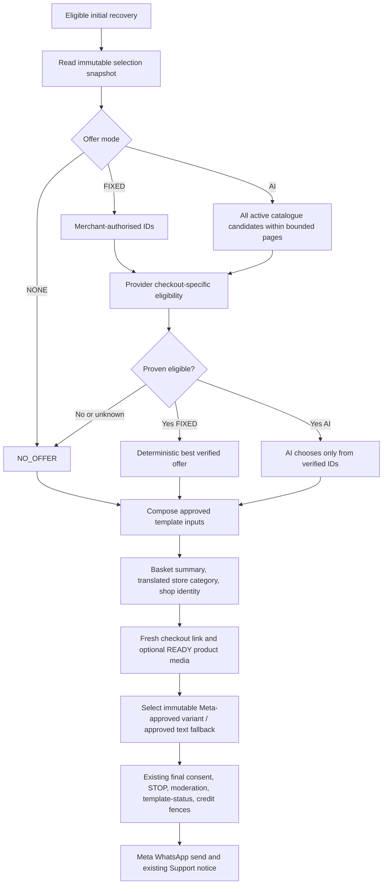

# ARCH-052 — Checkout-personalised WhatsApp initial outreach

## Status

**Proposed — portable architecture and task definitions only (29 October 2026).** No task worktree, feature branch, implementation code, publication, live Meta approval or Git push has occurred. The snapshot contains completed related tasks whose integration state must be reverified in the real development workspace.

## Problem

The desired customer-facing INITIAL WhatsApp message contains a genuine checkout product image (when available), verified store name, greeting, deterministic abandoned-item description, optional store-category copy and a working Resume checkout button. Discount policy must behave in one of three merchant-configured modes: **NONE**, **FIXED** (select among a merchant-authorised set only) or **AI_BEST_APPLICABLE** (discover all current candidates, independently verify, then let AI choose an eligible offer). Only offer claims proven for the actual checkout may reach the customer.

The current snapshot has a six-purpose immutable Meta template catalogue, checkout line item snapshots for both providers, store-category translation binding, Woo coupon synchronisation, and reusable Commerce product/discount tools. Important gaps remain: Shopify FIXED is single-radio; Woo merchant checkboxes overload provider `isAvailable`; Background’s default live provider discount validators return `unavailable`; the AI adapter is null; candidate discovery caps eight and incorrectly filters Woo AI by checkbox; product-photo and basket-summary bindings are absent; Woo checkoutUrl is null.

## Goals

- Render understandable, bounded customer-specific WhatsApp INITIAL copy using stored checkout items, verified shop name, existing translated `shop.categoryName` and safe checkout URL.
- Support no offer, merchant-selected set, and AI choice from a verified shortlist; preserve immutable initial promised offer for later sequence-two handling.
- Share canonical cross-service contracts through the published Shared package, without duplicate policy/variable definitions.
- Use independently evidenced Shopify and Woo discount eligibility. Unknown restrictions and unsupported cases never become promotional claims.
- Deliver actual customer-initiated Woo cart restoration; support optional verified product IMAGE header with a separately approved text-only fallback.
- Preserve ARCH-045/046 consent and STOP, ARCH-047 approved templates/final registration fence, ARCH-048 Woo recovery, ARCH-049 ShopBrand media, ARCH-050 merchant Support notice, moderation and credit admission.

## Non-Goals

- No new independent WhatsApp send channel, no Meta template creation on the ordinary send path, no merchant-authored Meta templates, no unapproved dynamic message bodies.
- No AI discount/coupon creation, customer cart modification, discount application or order placement. The Woo checkout restore handler is only invoked by an explicit customer click.
- No redesign of existing active store-category taxonomy/translation or of ShopBrand logo/square/cover media.
- No unbounded evaluation of all provider discounts through a single model prompt; no claim to support restrictions which provider APIs cannot prove.
- No reopening completed ARCH-047/048/049/050 tasks; consume their accepted behaviour and create bounded ARCH-052 adapter tasks.
- No new gateway/Render service assumed; use existing authorised private service boundaries and worker queues, and return a missing deployment route to the architect if discovered.

## Current Architecture — 29 October 2026 Snapshot

| Capability | Actual source / evidence | Design consequence |
|---|---|---|
| Checkout items | `moda-interact-background/src/services/checkout-recovery/recovery-mappers.ts` and `woocommerce-recovery/woo-recovery-admission.service.ts` store `CheckoutRecovery.lineItems` | Source for text summary; images are not present |
| Store category | Admin `authoring/registry.ts` and Background `recovery-template-brand.ts` already bind translated `shop.categoryName` from active store taxonomy | Reuse, do not reimplement category reading |
| Meta template system | `ARCH-047-BACKGROUND-001/006` Complete in task YAML; prepared fixed parameters and six purposes | Extend frozen semantic bindings and approved variants, not edit sent message strings |
| Offer resolver | `recovery-offers/` is implemented; default provider evaluator returns unavailable and AI is null | Need real provider evidence and model wiring |
| Provider candidates | `recovery-offer-repository.ts` includes `isAvailable:true` filter; resolver `MAX_CANDIDATES=8` | Different Shopify/Woo semantics and cursor scanning required |
| Merchant FIXED | Shopify one discount radio, Woo 50 checked coupon IDs in isAvailable, Admin single override FK | New canonical tenant-scoped selected set while keeping override independently single-valued |
| Shopify proof | Commerce read-only `discounts.evaluate`; `docs/discount-support-matrix.md` explicitly leaves unproven rounding semantics | Supported verified subset only; unknown rules are not sendable |
| Woo checkout URL | `woo-recovery-admission.service.ts` sets checkoutUrl null; no authenticated restore wire | Fresh plugin-issued customer restore CTA required |
| Product media | ARCH-049 ShopBrand R2 processing exists; `CheckoutRecovery.lineItems` and Commerce Shopify product-facts omit image sources | Reuse safe image pipeline but keep checkout-product state distinct |
| Existing safeguards | ARCH-045/046/047/048/050 completed task boundaries, existing SQL permits and billing | No second send/credit/STOP path |

Individual task frontmatter is authoritative, not stale parent summaries. In the supplied snapshot, `ARCH-049-BACKGROUND-004` is **Ready**, not Complete; image integration remains gated on its later acceptance. `ARCH-036-COMMERCE-001` remains Pending and concerns CommerceAgent Woo normalization, not live checkout-native coupon proof; ARCH-052 intentionally does not duplicate it.

## Proposed Architecture

**NONE** makes no discount verification or LLM request. **FIXED** checks only IDs frozen from merchant settings (or exactly one active Admin override) and picks a deterministic verified winner. **AI** scans the *whole available provider catalogue within documented pagination ceiling*, narrows by necessary restrictions, verifies a bounded eligible shortlist, and asks a constrained model for one valid ID. This does not promise mathematical global optimality when some candidate types are unsupported or provider budget limits prevent evaluating them all. If scanning is incomplete, record the limitation and use a documented no-offer/controlled outcome, not a fabricated "best" claim.

No eligible/verified offer maps to `INITIAL_NO_OFFER`. Verified single redeemable code maps to `INITIAL_CODE_OFFER`; proven applicable automatic discount maps to `INITIAL_AUTOMATIC_OFFER` (Woo must not claim native automatic coupon support merely because a code coupon exists). The text may mention a discount only when there is fresh, current, positive provider proof. The ability to produce a basket description is independent of a discount outcome.

Shop category is **the shop's active store category**, not the category of an item in the abandoned basket. The existing `shop.categoryName` binding supplies a translated store description only when an approved active translation exists. A generic approved text variant is required when category is unavailable. No runtime editing of approved message text is allowed.

## Repository Responsibilities

| Repository / owner | Responsibility |
|---|---|
| Database / `moda_database` | Canonical selected-discount same-shop set, immutable attempt selection snapshot, separate checkout product-media state |
| Shared / `moda_shared` | Versioned selection policy and immutable semantic binding/header-role contracts; publication gate |
| Shopify / `moda_app` | Merchant multi-selection UI/save; preserve provider availability |
| API / `moda_api` | Woo merchant selection Save/GET with canonical set, keep existing install auth |
| Commerce / `moda_commerce` | Shopify provable discount evaluation, exact checkout product image reader |
| Woo plugin / `moda_woocommerce` | Native coupon verification and private signed customer-click checkout restoration |
| Background / `moda_background` | Frozen policy/offer selection, paginated candidates, provider proof, model recommendation, basket summary, Woo return link, product media and existing send composition |
| Admin / `moda_admin` | Immutable Meta template AST, translation, approval, per-shop publication, product image header and paired approved fallback |
| System Test / `moda_system_test` | Terminal independent Shopify and Woo end-to-end verification |

No mandatory Gateway or Messaging task identified in this snapshot. If actual provider transport or deployment fails the approved private-boundary requirements, stop and create a separate owning task; never bypass auth to make the integration pass.

## Data Model and Security Invariants

1. `ShopRecoverySelectedDiscount` has a same-shop composite FK to `ShopifyDiscount`; it is the merchant FIXED authoritative set (maximum 50). Existing `ShopifyDiscount.isAvailable` retains its provider-observation meaning for Shopify; Woo selection is migrated to the new relation. Retain the one-FK compatibility anchor only until all approved readers migrate. An active Admin FIXED override keeps its one FK and does **not** union with merchant selections.
2. `RecoveryOutreachAttempt.authorisedDiscountIdsSnapshot` freezes version, source and sorted authorised IDs before eligibility begins. `offerSnapshot` and already-sent promise evidence retain their existing distinct meanings. Duplicate retry or a merchant settings change cannot expand a claimed attempt.
3. `CheckoutRecoveryProductMedia` holds one shop/recovery-bound product asset generation. Only R2-normalised READY derivative with verified origin, digest, MIME, size and freshness may be inserted into an approved IMAGE header. Source item must match the actual persisted checkout. Assets expire/clean up with recovery retention. There are no raw customer data fields in media.
4. A Woo restore link is a short-lived bearer capability with opaque signed token, canonical shop URL and server-side expiration; it is issued freshly by the merchant plugin through the authenticated read route. It is **not** a generic checkout URL or a persistent customer session cookie. Only explicit customer click reconstructs eligible cart items; paid/revoked/expired state denies restoration.
5. Every DB/provider/model/read is shop-scoped. External Woo calls use only approved origin/identity/grants, no private network SSRF or redirect fallback; Shopify Commerce evidence uses trusted checkout identity. Never log credentials, links, coupon/customer data or media sources.

## Contracts and Versioning

| Contract | Owner / authoritative shape | Consumer / validation |
|---|---|---|
| Recovery offer mode + selected IDs | Shared `/recovery-policy` versioned snapshot; `mode`, `source`, ordered `authorisedDiscountIds[]` | Shopify, Woo API, Background strict runtime parse |
| Checkout template semantic | Shared `/recovery-template-bindings` body key `checkout.itemsSummary`, role `CHECKOUT_PRODUCT` | Admin immutable compiler and Background immutable-binding validator; fixed projection digest vectors |
| Provider eligibility | Existing Background-local `ReadOnlyProviderEligibility`, `CheckoutRuleEvidence`, `RecoveryOfferDecision` | Commerce Shopify proof or authenticated Woo plugin proof through Background adapters; positive proof only |
| Woo coupon proof | Woo plugin narrow authenticated read-only service response; versioned fixture | Background Woo provider adapter, exact checkout fingerprint/expiry |
| Woo customer restore | Woo plugin authenticated fresh-link issue + public customer-click handler | Background trusted checkout URL resolver; **no** new Woo activity event version or hosted API proxy |
| R2 product media | Database READY metadata and Shared `CHECKOUT_PRODUCT` frozen header | Background prepared header, Admin approved immutable variant |
| Final Meta payload | Existing ARCH-047 compiled six-purpose Meta template snapshot | Existing Background final sending and SQL template status/credit admission |

Shared implementation task(s) -> architect accepted -> Shared publication -> independently reviewable consumer tasks. Consumers use the exact published version, not sibling source paths. Source contracts and testing fixtures are pinned; producer/consumer deployment order is documented per code acceptance.

## Offer Evaluation, Concurrency and Failure Handling

- Checkout-specific verification is on the **actionable recovery path**, never the raw Shopify/Woo event hot path. Cap candidate scan pages and per-candidate provider calls with measured configurable budgets and per-tenant fairness. One merchant with 5,000 coupons must not monopolise worker threads.
- Shopify eligible proof requires a currently supported complete rule and established calculation semantics. Unsupported usage/customer/market/currency/rounding/stacking rules remain UNKNOWN; no positive offer.
- Woo server-side validation must reconstruct/read authoritative Woo checkout context, current coupon restrictions and customer eligibility without provider-side basket mutation. Invalid/uncertain native rules remain unavailable.
- For FIXED, if ranking eligibility across all authorisations is incomplete, use a conservative no-offer or explicitly documented safe deterministic policy; do not fabricate highest saving. For AI, the model sees **only** previously verified shortlist IDs, savings/kinds and bounded item summary, not raw PII; its output is validated by app logic.
- A provider or AI exception is logged and thrown to existing retry layer or converted to a typed controlled no-offer result; failures cannot silently become eligible. Per-checkout fingerprint/offer expiry must be checked before preparation and bounded final admission; no external provider calls during SQL transaction.
- Existing consent/STOP, recipient eligibility, moderation, template approval/status freshness, WABA identity, credit reservation/compensation, one initial/send promise and later follow-up consistency remain unchanged. Duplicate BullMQ delivery must not cause duplicate sends, billing or merchant notices.
- IMAGE headers cannot be dynamically changed to TEXT. An absent unsafe image selects a *different pre-approved template* for the same purpose/language or returns typed unavailable. Text-only outreach is not contingent on media-preparation success.

## Scalability and Observability

Capacity here is **actionable recoveries**, provider eligibility reads, optional media preparation and AI recommendations—not the platform's 20,000 Shopify **webhook events/minute** reference ingress. Those upstream events are already filtered asynchronously before a subset becomes outreach. The provider/catalogue/LLM ratios are UNKNOWN until measured; do not claim throughput or provider approval evidence absent benchmarks.

Reuse shared structured logger for changed Node runtime logs, WordPress plugin operational logger for PHP, existing BullMQ/OpenTelemetry instrumentations and trace IDs. Emit only bounded semantic decision outcome, offer mode, tenant pseudonymous ID, job/recovery ID, candidate count, incomplete scan, provider failure/timeout, AI choice rejected, media ready/absent and approved template fallback. Provider metrics should be domain-specific when standard instrumentation cannot express the decision; no duplicate generic HTTP latency metrics. Include queue age, job retry, provider request budget, no-offer reason and final-send status in integrated tests. Never expose checkout URLs, raw coupon codes, customer PII, provider tokens or product-media source URLs in logs. Observability backend outages must not affect business processing.

## Rollout and Migration

**Pre-production feature rollout**, but preserve existing Shopify availability, Woo selections and durable recovery/credit histories. The platform snapshot alone does not justify deleting durable state.

1. Accept additive Database-001/002 and Shared-001/002. Publish Shared-003 only after accepted implementation. Backfill selected merchant IDs without reinterpreting provider flags; preserve old attempt records and legacy compatibility anchors until all consumers migrate.
2. Implement Shopify merchant and Woo API selected-set writers/readers, then Background immutable policy snapshots and candidate discovery. Do not deploy a new reader assuming all writers changed before migrations are applied.
3. Complete Commerce Shopify proof and Woo native proof independently; wire Background provider adapters and AI recommender after both have accepted outcomes. Positive offers remain fail-closed until verified in deployed read path.
4. Independently implement text-summary/Admin templates and Woo customer-tapped restore link; then product media/approved header/fallback. `ARCH-049-BACKGROUND-004` must be accepted before product media integration relies on the approved brand-media binding.
5. Integrate final INITIAL send after prerequisites, retain all existing final-safety gates. Developer may manually exercise the feature before terminal `SYSTEM-TEST-001/002`; neither system test gates feature implementation.
6. For rollback, disable or avoid assigning new product-IMAGE/offer variants, preserve existing approved text-only NO_OFFER templates and avoid dropping new DB state before accepted consumers stop reading it. Model/Meta approval and customer restoration have explicit external readiness checks.

No production-compatible migration adapters are required beyond preserving actually persisted selected state and existing other-feature consumers. No parent/implementation worktree or Git remote was accessible in this review; these are **portable definitions**, not materialised tasks.

## Decisions / Tasks

| Task | Owner | Status | Dependencies |
|---|---|---|---|
| [`ARCH-052-DATABASE-001`](../decisions/database/ARCH-052/DATABASE-001-persist-merchant-selected-discount-sets.md) | `moda_database` | Ready | — |
| [`ARCH-052-DATABASE-002`](../decisions/database/ARCH-052/DATABASE-002-persist-checkout-product-media-provenance.md) | `moda_database` | Ready | — |
| [`ARCH-052-SHARED-001`](../decisions/shared/ARCH-052/SHARED-001-extend-recovery-offer-policy-contract.md) | `moda_shared` | Ready | — |
| [`ARCH-052-SHARED-002`](../decisions/shared/ARCH-052/SHARED-002-define-checkout-template-binding-contract.md) | `moda_shared` | Ready | — |
| [`ARCH-052-COMMERCE-001`](../decisions/commerce/ARCH-052/COMMERCE-001-verify-shopify-discount-against-current-checkout.md) | `moda_commerce` | Ready | — |
| [`ARCH-052-COMMERCE-002`](../decisions/commerce/ARCH-052/COMMERCE-002-read-authoritative-shopify-checkout-product-image.md) | `moda_commerce` | Ready | — |
| [`ARCH-052-SHARED-003`](../decisions/shared/ARCH-052/SHARED-003-publish-initial-outreach-shared-contracts.md) | `moda_shared` | Pending | `ARCH-052-SHARED-001`, `ARCH-052-SHARED-002` |
| [`ARCH-052-WOOCOMMERCE-001`](../decisions/woocommerce/ARCH-052/WOOCOMMERCE-001-expose-read-only-native-coupon-verification.md) | `moda_woocommerce` | Ready | — |
| [`ARCH-052-WOOCOMMERCE-002`](../decisions/woocommerce/ARCH-052/WOOCOMMERCE-002-create-secure-customer-initiated-checkout-resume.md) | `moda_woocommerce` | Ready | — |
| [`ARCH-052-API-001`](../decisions/api/ARCH-052/API-001-migrate-woo-selected-discounts-to-canonical-set.md) | `moda_api` | Pending | `ARCH-052-DATABASE-001`, `ARCH-052-SHARED-003` |
| [`ARCH-052-SHOPIFY-001`](../decisions/shopify/ARCH-052/SHOPIFY-001-select-multiple-authorised-recovery-discounts.md) | `moda_app` | Pending | `ARCH-052-DATABASE-001`, `ARCH-052-SHARED-003` |
| [`ARCH-052-ADMIN-001`](../decisions/admin/ARCH-052/ADMIN-001-author-six-initial-outreach-template-variants.md) | `moda_admin` | Pending | `ARCH-052-SHARED-003` |
| [`ARCH-052-ADMIN-002`](../decisions/admin/ARCH-052/ADMIN-002-author-optional-checkout-product-image-headers.md) | `moda_admin` | Pending | `ARCH-052-SHARED-003`, `ARCH-049-ADMIN-002` |
| [`ARCH-052-BACKGROUND-001`](../decisions/background/ARCH-052/BACKGROUND-001-snapshot-authorised-discount-policy-at-attempt.md) | `moda_background` | Pending | `ARCH-052-DATABASE-001`, `ARCH-052-SHARED-003`, `ARCH-052-SHOPIFY-001`, `ARCH-052-API-001` |
| [`ARCH-052-BACKGROUND-002`](../decisions/background/ARCH-052/BACKGROUND-002-discover-bounded-offer-candidates.md) | `moda_background` | Pending | `ARCH-052-BACKGROUND-001` |
| [`ARCH-052-BACKGROUND-005`](../decisions/background/ARCH-052/BACKGROUND-005-bind-basket-summary-and-merchant-context.md) | `moda_background` | Pending | `ARCH-052-SHARED-003` |
| [`ARCH-052-BACKGROUND-003`](../decisions/background/ARCH-052/BACKGROUND-003-connect-shopify-woo-live-eligibility-providers.md) | `moda_background` | Pending | `ARCH-052-BACKGROUND-002`, `ARCH-052-COMMERCE-001`, `ARCH-052-WOOCOMMERCE-001` |
| [`ARCH-052-BACKGROUND-004`](../decisions/background/ARCH-052/BACKGROUND-004-wire-bounded-ai-offer-selector.md) | `moda_background` | Pending | `ARCH-052-BACKGROUND-003` |
| [`ARCH-052-BACKGROUND-006`](../decisions/background/ARCH-052/BACKGROUND-006-resolve-fresh-woo-resume-checkout-links.md) | `moda_background` | Pending | `ARCH-052-WOOCOMMERCE-002` |
| [`ARCH-052-BACKGROUND-007`](../decisions/background/ARCH-052/BACKGROUND-007-prepare-shop-scoped-recovery-product-image.md) | `moda_background` | Pending | `ARCH-052-DATABASE-002`, `ARCH-052-SHARED-003`, `ARCH-052-COMMERCE-002`, `ARCH-049-BACKGROUND-001`, `ARCH-049-BACKGROUND-002`, `ARCH-049-BACKGROUND-004` |
| [`ARCH-052-BACKGROUND-008`](../decisions/background/ARCH-052/BACKGROUND-008-integrate-three-modes-into-initial-whatsapp-send.md) | `moda_background` | Pending | `ARCH-052-BACKGROUND-003`, `ARCH-052-BACKGROUND-004`, `ARCH-052-BACKGROUND-005`, `ARCH-052-BACKGROUND-006`, `ARCH-052-BACKGROUND-007`, `ARCH-052-ADMIN-001`, `ARCH-052-ADMIN-002` |
| [`ARCH-052-SYSTEM-TEST-001`](../decisions/system-test/ARCH-052/SYSTEM-TEST-001-certify-shopify-initial-outreach-modes.md) | `moda_system_test` | Pending | `ARCH-052-BACKGROUND-008`, `ARCH-052-SHOPIFY-001`, `ARCH-052-COMMERCE-001`, `ARCH-052-COMMERCE-002`, `ARCH-052-ADMIN-001`, `ARCH-052-ADMIN-002`, `ARCH-052-DATABASE-001`, `ARCH-052-DATABASE-002` |
| [`ARCH-052-SYSTEM-TEST-002`](../decisions/system-test/ARCH-052/SYSTEM-TEST-002-certify-woocommerce-initial-outreach-modes.md) | `moda_system_test` | Pending | `ARCH-052-BACKGROUND-008`, `ARCH-052-API-001`, `ARCH-052-WOOCOMMERCE-001`, `ARCH-052-WOOCOMMERCE-002`, `ARCH-052-ADMIN-001`, `ARCH-052-ADMIN-002`, `ARCH-052-DATABASE-001`, `ARCH-052-DATABASE-002` |

The initial Ready frontier is DATABASE-001, DATABASE-002, SHARED-001, SHARED-002, COMMERCE-001, COMMERCE-002, WOOCOMMERCE-001 and WOOCOMMERCE-002. All others are Pending. These labels describe **dependency eligibility in a portable plan**, not materialisation or execution. Existing external ARCH-049-BACKGROUND-004 remains Ready in this snapshot, so BG007 remains Pending.

The Woo coupon CommerceAgent normalization task `ARCH-036-COMMERCE-001` is a separate, deferred responsibility; it does not substitute for Native Woo provider checkout proof and is not silently reopened. Existing ARCH-036-SYSTEM-TEST-002 refers to a superseded task and requires separate architect reconciliation, not a dependency of this initiative.

## Open Questions and Explicit Gating Checks

- Verify the live Commerce private discount-proof invocation supports a non-conversation recovery request. If the existing service cannot expose safe proof to Background, create a Commerce/Gateway-owned connector task before BG003; do not invent public access in BG.
- Verify WordPress plugin can durably retain a safe snapshot and prove current checkout customer-specific coupon restrictions after the original browser session expires. If it cannot, only NO_OFFER may send; implementation must not mark Woo native verification Complete.
- Confirm Meta’s approved image template sample/registration and current ShopBrand HEADER media binding availability, as distinct from possessing a working R2 image URL.
- Confirm shop brand name source is reliable and category locale translation is approved for each assigned template. Generic fallback must have separately approved immutable identity.
- Before production rollout, measure catalogue scan/provider verification budget and queue lag, especially on large Woo catalogues/hot shops.

## Change History

- 2026-10-29: Initial source-grounded ARCH-052 architecture and 23 portable task definitions authored from updated 08:07 snapshot. No repository implementation, branches or materialisation.
