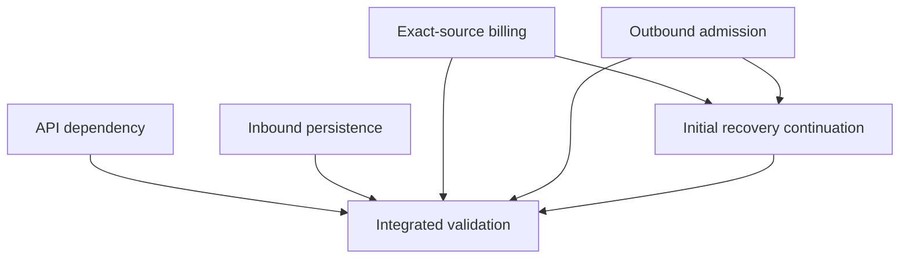

# ARCH-056: Background persistence and initial recovery progress

## Status

**Definition revision 2; six tasks defined but not materialised.** The user requested tasks grouped around the database touchpoints in the updated assessment, then explicitly asked that errors retain their actual messages for debugging before production. Revision 2 strengthens logging ownership and tests of the emitted records. It supersedes the unapplied attempt-1 definition package. This package defines five implementation tasks and one terminal system-test task. It contains no application implementation, migration, task claim, review acceptance or production rollout.

`ARCH-056` is unused in the supplied original snapshot. The real launcher must check for a conflicting live allocation before materialising it. The snapshot has no usable Git history with which to prove current remote branches, gitlinks or accepted merge ancestry. No such state is asserted here.

Four definitions are `ready` because their named existing prerequisites are Complete in the snapshot; Background continuation and terminal validation are `pending` on the new interfaces. These are normal task statuses, not a claim that any task worktree exists. All definitions are unclaimed, attempt 0, agent-executed and subject to architect review.

## Problem

The focused follow-up identified three connected correctness boundaries. The API exports an older Database schema/migration tree than its normal generated client requires. Inbound text persistence acquires a child foreign-key lock before requesting the stronger Conversation lock used to capture pending-turn state. Initial recovery has durable message, permit, receipt, billing and finalisation progress, but ordinary retry entry points do not consistently classify and continue that progress.

Initial recovery also spans several owners. Fixing only the no-offer fallback would leave the actual candidate route, outbound duplicate suppression, source settlement and conditional cleanup inconsistent. One task for each finding would assign multiple agents to the same services. This initiative instead assigns one owner to each bounded persistence or continuation touchpoint and freezes the interfaces between them.

## Goals

1. Make normal API generation consume the accepted Database contract with verifiable dependency provenance.
2. Serialize inbound parent state before inserting its child message, preserving atomic rollback and the accepted fixed pending-turn deadline.
3. Make confirmed initial-outreach billing return positive proof of settlement of the exact original source, or a specific hold.
4. Resume a proved existing, unpermitted initial template using the same message and usage identity, with fresh final admission and transactional cleanup.
5. Let the actual initial-recovery entry routes continue safe durable progress without a second provider request or replacement charge.
6. Validate these boundaries through the existing migrated service/system-test infrastructure with recorded revisions and honest evidence classes.

## Non-Goals

The package does not close the entire wider database review. The complete 37-reference register in [finding-task-map.md](ARCH-056/finding-task-map.md) records selected, partial, preserved and deferred findings. Runtime leases, scan cursors, unmatched provider-status durability, general AI-turn outcome propagation, broad query optimisation, index changes and external object cleanup remain separate work.

There is no new schema, ledger, outbox, queue, global lease, Shared publication, public API, credit pricing rule or automatic historical data repair. No change to sequence-two ownership, human sends, STOP scope, recovery lifetime, merchant mode selection, consent, Woo production send enablement or accepted Support notice identities is selected. Unrelated existing tasks and every `_index.md` remain unchanged.

## Source and evidence

Baseline: `moda-interact-workspace(20261103-212722).zip`, SHA-256 `f8194947c3564a8f9ea8942d9462ec83716aecc17fc1626d7d846af68c044024`. Architect role: `moda_architect(20261102-112835).toml`. The prior assessment and focused follow-up are evidence inputs, not implementation results. This package is independently applicable to the original updated archive; the earlier review patches are not prerequisites.

[source-baseline.json](ARCH-056/source-baseline.json) records original source hashes, schema/migration comparisons and the individual prerequisite task states. [deterministic-execution-map.json](ARCH-056/deterministic-execution-map.json) records exact file ownership, new paths, dependencies, validation commands and finding disposition. Paths in the task bodies are relative to their owning implementation repository. A source hash identifies the reviewed bytes; later accepted changes require a recorded rebase/review, not blindly restoring old bytes.

The definition pass performs document, dependency, ownership and patch validation. It does not run application builds, migrated PostgreSQL tests, provider requests or system scenarios. Required implementation evidence is specified in each task and must be produced later; a scenario written in a document is not a passing test.

## Current Architecture

The existing PostgreSQL/Prisma, Redis/BullMQ and provider boundaries are retained. API build/typecheck regenerate from its nested `database/prisma/schema.prisma`. Background uses the accepted canonical schema. Inbound text currently inserts a ConversationMessage before the locked pending-turn helper, then writes language and monotonic Conversation clocks in the same transaction. Engagement occurs after commit.

Initial recovery uses a durable Recovery, sequence-one outreach attempt, ConversationMessage, UsageEvent, provider permit/receipt and source-specific credit reservation. The usage identity `recovery-outreach:<attemptId>` is distinct from a provider dispatch key. Shopify and Woo have different existing permit-key formats; both remain unchanged. Candidate retries are bounded. A retained failed queue job is not an autonomous repair scheduler.

Successful initiation currently crosses source commitment, atomic optional Support/attempt finalisation, a conditional Recovery transition and follow-up scheduling. Existing source owners and delivery compensation enforce legitimate reservation states and exact accounting. Higher-level code must inspect their outcomes rather than treating a no-op replay as positive commitment.

## Proposed Architecture

### Decision 1 — Separate dependency coherence from endpoint implementation

API-001 inspects the actual recorded Database gitlink, materialized dependency and accepted merged history. It updates only the API-owned gitlink if necessary. A correct recorded pin with stale exported contents can have a truthful zero-diff rematerialisation result. Both accepted nullable fields and all three existing ARCH-055 forward migrations are required; selecting a sibling schema for a test does not repair normal API generation.

Unfinished ARCH-055 API endpoint/readiness work remains with its current owner. A failure caused by that work is reported as a distinct blocker, not repaired opportunistically or hidden behind an alternate generated client.

### Decision 2 — Parent-first inbound transaction

BACKGROUND-001 moves the existing locked pending-turn helper before the message INSERT. The whole helper/message/language/clock operation remains one transaction. The helper's lock mode, current-state decision, frozen deadline, control revision and version semantics remain intact. Raced duplicates can now execute helper work before losing the INSERT; rollback must remove that work completely.

The earlier language-resolution race is not selected here. Successful distinct-message paths gain no database call site; error/duplicate-path work may increase and must be measured honestly.

### Decision 3 — Billing owns exact-source proof

BACKGROUND-002 owns two additive initial-outreach ports: read-only exact-source revalidation and positively verified confirmed settlement. The former returns the same validated reservation/source, corroborated absence for a fresh unsent attempt, or a typed hold. The latter returns settled only when the exact reservation and event are verified COMMITTED against the owned durable provider receipt. A lower-level replay returning AMBIGUOUS, RELEASED or another noncommitted state is not success.

Confirmed settlement is one bounded-retry Serializable transaction. It acquires the owned Shop FOR KEY SHARE before the message FOR UPDATE, then invokes the existing source owner's ledger/CAS implementation through an additive same-transaction wrapper. The Shop lock is required because inserting UsageEvent would otherwise acquire that lock implicitly through its immediate foreign key while a competing final fence holds Shop FOR UPDATE and waits for the message. It does not acquire a new Shop, Conversation or attempt lock after the message. Existing counter-before-reservation ordering remains; inserting an early reservation FOR UPDATE is not permitted.

The same owner makes a locking-only correction at the existing compensation and provider-status transaction entries. Resolve the exact message/Shop pointer without mutation, acquire Shop KEY SHARE, then reread and validate the same identity before the existing message and accounting/status mutations. A changed or conflicting pointer cannot authorize locking a different Shop after the message. Existing status monotonicity, attempt/command predicates, 131026 classification, reporting and post-commit downstream calls remain intact. This is not durable unmatched-status retention or a new compensation policy.

The small duplicated Shopify meter/plan read in the paid-included source owner is explicitly included in BACKGROUND-002. It reuses the coherent same-transaction result and preserves later admission checks. This is not generic caching or a claimed performance improvement. O7's fallback/lifetime read optimisation is explicitly deferred.

### Decision 4 — Outbound owns identity, permit and receipt persistence

BACKGROUND-003 adds a narrowly scoped initial-template inspection/resume path. It resolves UsageEvent-to-message lineage, validates ownership and treats an existing unpermitted PENDING message as unfinished work. It uses the same prepared message/content/usage identity; it does not reserve a replacement message or reinterpret a usage key as a provider permit key.

The final fence remains the authority to send. The required order is Shop, Conversation, initial attempt, message FOR UPDATE, exact credit reservation FOR SHARE, then the conditional permit update. There is no later parent lock. Woo's existing credit-before-message block is reordered within the same final fence so it cannot oppose settlement's message-before-reservation order. Its intervening accepted Recovery/consent locks remain in their existing order. A stale preflight does not authorize HTTP.

The receipt transaction uses the already verified Conversation identity and takes/updates that parent before updating the exact permitted message. Receipt and Conversation clock remain atomic. This parent-first receipt requirement is a new architecture choice needed for the competing resume/fence path; the earlier static markSent audit lead was not a reproduced incident. Original provider errors and errors persisting a successful HTTP response must remain distinguishable. A persistence error cannot be relabelled as provider rejection.

Pre-permit failure cleanup must win a conditional PENDING/no-permit/no-receipt transition before deleting its usage route, in one transaction. A loser rereads and classifies the winner's progress. Preserve the owned failed-message lineage before removing the sole route to it. Initial-only cleanup and known-rejection persistence acquire Shop FOR UPDATE, then the initial attempt, then the message; this serializes their attempt/message writes with the status writer's early Shop KEY SHARE. General cleanup has no initial-attempt mutation. Once a permit exists, pre-permit cleanup cannot revoke it or erase its usage identity.

### Decision 5 — Recovery owns classification and continuation

BACKGROUND-004 composes the two ports through the actual candidate/materialiser/initiation/finalisation routes and the guarded Woo consumer. It classifies persisted progress before preparing new content or selecting current credit. A confirmed receipt is eligible for exact-source settlement and local completion even if a new send would now be barred. It never grants permission for a new request on that basis.

An unpermitted resume still needs current lifetime, STOP/order/control, template and source checks, followed by the final fence. A permitted message without a durable receipt remains uncertain; there is no resend, replacement debit, age-based assumption or successful completion. Attempt FAILED alone is not evidence that HTTP was rejected.

Support notice and attempt finalisation stay atomic and idempotent. The Support finalizer takes the proved Shop FOR KEY SHARE before its existing attempt FOR UPDATE, then revalidates the routing identity. This pre-acquires the referenced parent protection before first-thread/notice FK inserts and prevents a final fence from holding Shop/Recovery while waiting for the attempt. Recovery transition uses the existing expected-state predicate and cannot downgrade later terminal progress. A finalised attempt's stored `followUpDueAt`, including null, is authoritative. Follow-up enqueue failure remains replayable without choosing a new due date or duplicating successful initial-send side effects.

Business blocking, retryable technical failure, provider uncertainty, lineage conflict and completed progress remain distinct outcomes. The task must define the explicit existing-job repair procedure after bounded retries exhaust; it must not claim inevitable recovery without a trigger or introduce an unbounded scanner.

## Repository Responsibilities and Task Graph

| Task | Owner and touchpoint | Initial status | Direct new prerequisite |
|---|---|---|---|
| [ARCH-056-API-001](../decisions/api/ARCH-056/API-001-align-accepted-database-dependency.md) | API; recorded/materialized Database dependency | Ready | None |
| [ARCH-056-BACKGROUND-001](../decisions/background/ARCH-056/BACKGROUND-001-serialize-inbound-conversation-persistence.md) | Background; inbound Conversation transaction and existing WhatsApp worker failure diagnostics | Ready | None |
| [ARCH-056-BACKGROUND-002](../decisions/background/ARCH-056/BACKGROUND-002-settle-confirmed-initial-outreach-credit.md) | Background; exact-source billing, ledger wrappers and competing status/compensation entry locks | Ready | None |
| [ARCH-056-BACKGROUND-003](../decisions/background/ARCH-056/BACKGROUND-003-resume-owned-initial-template-admission.md) | Background; outbound admission, final fence, cleanup and receipt | Ready | None |
| [ARCH-056-BACKGROUND-004](../decisions/background/ARCH-056/BACKGROUND-004-continue-durable-initial-recovery-progress.md) | Background; candidate, orchestration, fallback and finalisation | Pending | BACKGROUND-002, BACKGROUND-003 |
| [ARCH-056-SYSTEM-TEST-001](../decisions/system-test/ARCH-056/SYSTEM-TEST-001-validate-background-persistence-and-recovery-progress.md) | System-test; existing catalogue/runner and scoped scenarios | Pending | All five implementation tasks |

Existing accepted prerequisites are named in each canonical task. Terminal system tests never become dependencies of implementation. BACKGROUND-002 and BACKGROUND-003 have distinct production writers and fixed interfaces; BACKGROUND-004 consumes both. Shared context/read-only files do not grant write ownership. A newly discovered need to cross an allowlist or edit another owner is returned to the architect before mutation.

## Data Model and Contracts

No model or migration is added. Existing foreign keys, provider-message uniqueness, UsageEvent identity, source owner keys, reservation status/counters, attempt identity and permit CAS remain the persisted contract. `ConversationMessage.providerDispatchKey` and `providerDispatchAdmittedAt` describe dispatch permission; the successful provider receipt fields describe a different fact. Neither can be inferred from generic attempt status.

The exact TypeScript inputs, discriminants, hold reasons, projections, predicates and exception behavior are fixed in BACKGROUND-002/003/004. They are repository-local contracts, with BG-002 producing billing results, BG-003 producing admission/progress results and BG-004 consuming both. No new Shared export, public payload or schema version is introduced. Existing Shared key/logging/schema utilities remain authoritative.

The API consumes the existing ARCH-055 Database contract through its normal generated client. The Database repository retains ownership; this initiative does not edit copied schemas or backfill historical data. System-test consumes actual accepted source/build provenance and public worker/provider routes where available; it owns no application policy.

## Consistency, Ordering and Failure Handling

The selected lock graph accounts for both explicit locks and immediate foreign-key locks. Final fences and receipts acquire their parent state before the message. Settlement, compensation and provider-status convergence pre-acquire Shop KEY SHARE before their message mutation; the atomic Support finalizer pre-acquires it before its attempt lock. The selected Shop-FOR-UPDATE fence therefore cannot already hold descendants and wait in the reverse order. Source owner ledger ordering remains unchanged. This claim is scoped to the selected competing paths; it is not a proof that all application writer graphs are deadlock-free. Tests must force the relevant competing orders using actual FK-backed UsageEvent and first-Support-thread/notice inserts, not rely on explicit-lock-only simulations, uncoordinated promises or time-based sleeps.

Network/provider/Redis work stays outside database transactions. Durable intent precedes HTTP; local completion follows a proved receipt. Queue retry is bounded. Serialization/conflict retry reuses the existing bounded policy and never repeats a provider side effect inside a database retry callback. Conditional-update losers reload the exact owned row before classifying progress.

**ARCH-028-BACKGROUND-013 remains blocked.** The decision whether pre-HTTP permission alone is billable has not been approved. ARCH-056 neither unblocks it nor implements its proposed uncertainty rule. AMBIGUOUS, released or multiply matched sources and unsupported historical paid periods remain explicit holds. No fallback may choose the first/newest/current reservation, reactivate a released source, switch the original source or charge a substitute to finish a receipt.

The exact successful-source path can be corrected under existing policy while uncertain cases remain contained. Tests must assert those holds and absence of duplicate side effects. A hold is an observable unresolved outcome, not a completed recovery.

## Validation Strategy

Each task owns focused unit and migrated integration tests for its changed boundary. The terminal task adds nine permanent domain-prefixed scenarios through the existing system-test catalogue, selector and `createDefaultExecutors`; it does not create a second runner. Catalogue source mapping and generated coverage output must remain symmetric and valid.

Required evidence separates CONTRACT source/dependency checks, INTEGRATION direct real-service/PostgreSQL concurrency, and BLACK_BOX actual worker/provider-emulator routes. A whole progress-owner mock cannot certify the continuation path. A floating remote-main image or unverified reused image cannot certify the accepted correction; record exact executed Background/API/Database revisions and schema/migration provenance.

The terminal suite covers dependency coherence, ingress serialization/rollback, real candidate retries, same-message admission/cleanup, permit uncertainty and HTTP-success/local-persistence failure, exact settlement/holds, Support/status/follow-up replay, lock interactions, Woo gate and exhausted-job repair. Missing prerequisites, absent injection capability, skipped required cases and blocked outcomes are not passing evidence. No latency, QPS, capacity or live-provider certification is inferred.

## Common Execution, Logging and Evidence Contract

Use `docs/task-definition-materialization.md`, `docs/agent-worktree-isolation-policy.md`, `docs/agent-vcs-ownership-policy.md`, `docs/developer-task-workflow.md` and `docs/observability/shared-logging.md`. The launcher-provided task/startup packet owns route resolution, parent/implementation worktrees and claim preparation. An executor accepts that prepared context and does not rerun preparation, work in an unrelated checkout or start an enabled task.

Edit paths relative to the owning worktree. Preserve unrelated working changes. Do not install a new test framework, replace pinned dependencies, edit historical migrations, run schema push/reset or weaken required checks to obtain a green result. Missing existing dependencies/infrastructure follow the repository's established setup and are reported precisely. Preserve accepted prior work and known baseline evidence; a newly introduced failure is not a baseline waiver.

Use the existing Shared structured logger. Unexpected errors retain the original Error/cause and safe structured provider/SDK context; do not replace them with message-only errors, omit failure causes, log message bodies/tokens/phone numbers, or introduce a generic logger/duplicate observability layer. Changed paths distinguish policy holds from technical errors; technical errors remain retryable where the established job contract requires it. Required transaction, query and row evidence is redacted.

Completion Reports record actual files, commands, exit results, migrations, failure injection/session barriers, affected rows, original-error assertions, build/test revision provenance, cleanup and unresolved issues. No check is pre-marked complete. Automatic completion mode means architect acceptance, not executor self-acceptance. After scoped acceptance evidence, publish the normal mirrored task evidence, set the task to review, return to `moda_architect` and stop. No merge to main or deployment is authorised by these definitions.

### Mandatory logging acceptance contract — revision 2

This contract applies to every newly added or changed failure path in the five implementation touchpoints. It is not a claim that every existing Background subsystem has passed a logging audit. R3 and the other deferred paths remain in the finding register. API-001 is dependency-only: it records original generator/build/runner stderr and exit status but gains no authority to edit API runtime logging.

**Observed baseline.** The approved API is `logger.error(eventName, fields)` with an object such as `{error: originalError}`. Shared's inspected `sanitizeError` serializes `Error` to `name` and `message`; it omits stack, cause, arbitrary SDK/Prisma properties and `AggregateError.errors`. Passing an Error as the whole second argument, putting a third argument after fields, or using an object-first logger signature does not satisfy this contract. The reviewed Background manifest pins Shared 3.0.0, while the sibling Shared source manifest reports 3.1.0. Tests must import the actual locked installed `@modainteract/moda-interact-shared/logging` package and record its version/resolution. A sibling-source assertion cannot certify the installed package, and no version bump or Shared implementation is authorised here.

1. **Original diagnostic plus disposition.** Every owned technical failure has a named logging owner and a stable event. Emit the actual safe source error name and message, with the operation/stage and available safe Shop/recovery/attempt/message/job identity. Stage and correlation state are local to one invocation, never shared mutable fields on a singleton logger/service. The exception message is not replaced by `PERSISTENCE_FAILURE`, `PROVIDER_FAILURE`, `unknown failure` or another internal classification when a source message exists. Keep `reasonCode` separate. Preserve the original thrown object/cause in application propagation; a log projection may redact it without mutating or replacing the original. Where an established source adapter deliberately protects SDK text, preserve that adapter's bounded diagnostic mechanism instead of exposing its raw error downstream.
2. **Retain useful provider/database fields explicitly.** Reuse the existing provider adapter's original `providerError.message`, code, HTTP status, request ID and safe bounded details when supplied. SDK/network failures use the actual safe exception and available original cause information. Prisma failures retain their actual `code` and `clientVersion` when present; metadata is an explicit allowlist of safe model/constraint/field identifiers, never a wholesale `meta`, query, parameter, request or response dump. Do not guess missing upstream values or fabricate `providerError` for an internal database/eligibility error.
3. **Converted errors are still observable.** A caught exception converted into an approved fallback, hold, retry or degraded result must have its source diagnostic emitted before the original information is discarded. Expected policy refusals without an exception receive their real reason and safe context; they do not acquire an invented exception/provider explanation. Use warn for bounded retry/degraded/held progress and error for a failed operation/final retry. Existing source diagnostics may be followed by a correlated contextual outcome; do not log the same raw provider body at every layer or add duplicate generic loggers.
4. **Paired failures must expose both original messages.** At a selected operation/cleanup aggregation point, emit explicit safe `operationError` and `cleanupError` fields (each with its actual name/message and allowed source code), or the task's equally explicit fixed-role component fields, before throwing the preserved aggregate. Attaching an AggregateError as `error` or `cause` alone is insufficient because its child messages are omitted by Shared. Known wrapper causes use explicit bounded semantic fields or the existing source adapter's cause-chain diagnostic. Do not introduce a general error-graph serializer, generic logger, new telemetry pipeline or raw stack dump. Stack visibility is not promised by this package.
5. **Commit and retry stages must be truthful.** Do not emit a final applied/settled/sent-success event inside a transaction that can still roll back, or after a required failure was caught. Separate provider-request failure from a later receipt-persistence failure after HTTP success. Record bounded retry number and eventual outcome where the owner retries; final failure remains thrown/held according to the task's existing contract. Logs do not change billing, final-permit, rollback or queue-acknowledgement decisions.
6. **Safe diagnostics in both environments.** Preserve source wording except explicit security redaction and bounded truncation, with `redactionApplied` and `truncated` where extraction performs either. Existing provider-specific bounds apply. No customer message/phone/email/address, token/credential, connection string, signed URL, raw SQL parameters or complete payload is intentionally logged. Shared's generic string scrub is a second defence; it does not remove every phone/PII span embedded in an Error message. Replace tests that assert raw phone retention with tests that retain the safe original wording and remove the sensitive span. If a portion cannot be safely extracted, redact that portion explicitly while retaining supplied safe codes/status/identifiers. Do not suppress all useful diagnostics as a blanket privacy workaround. Preserve moderation's existing test/development-only bounded `exceptionMessage` preview and production-safe stage/code contract; do not reattach raw SDK payload/cause to bypass it.
7. **Test the emitted record and propagation.** Each Background task adds assertions in its owned tests using the actual installed Shared `createLogger` and a capture `sink`. Serialize/parse the captured record and assert `data.error.message` or the explicitly selected source/component message field contains a unique harmless injected source message, together with the expected event, level, service/environment, stage and correlation identity. A mock logger `toHaveBeenCalled` assertion or a rejection-only test is insufficient. Also assert original exception identity/approved typed outcome, absence of injected secrets/PII, both component messages for paired failure, no fabricated provider fields, correct retry/commit timing and unchanged business behavior when the sink throws. The terminal task checks real emitted process logs for its existing runtime failure cases and records the observed event/message/correlation, not only a copied error string in the test report.

The existing provider failure contract in `docs/observability/shared-logging.md` remains authoritative. `WhatsAppService` already logs original Meta response/transport diagnostics at its source boundary; preserve and validate those records. The selected Woo outreach failure helper currently omits Error entirely, its guarded-sender test currently permits a raw phone in `errorMessage`, and nested aggregate component diagnostics are not automatic. BG003/BG004 explicitly correct those selected consumer/test gaps. This definition pass inspected source behavior; emitted-message acceptance is still future implementation evidence.

The read-only serializer probe imported the uploaded sibling Shared `src/logging/redaction.ts` with synthetic fixtures. It confirmed name/message retention, omission of ordinary cause/code/meta and aggregate children, independent visibility of explicitly named primary/cleanup errors, and retention of a phone-shaped span in a generic error string. The source hash, package versions and exact probe limits are recorded in `source-baseline.json`. It did not load Background's installed Shared package or exercise a deployed transport.

| Audited baseline location | Diagnostic gap or preserved behavior | Assigned owner |
|---|---|---|
| Shared `src/logging/types.ts`, `logger.ts`, `redaction.ts` | Event-first API; Error name/message only; explicit semantic source fields required | Read-only contract for all tasks |
| Background `src/services/conversation.service.ts`, `src/workers/whatsapp.worker.ts` | Existing inbound source error is useful; distinguish post-commit stage and prevent raw worker fields from bypassing redaction | BACKGROUND-001 |
| Background `src/services/whatsapp-provider-status.service.ts`, `src/services/recovery-delivery-compensation/reconcile.service.ts` | Record truthful retry/after-commit stage and detailed source owner; an in-transaction applied record is premature | BACKGROUND-002 |
| Background `src/services/woocommerce-recovery/woo-initial-send-fence.service.ts`, `woo-guarded-initial-sender.service.ts` and owned tests | Replace synthetic PERSISTENCE_FAILURE logging and raw-phone retention assertion | BACKGROUND-003 |
| Background `src/services/whatsapp.service.ts` | Preserve source provider messages; validate nested trace identifier and propagate nested detail-array redaction/truncation flags | BACKGROUND-003, diagnostics only |
| Background `src/services/woocommerce-recovery/woo-recovery-outreach.service.ts`, fallback/finalisation owners, `src/workers/pending-recovery-candidate.worker.ts` | Original safe messages at conversion boundaries; independently visible operation and cleanup failures | BACKGROUND-004 |
| System-Test `src/harness/background-worker-container.js`, `processes.js`, `redaction.js` | Existing raw stdout/stderr buffers support checks before the evidence redactor can obscure emitted content | SYSTEM-TEST-001, existing modules and run artifacts |

## Delivery and Rollout

[execution-plan.md](ARCH-056/execution-plan.md) contains the strict apply/check and explicit stage/commit/push protocol for the definition package, followed by canonical task materialisation commands. Definition publication is separate from implementation and release.

ARCH-055's existing compatible migration/producer/Background deployment requirements still govern its schema. This initiative adds no deployment migration. The normal Woo production gate stays closed. Final acceptance requires the named implementation tasks and terminal proof; this proposal is not a rollout-ready assertion.
