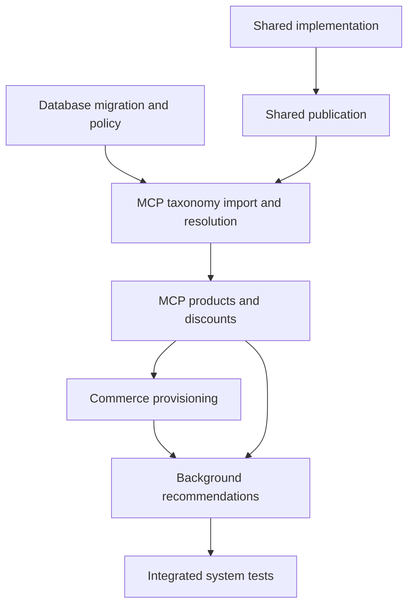

# ARCH-058: Standard CommerceAgent product discovery and discount recommendations

**Status:** task definitions for implementation; not implemented or deployed. 4 November 2026.

## Decision

Create eight repository-owned tasks to make product discovery a standard CommerceAgent capability. Use a global reference taxonomy in PostgreSQL/pgvector to interpret a product request, current merchant product reads to establish what the shop actually sells, and the canonical discount options/details flow to check promotions against the exact proposed purchase. Automatically create and publish the three standard product tools for every otherwise authorized store, including Free plans and new stores.

The required operator workflow is repeatable: migrate the database, import and activate the approved taxonomy generation, then publish the owned Commerce definitions/behavior/response fields. Admin's current Redis taxonomy implementation stays separate and intact.

Attempt 2 is prepared against the uploaded `moda-interact-workspace(20261104-035517).zip`. That snapshot already contains revision03's review and source-baseline evidence, byte-identical to the supporting files previously delivered. This patch preserves those files and adds only this architecture, the contracts and eight canonical task definitions. It replaces the rejected Attempt 1 task-definition patch; no earlier task-definition patch is required. The implementation task scope and contracts are unchanged. ARCH-057 is reserved for the separate Shopify application review, so this initiative uses ARCH-058. Existing architecture/task histories and decision indexes are unchanged.

## Source and governing documents

- [Source-grounded review, revision03](reviews/commerce-agent-product-discovery-20261104-015544-r03/review.md), including its evidence table and explicit unverified deployment assumptions.
- [Source-baseline hashes](reviews/commerce-agent-product-discovery-20261104-015544-r03/source-baseline.json).
- [Frozen interfaces and execution behavior](ARCH-058/contracts.md), normative for the tasks below.
- [Task definition and materialisation](../task-definition-materialization.md), [developer task workflow](../developer-task-workflow.md), [worktree isolation](../agent-worktree-isolation-policy.md), [VCS ownership](../agent-vcs-ownership-policy.md) and [Shared logging](../observability/shared-logging.md).

Snapshot facts are not claims about the user's current running environment. Accepted source must be reconciled at materialisation, especially accepted ARCH-052 discount work and concurrent Background/Shopify work. Do not reopen accepted task statuses just because the source snapshot exposes a missing or stubbed path.

## Tasks and deliverables

| Task | Repository | Main deliverable | Prerequisites | Initial status |
| --- | --- | --- | --- | --- |
| [DATABASE-001](../decisions/database/ARCH-058/DATABASE-001-persist-reference-taxonomy-and-core-product-discovery.md) | `moda-interact-database` | Forward taxonomy/schema migration, required `product_search` policy and targeted existing/future plan mappings; grant JSON guard update | None | ready |
| [SHARED-001](../decisions/shared/ARCH-058/SHARED-001-define-product-discovery-and-recommendation-contracts.md) | `moda-interact-shared` | Category/search schemas, built-in identities/grants, trusted conversation context, optional lookup outcome and recommendation selection contract; runner integration | None | ready |
| [SHARED-002](../decisions/shared/ARCH-058/SHARED-002-publish-product-discovery-contracts.md) | `moda-interact-shared` | Publish the accepted exact Shared package and verify registry artifact | SHARED-001 | pending |
| [MCP-001](../decisions/mcp/ARCH-058/MCP-001-import-and-resolve-postgresql-taxonomy.md) | `moda-interact-mcp` | Approved source manifest, repeatable importer, PostgreSQL category resolution and always-enabled feature eligibility | DATABASE-001, SHARED-002 | pending |
| [MCP-002](../decisions/mcp/ARCH-058/MCP-002-ground-merchant-products-and-discounts.md) | `moda-interact-mcp` | Current-shop category/product reads, provider pagination and currency correctness; canonical conversational discount execution and permission checks | MCP-001 | pending |
| [COMMERCE-001](../decisions/commerce/ARCH-058/COMMERCE-001-provision-standard-product-discovery.md) | `moda-interact-commerce` | Automatic creation/versioning/publication of three standard tools and owned behavior/response fields; one environment setup command | MCP-002 | pending |
| [BACKGROUND-001](../decisions/background/ARCH-058/BACKGROUND-001-ground-product-and-discount-recommendations.md) | `moda-interact-background` | Trusted context, grounded recommendations, independent alternative/purchase checks, final revalidation and localized host composition | MCP-002, COMMERCE-001 | pending |
| [SYSTEM-TEST-001](../decisions/system-test/ARCH-058/SYSTEM-TEST-001-validate-standard-product-discovery.md) | `moda-interact-system-test` | Integrated provision/restart/restore, all-store access, product/discount authorization, recommendation and failure-evidence tests | All seven preceding tasks | pending |

Shared implementation and Shared publication are deliberately separate because consumers must install a verified published package. Two MCP tasks separate corpus lifecycle/retrieval from merchant/provider/discount execution while keeping both with their existing repository owner. The setup wrapper belongs to Commerce, which already owns system-tool publication; no additional parent-workspace, Gateway or Admin implementation task is needed.

All task definitions use attempt 0, null executor/claim and the normal ready/pending states. They are **defined but not materialised**. Creating these documents does not create implementation worktrees, branches, a release, a database migration, a seed/import script or a deployed feature.

## Execution order

Database and Shared contract implementation can begin in parallel. Once Shared implementation is architect-accepted, publish the exact package. MCP taxonomy work begins after both the Database contract and Shared publication are complete. Then execute merchant product/discount integration, Commerce provisioning, Background recommendation integration and the integrated system tests.



The system-test task formally depends on every preceding task even though the diagram shows the final chain for readability. Each task returns to the architect for acceptance before its dependent frontier is promoted. Do not merge, publish or deploy merely because a task definition is marked ready.

## Product and discount behavior

For a request such as “I want a hammer,” the agent can call `commerce_resolve_product_categories` with the customer's intent. MCP embeds that text with the pinned reference embedding configuration and returns a bounded ranked set of real taxonomy IDs and full paths from a complete PostgreSQL generation. Those candidates establish product meaning. They do not establish that the current shop carries hammers.

The agent then calls `commerce_search_products` for the authenticated shop, using useful text and, where supported, a verified native category filter. Exact product reads confirm relevant product/variant identity, availability, price and currency when known. A taxonomy match without merchant products produces no stock claim. An ambiguous request can lead to a clarification; a temporarily unavailable optional taxonomy lookup can lead to ordinary merchant text search. Hard authorization, stale-turn and malformed-result errors retain their existing terminal behavior.

Shopify's reference IDs are not WooCommerce shop category IDs. Shopify category filtering uses the provider's documented products path; Woo filtering uses a native shop category and verifies exact assigned membership after bounded provider reads. The first increment does not introduce descendant expansion, arbitrary SQL, a merchant product mirror or a cross-platform guessed ID map.

When recommending a product, read the current merchant discount policy and use the accepted `commerce_get_discount_options`/`commerce_get_discount_details` flow. `NONE` produces no promotional lookup or claim. `FIXED` respects the current permitted selection/override. `AI_BEST_APPLICABLE` reads the permitted canonical catalogue. The host checks conditions for each proposed product, real variant or null Woo simple-product variant, explicit quantity, current purchase scope and known currency. Do not treat the three suggested alternatives as one qualifying basket.

The model selects observed IDs; it does not author trusted prices or calculate promotions. The host rechecks selected products and conditions in finalization and composes the full recommendation from validated data in the current conversation language. Unknown, stale, incomplete, unauthorized or unsupported conditions produce no asserted saving. Current observed facts are not a provider redemption guarantee. Existing admission, takeover, language, moderation and delivery processing stay in control.

## Durable taxonomy and operational setup

The new reference corpus is global per environment/source/language and lives in separate PostgreSQL tables with complete immutable generations, versioned source/checksum and embedding tuple. A validated candidate is prepared outside the final transaction. A per-corpus lock and embedding-configuration row lock protect atomic activation. Failed imports leave the old generation usable; exact reruns are no-ops; conflicting concurrent generations cannot overwrite one another silently. A runtime query pins one complete generation through embedding and retrieval. PostgreSQL restart and restore are integrated acceptance cases.

MCP reads the existing `REFERENCE_TAXONOMY` embedding configuration using the correct purpose/AAD. It does not update that shared configuration or operate Admin's Redis taxonomy index. The uploaded archive includes a pinned source manifest, not the corpus bytes or a verified checksum/count. Obtaining and validating those real bytes is an explicit MCP-001 work item; task definitions must not invent taxonomy IDs or counts.

The concrete implementation paths are:

| Deliverable | Task |
| --- | --- |
| `moda-interact-database/prisma/migrations/20261104120000_reference_taxonomy_and_core_product_discovery/migration.sql` | DATABASE-001 |
| Targeted canonical seed-policy alignment, without running the destructive broad seed against an existing environment | DATABASE-001 |
| `moda-interact-mcp/src/data/reference-taxonomy-manifest.json` | MCP-001 |
| `moda-interact-mcp/scripts/sync-reference-taxonomy.mjs` and `npm run taxonomy:sync` | MCP-001 |
| Extended `moda-interact-commerce/scripts/sync-system-commerce-tools.mjs` and existing `npm run commerce:sync-tools` | COMMERCE-001 |
| `moda-interact-commerce/scripts/setup-commerce-product-discovery.mjs` and `npm run commerce:setup-discovery` | COMMERCE-001 |

After these tasks are implemented and compatible runtime versions are available, an operator runs the following from the accepted Commerce checkout, supplying the actual workspace root:

```bash
npm run commerce:setup-discovery -- \
  --workspace-root="$MODA_WORKSPACE_ROOT" \
  --environment=test \
  --dry-run

npm run commerce:setup-discovery -- \
  --workspace-root="$MODA_WORKSPACE_ROOT" \
  --environment=test \
  --apply
```

These are future implementation commands; the scripts do not exist merely because this task bundle is applied. The wrapper validates the selected repository identities/environment, then invokes the Database migration path, MCP importer and Commerce publisher in order. An optional staged source file must match the approved manifest bytes. Production retains the existing explicit confirmation flag. Dry-run does not mutate state, publish, create audit entries or call the paid embedding API.

The wrapper emits a stage receipt, stops on failure, reports the completed stages, and can be rerun safely. Publication preserves unrelated release pins, feature prompts and response fields, uses ownership/content checks and a pointer compare-and-swap, and reports all three product tools. It does not silently migrate retained conversation grants. Use fresh pre-production test conversations or an explicitly reviewed transition after a compatible rollout.

## Important boundaries

The approved design uses the existing feature, selection, system publication, discount facts, logger and host mechanisms. It adds only the contracts and adapters needed to connect them. The database migration must account for the current JSON shape guard and release-membership insert trigger when introducing built-in grant entries; merely changing the TypeScript type would fail at persistence.

Original provider/SDK errors, messages and safe response details must survive through Shared structured logs with current redaction. Missing credentials, a provider error, invalid generated embeddings and a stale grant must be diagnosable without leaking secrets or customer data. Tests distinguish permitted optional lookup degradation from hard failures; a blanket empty-success catch is not acceptable.

No changes are planned to Admin taxonomy readers/scripts/UI/indexes, Redis availability for Admin, the existing discount policy model, cart/coupon mutations, prior migration files, accepted ARCH-052 histories, unrelated ARCH-053/055/056/057 work, or any `docs/decisions/**/_index.md`. New runtime files and log events use semantic names rather than architecture numbers.

## Acceptance and evidence

Individual tasks specify their repository tests and exact completion-report requirements. The integrated suite must demonstrate a clean and upgraded PostgreSQL17/pgvector setup, repeat execution, failed-stage recovery, restart/restore, atomic generation/configuration behavior, all-store capability availability, tenant/provider/category/cursor correctness, current policy and exact-purchase discount checks, full response grounding, supported-language composition and redacted original-error evidence. Tests exercise real adapters and schema guards with deterministic fixtures; they do not send customer messages.

An optional real-model evaluation separately measures semantic retrieval and clarification/relevance across the supported languages under a named model/corpus/budget. A scripted model or fixture transport cannot certify real-model semantic quality. Missing optional evaluation is explicitly NOT_RUN/BLOCKED, never reported as passed.

For this task-definition deliverable, validation consists of canonical task metadata/routes, complete dependency graph, matching enables, source-relative links, untouched original files/indexes, strict `git apply --check --whitespace=error-all`, applied `git diff --check`, and reverse-apply verification. No runtime, importer, migration or provider test is claimed until the corresponding implementation task executes.
