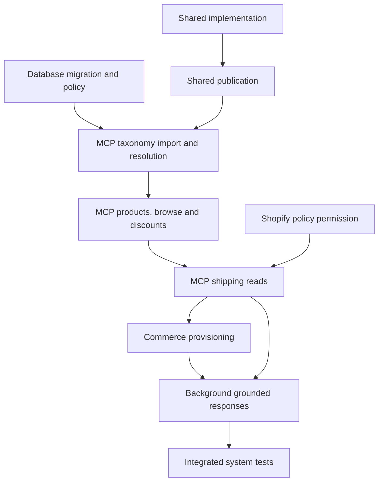

# ARCH-058: Standard CommerceAgent product discovery, grounded responses and shipping information

**Status:** implementation in progress; remaining task definitions corrected in Attempt 4 on 4 November 2026. Architecture-wide completion and deployment are not certified.

DATABASE-001, SHARED-001, SHARED-002 and SHOPIFY-001 are complete in the uploaded 094947 snapshot. Shared 4.0.0 / runner 1.1.0 is published and accepted; its immutable receipt is recorded. The user reports MCP-001 is under development, although the archived task still says ready/Attempt 0. This amendment preserves that task and its active work. MCP-002, MCP-003, COMMERCE-001, BACKGROUND-001 and SYSTEM-TEST-001 remain pending; their definitions now identify exact source changes and validation ownership.

The [implementation handoff](ARCH-058/implementation-handoff.md) and [execution baseline](ARCH-058/execution-baseline.json) record accepted pins, inspected source hashes and concrete integration prerequisites. This is a documentation correction, not a claim that remaining consumers are implemented or deployed.

## Decision

Create ten repository-owned tasks to make product discovery and basic native shipping information standard CommerceAgent capabilities, with explicit grounded fallback responses. Use a global reference taxonomy in PostgreSQL/pgvector to interpret a product request, current merchant product reads to establish what the shop actually sells, and the canonical discount options/details flow to check promotions against the exact proposed purchase. Automatically create and publish the four standard product/shipping tools for every otherwise authorized store, including Free plans and new stores.

The required operator workflow is repeatable: migrate the database, import and activate the approved taxonomy generation, then publish the owned Commerce definitions/behavior/response fields. Admin's current Redis taxonomy implementation stays separate and intact.

Attempt 4 is based on the exact uploaded `moda-interact-workspace(20261104-094947).zip`. It amends only five remaining task definitions plus their architecture/contracts/handoff evidence. The completed Database/Shared/Shopify records, MCP-001, existing review artifacts and all decision indexes remain byte-identical. Apply this correction directly to that snapshot state; do not apply an older replacement bundle first. If a remaining task has since been claimed, preserve its actual claim/history and reconcile the definition in its canonical parent task worktree. ARCH-057 remains the separate Shopify application initiative.

## Source and governing documents

- [Source-grounded review, revision03](reviews/commerce-agent-product-discovery-20261104-015544-r03/review.md), including its evidence table and explicit unverified deployment assumptions.
- [Source-baseline hashes](reviews/commerce-agent-product-discovery-20261104-015544-r03/source-baseline.json).
- [Frozen interfaces and execution behavior](ARCH-058/contracts.md), normative for the tasks below.
- [Remaining implementation handoff](ARCH-058/implementation-handoff.md) and [execution baseline](ARCH-058/execution-baseline.json), including exact accepted artifact identities and the observed accepted MCP catalogue/diagnostics integration gaps.
- [Task definition and materialisation](../task-definition-materialization.md), [developer task workflow](../developer-task-workflow.md), [worktree isolation](../agent-worktree-isolation-policy.md), [VCS ownership](../agent-vcs-ownership-policy.md) and [Shared logging](../observability/shared-logging.md).

Snapshot facts are not claims about the running environment. Consume the accepted artifacts listed in the handoff. In particular, the archive records ARCH-052-MCP-002 as complete but lacks its discount reader source; MCP-002 requires that accepted implementation in its prepared base before extending it. Do not recreate a catalogue or reopen an accepted task to compensate for an integration gap. Matching launcher preparation evidence is reused, not rediscovered.

## Tasks and deliverables

| Task | Repository | Main deliverable | Prerequisites | Current recorded state |
| --- | --- | --- | --- | --- |
| [DATABASE-001](../decisions/database/ARCH-058/DATABASE-001-persist-reference-taxonomy-and-core-product-discovery.md) | `moda-interact-database` | Forward taxonomy/schema migration, required `product_search` policy and targeted existing/future plan mappings; grant JSON guard update | None | complete |
| [SHARED-001](../decisions/shared/ARCH-058/SHARED-001-define-product-discovery-and-recommendation-contracts.md) | `moda-interact-shared` | Category/search/browse/shipping schemas, built-in identities/grants, trusted conversation context, optional lookup outcome and typed answer presentation; runner integration | None | complete |
| [SHARED-002](../decisions/shared/ARCH-058/SHARED-002-publish-product-discovery-contracts.md) | `moda-interact-shared` | Publish the accepted exact Shared package and verify registry artifact | SHARED-001 | complete |
| [MCP-001](../decisions/mcp/ARCH-058/MCP-001-import-and-resolve-postgresql-taxonomy.md) | `moda-interact-mcp` | Approved source manifest, repeatable importer, PostgreSQL category resolution and always-enabled feature eligibility | DATABASE-001, SHARED-002 | in progress per user; archived task ready |
| [MCP-002](../decisions/mcp/ARCH-058/MCP-002-ground-merchant-products-and-discounts.md) | `moda-interact-mcp` | Current-shop category/product/browse reads, visibility/pagination/currency correctness; canonical conversational discounts | MCP-001 | pending |
| [SHOPIFY-001](../decisions/shopify/ARCH-058/SHOPIFY-001-enable-shipping-policy-read-scope.md) | `moda-interact` | Add `read_legal_policies` to deployable app configurations, verify runtime SCOPES/actual grants and document rollout | None | complete |
| [MCP-003](../decisions/mcp/ARCH-058/MCP-003-read-merchant-shipping-information.md) | `moda-interact-mcp` | Fixed native shipping reads, paired offline scope preflight, normalized variant facts and bounded policy data | MCP-002, SHOPIFY-001 | pending |
| [COMMERCE-001](../decisions/commerce/ARCH-058/COMMERCE-001-provision-standard-product-discovery.md) | `moda-interact-commerce` | Automatic creation/versioning/publication of four standard tools and owned behavior/response fields; one environment setup command | MCP-002, MCP-003 | pending |
| [BACKGROUND-001](../decisions/background/ARCH-058/BACKGROUND-001-ground-product-and-discount-recommendations.md) | `moda-interact-background` | Trusted context, grounded recommendations and limitation responses, shipping presentation, final revalidation and localized host composition | MCP-002, MCP-003, COMMERCE-001 | pending |
| [SYSTEM-TEST-001](../decisions/system-test/ARCH-058/SYSTEM-TEST-001-validate-standard-product-discovery.md) | `moda-interact-system-test` | Integrated provision/restart/restore, all-store access, product/shipping/discount authorization, fallback composition and failure-evidence tests | All nine implementation/publication tasks | pending |

Shared implementation and Shared publication are deliberately separate because consumers must install a verified published package. Three MCP tasks separate corpus lifecycle/retrieval, merchant product/discount execution and the independently reviewable shipping reader with its distinct permission and absence semantics. The setup wrapper belongs to Commerce, which already owns system-tool publication; no additional parent-workspace, Gateway or Admin implementation task is needed.

The five amended pending definitions retain attempt 0, null executor/claim and their existing dependency metadata. Completed records retain accepted attempts and reports. No task branch, implementation worktree, claim, commit, package publication or environment import is created by this patch. The new handoff clarifies the remaining work without resetting accepted or active execution state.

## Execution order

Finish and review the active MCP-001 work, consuming the already accepted Database and published Shared artifacts. Then execute MCP-002 after its accepted discount source is integrated; follow with MCP-003, COMMERCE-001 and BACKGROUND-001. Shopify permission setup is already complete, but actual installation grants remain a runtime check. SYSTEM-TEST-001 is invoked by the developer after all nine prerequisites are complete. The graph includes completed prerequisites for traceability; it is not an instruction to repeat them.



The system-test task formally depends on every preceding task even though the diagram shows the final chain for readability. Each task returns to the architect for acceptance before its dependent frontier is promoted. Do not merge, publish or deploy merely because a task definition is marked ready.

## Product and discount behavior

For a request such as “I want a hammer,” the agent can call `commerce_resolve_product_categories` with the customer's intent. MCP embeds that text with the pinned reference embedding configuration and returns a bounded ranked set of real taxonomy IDs and full paths from a complete PostgreSQL generation. Those candidates establish product meaning. They do not establish that the current shop carries hammers.

The agent then calls `commerce_search_products` for the authenticated shop, using useful text and, where supported, a verified native category filter. Exact product reads confirm relevant product/variant identity, availability, price and currency when known. A taxonomy match without merchant products produces no stock claim. An ambiguous request can lead to a clarification; a temporarily unavailable optional taxonomy lookup can lead to ordinary merchant text search. Hard authorization, stale-turn and malformed-result errors retain their existing terminal behavior.

Shopify's reference IDs are not WooCommerce shop category IDs. Shopify category filtering uses the provider's documented products path; Woo filtering uses a native shop category and verifies exact assigned membership after bounded provider reads. The first increment does not introduce descendant expansion, arbitrary SQL, a merchant product mirror or a cross-platform guessed ID map.

When recommending a product, read the current merchant discount policy and use the accepted `commerce_get_discount_options`/`commerce_get_discount_details` flow. `NONE` produces no promotional lookup or claim. `FIXED` respects the current permitted selection/override. `AI_BEST_APPLICABLE` reads the permitted canonical catalogue. The host checks conditions for each proposed product, real variant or null Woo simple-product variant, explicit quantity, current purchase scope and known currency. Do not treat the three suggested alternatives as one qualifying basket.

The model selects observed IDs; it does not author trusted prices or calculate promotions. The host rechecks selected products and conditions in finalization and composes the full recommendation from validated data in the current conversation language. Unknown, stale, incomplete, unauthorized or unsupported conditions produce no asserted saving. Current observed facts are not a provider redemption guarantee. Existing admission, takeover, language, moderation and delivery processing stay in control.

## Response behavior and shipping information

The agreed customer behavior is a truthful limitation followed by useful merchant information. An unrelated question such as weather receives a concise store-scope response plus at most one verified product and any currently permitted applicable promotion. With no supported promotion, show the product without asserting that the merchant has no discounts. With no verified product, show the verified store link. Product context comes from the customer's conversation, refreshed owned basket or explicit bounded catalogue browse; an unrelated place name never becomes a shipping destination. Do not call a suggestion similar, featured or a bestseller without the relevant evidence.

A shipping knowledge gap first uses the relevant authorized sources when available. Existing Merchant Knowledge remains optional and separately entitled. The new native reader can obtain Shopify's published shipping policy and basic provider product/variant attributes without requiring the merchant to upload a knowledge document. Woo's first increment reads product attributes; native general policy is explicitly unsupported, with existing approved Merchant Knowledge remaining available when granted. Do not guess WordPress page slugs or introduce an extra knowledge configuration UI.

Shipping metadata, written policy and basket/destination-specific quotes are different sources. This increment introduces no live quote, cart creation/update, zones-based price reconstruction or promised ETA. Unknown Woo measurement units and variant shipping requirements remain unknown. A similar product does not resolve an unknown delivery cost or time. Future quote work is captured in [the separate design follow-up](ARCH-058/shipping-quote-follow-up.md), which is not an executable repository task or an ARCH-058 acceptance dependency.

The response contract adds a bounded disposition within ordinary `ANSWER` details: STANDARD, OUT_OF_SCOPE_REDIRECT or SHIPPING_INFORMATION_UNVERIFIED. It leaves the terminal REFER_TO_STORE envelope intact. Background latches controlled composition when recommendation/product/discount work, product-bearing shipping reads or owned presentation fields are involved; omitted details cannot bypass the validator. The model selects observed identifiers. Background composes the fixed limitation, source link, validated product/offer and link using the current language and whole wrapped-message limit. Positive shipping-plus-product messages use only the typed shipping requirement and verified policy link; raw model policy summaries are not concatenated to a validated recommendation. Ordinary policy-only grounded answers retain the existing non-recommendation path. Contracts sections 2.3 and 5.1 are normative.

The four published tools are commerce_resolve_product_categories, commerce_search_products, commerce_get_product and commerce_get_shipping_information. Search gains an explicit browse flag with bounded visibility checks and mode-bound cursors. Get/search product outputs stay unchanged; shipping has its own typed output and fixed operation. Commerce publishes the corresponding nonempty owned response instructions and verifies all four tools in receipts and repeat runs.

Shopify's read_legal_policies permission is declared by its owning application task. MCP reads actual persisted offline scope with the corresponding token and checks before requesting policy data. Missing policy scope is an expected tool-data result; an attempted query's authentication/provider failure is an error. Declaring or publishing the feature never creates a merchant's permission. Product reads keep their existing read_products access. Existing Session.scope is sufficient; shipping adds no database migration or policy mirror.

## Durable taxonomy and operational setup

The new reference corpus is global per environment/source/language and lives in separate PostgreSQL tables with complete immutable generations, versioned source/checksum and embedding tuple. A validated candidate is prepared outside the final transaction. A per-corpus lock and embedding-configuration row lock protect atomic activation. Failed imports leave the old generation usable; exact reruns are no-ops; conflicting concurrent generations cannot overwrite one another silently. A runtime query pins one complete generation through embedding and retrieval. PostgreSQL restart and restore are integrated acceptance cases.

MCP reads the existing `REFERENCE_TAXONOMY` embedding configuration using the correct purpose/AAD. It does not update that configuration or operate Admin's Redis index. The archived Admin manifest/pipeline and the user-reported MCP-001 source check are recorded separately in the handoff. Remaining tasks reuse MCP-001's accepted manifest/CLI/verified asset and never open a second release-selection/importer task. A supplied local file must match the accepted distribution-byte checksum; compressed and derived files are not interchangeable.

The concrete implementation paths are:

| Deliverable | Task |
| --- | --- |
| `moda-interact-database/prisma/migrations/20261104120000_reference_taxonomy_and_core_product_discovery/migration.sql` | DATABASE-001 |
| Targeted canonical seed-policy alignment, without running the destructive broad seed against an existing environment | DATABASE-001 |
| `moda-interact-mcp/src/data/reference-taxonomy-manifest.json` | MCP-001 |
| `moda-interact-mcp/scripts/sync-reference-taxonomy.mjs` and `npm run taxonomy:sync` | MCP-001 |
| Extended `moda-interact-commerce/scripts/sync-system-commerce-tools.mjs` and existing `npm run commerce:sync-tools` | COMMERCE-001 |
| `moda-interact-commerce/scripts/setup-commerce-product-discovery.mjs` and `npm run commerce:setup-discovery` | COMMERCE-001 |

After these tasks are implemented and compatible runtime versions are available, an operator runs the following from the accepted Commerce checkout, supplying the actual workspace root:

```bash
npm run commerce:setup-discovery -- \
  --workspace-root="$MODA_WORKSPACE_ROOT" \
  --environment=test \
  --dry-run

npm run commerce:setup-discovery -- \
  --workspace-root="$MODA_WORKSPACE_ROOT" \
  --environment=test \
  --apply
```

These are future implementation commands; the scripts do not exist merely because this task bundle is applied. The wrapper validates the selected repository identities/environment, then invokes the exact Database migration command, accepted MCP importer and Commerce publisher in order. A schema-empty target defers configuration/actor checks until after migration; missing prerequisites produce explicit partial-failure receipts, and the same command resumes after the existing configuration workflow supplies them. An optional staged source file must match the approved manifest bytes. Production retains the existing explicit confirmation flag. Dry-run does not mutate state, publish, create audit entries or call the paid embedding API.

The wrapper emits a stage receipt, stops on failure, reports the completed stages, and can be rerun safely. Publication preserves unrelated release pins, feature prompts and response fields, uses ownership/content checks and a pointer compare-and-swap, and reports all four standard tools. It does not silently migrate retained conversation grants. Use fresh pre-production test conversations or an explicitly reviewed transition after a compatible rollout.

## Important boundaries

The approved design uses the existing feature, selection, system publication, discount facts, logger and host mechanisms. It adds only the contracts and adapters needed to connect them. The database migration must account for the current JSON shape guard and release-membership insert trigger when introducing built-in grant entries; merely changing the TypeScript type would fail at persistence.

Original provider/SDK errors, messages and safe response details must survive through Shared structured logs with current redaction. Missing credentials, a provider error, invalid generated embeddings and a stale grant must be diagnosable without leaking secrets or customer data. Tests distinguish permitted optional lookup degradation from hard failures; a blanket empty-success catch is not acceptable.

No changes are planned to Admin taxonomy readers/scripts/UI/indexes, Redis availability for Admin, the existing discount policy model, cart/coupon mutations, prior migration files, accepted ARCH-052 histories, unrelated ARCH-053/055/056/057 work, or any `docs/decisions/**/_index.md`. New runtime files and log events use semantic names rather than architecture numbers.

## Acceptance and evidence

Individual tasks specify their repository tests and exact completion-report requirements. The integrated suite must demonstrate a clean and upgraded PostgreSQL17/pgvector setup, repeat execution, failed-stage recovery, restart/restore, atomic generation/configuration behavior, all-store capability availability, tenant/provider/category/cursor correctness, current policy and exact-purchase discount checks, full controlled-response grounding, shipping policy/variant/permission semantics, unsupported-question fallback, supported-language composition, whole-wrapper bounds and redacted original-error evidence. Tests exercise real adapters and schema guards with deterministic fixtures; they do not send customer messages.

An optional real-model evaluation separately measures semantic retrieval and clarification/relevance across the supported languages under a named model/corpus/budget. A scripted model or fixture transport cannot certify real-model semantic quality. Missing optional evaluation is explicitly NOT_RUN/BLOCKED, never reported as passed.

For Attempt 4, validation consists of canonical task metadata/routes, the dependency graph, source-relative links, byte-identical completed/active task records and implementation files, unchanged indexes, strict `git apply --check --whitespace=error-all`, applied `git diff --check` and reverse-apply verification against a fresh exact 094947 archive extraction. New runtime validation is not claimed. Each remaining task separates fast agent checks from exact developer-owned long commands under the existing validation policy; pending evidence is not a pass.

## Attempt 3 definition review

Reviewed design changes: the existing hard-referral path discards product details; search previously required a query/category; product outputs omit shipping facts; Shopify policy permission is absent from deployable app scopes; MCP's session reader currently projects token without scope; and Woo product projections omit shipping fields/measurement units. The tasks now assign each gap to an existing repository owner with explicit producer/consumer contracts. Scope checks reuse existing offline Session storage and generic authenticated scope persistence. No additional Database, Admin, API, Gateway or Messaging task is needed for the defined first increment. Concurrent ARCH-057 scope/session changes must be reconciled at materialisation, without reopening or duplicating their implementation.

Primary provider references: [Shopify Admin ShopPolicy](https://shopify.dev/docs/api/admin-graphql/2026-07/objects/ShopPolicy), [InventoryItem](https://shopify.dev/docs/api/admin-graphql/2026-07/objects/InventoryItem), [Woo products](https://developer.woocommerce.com/docs/apis/rest-api/v3/products/) and [Woo variations](https://developer.woocommerce.com/docs/apis/rest-api/v3/product-variations/). Native policy absence is not a shipping quote. This review is static against the uploaded source, not proof of installed permissions, provider execution or deployed behavior.

## Attempt 4 remaining-task review

The review corrected concrete implementation gaps: stale release selection; missing accepted discount source integration; category/browse pagination and private Woo allowlists; execution-time conversation context; paired shipping permission reads; publication changes to owned response instructions; fresh-schema setup prerequisites and stdout receipts; actual Background prompt/policy/basket projections; one shared finalization budget; host test discovery; and SystemTest fixtures that would overwrite the real published release. Each is assigned to one of the five existing pending owners with exact touchpoints, outcomes and commands in its task. No additional Database, Shared, Admin or taxonomy redesign is introduced.

Natural-language intent and relevance remain model behavior. Trusted feature instructions direct bounded discovery and discount checks; the host validates selections, source facts, current policy and output. Missing or invalid selections produce the verified store-link fallback. Scripted integration fixtures demonstrate this control flow and the deterministic host guarantees, not real-model semantic quality or live merchant deployment.
