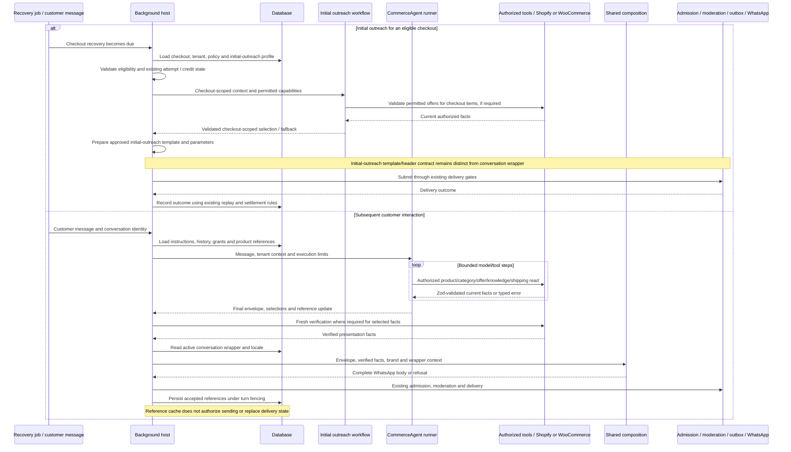

# ARCH-066 — Background and Commerce Studio sequence diagrams

Status: intended flow after implementation, not a statement that these changes are deployed. Read with [ARCH-066](ARCH-066-conversation-product-context-and-whatsapp-preview-parity.md).

There are two distinct execution purposes. Initial outreach concerns the selected checkout and its items only; subsequent CommerceAgent turns answer customer messages using authorized current-shop information. Neither assumes a merchandise type. Current initial-outreach code includes checkout offer selection/revalidation; “checkout only” limits the product scope, not the ability to validate an offer against current authorized data.

## 1. Background



Existing initial-outreach touch points include `src/services/recovery-template-integration/automated-recovery-template.service.ts`, `src/services/recovery-offers/initial-outreach-offer-selection.service.ts`, `initial-outreach-agent-context.service.ts`, `current-outreach-offer-revalidation.service.ts` and `src/agents/initial-outreach-offer.*` in Background. The diagram groups existing delivery gates; it does not reorder their internal transactions.

## 2. Commerce Studio

```mermaid
sequenceDiagram
    participant Staff as Authorized Studio user
    participant Studio as Commerce Studio host
    participant DB as Configuration / checkout reader
    participant Outreach as Initial outreach preview
    participant Agent as Shared CommerceAgent runner
    participant Tools as Read-only authorized tools
    participant Compose as Shared presentation / template rendering
    participant Redis as Preview state

    Staff->>Studio: Select shop and test purpose
    Studio->>Studio: Check role and tenant access
    alt Initial outreach test (Super Admin)
        Staff->>Studio: Select same-shop checkout or explicit synthetic checkout fixture
        Studio->>DB: Read checkout input and pinned outreach profile/template
        Studio->>Studio: Validate checkout identity, required fields and product scope
        Studio->>Outreach: Checkout-only product context and permitted offer checks
        Outreach->>Tools: Current read-only offer verification when required
        Tools-->>Outreach: Validated facts / typed failure
        Outreach-->>Studio: Outreach selection / fallback and diagnostics
        Studio->>Compose: Initial-outreach template, header and parameter inputs
        Compose-->>Studio: Rendered initial message or precise refusal
        Studio->>Redis: Store preview input provenance, result and tool activity
        Studio-->>Staff: Initial message, template parameters, header and diagnostics
        Note over Studio,Redis: No recovery creation, credit reservation, registration, outbox or WhatsApp send
    else Subsequent interaction test
        Staff->>Studio: Select conversational features and execution limits
        Studio->>Redis: Create preview with separate product-reference context
        Staff->>Studio: Send customer test message
        Studio->>Agent: Instructions, history, references and limits
        loop Bounded model/tool steps
            Agent->>Tools: Read selected shop through chosen execution mode
            Tools-->>Agent: Zod-validated facts or typed error
        end
        Agent-->>Studio: Final envelope, selections and reference update
        Studio->>Tools: Same required presentation fact verification
        Tools-->>Studio: Verified presentation facts
        Studio->>DB: Read pinned active conversation wrapper and locale
        Studio->>Compose: Same composition inputs as Background, labelled preview context
        Compose-->>Studio: Final WhatsApp body or refusal
        Studio->>Redis: Fenced history, references, body and tool activity
        Studio-->>Staff: Final body; expandable agent output and tool activity
    end
    Note over Studio,Compose: Same explicit facts and template/context inputs must produce identical text to Background
```

## Implementation coverage

Initial outreach preview is now defined by ARCH-066-SHARED-004, BACKGROUND-002, COMMERCE-002 and SYSTEM-TEST-002. The initial preview source is an existing same-shop CheckoutRecovery; synthetic checkout entry is deferred. Every checkout product/variant is read live, including when no offer is configured. Checkout quantities and historical prices remain separate from current product facts. The preview never searches for unrelated products or creates a recovery attempt. These definitions supersede the earlier checkout-preview exclusion; implementation has not started.

Both branches require parity tests on Shopify and WooCommerce. Meta registration, approval and real delivery remain separate from read-only Studio preview.
