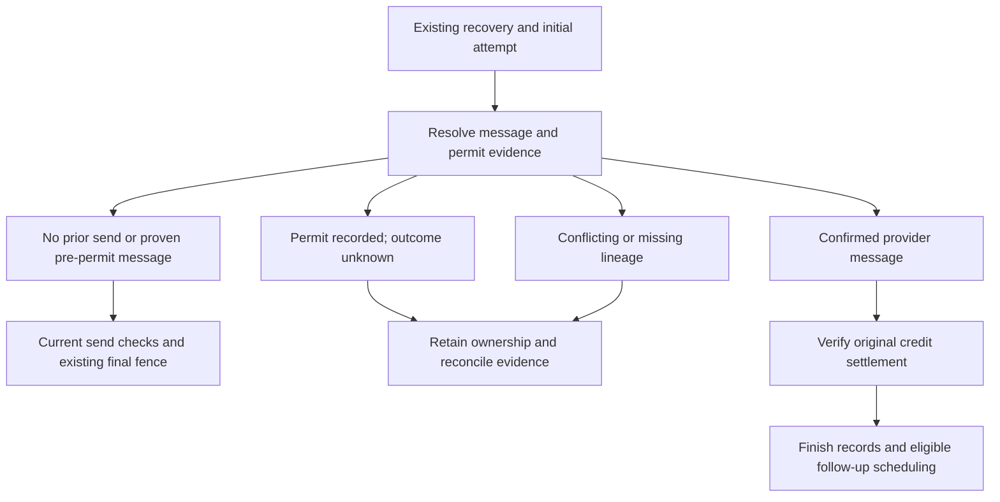

# Background database deep dive — focused correction contracts

Date: 3 November 2026. Phase 3 follows the updated-snapshot reassessment. This is an architectural review and correction specification, not an implementation acceptance.

## Result

**The updated snapshot supports two narrow corrections and one linked recovery-lifecycle correction.** Reconcile the API's Database dependency; move the existing inbound conversation lock before the message insert; and repair initial-outreach continuation as one persisted-state protocol. Changing only the fallback lookup would leave several failure states stranded and could make retry unsafe if provider or billing evidence were ignored.

The additional billing trace establishes a specific acceptance condition: a fulfilled reservation `commit()` call is not sufficient proof of settlement. The common transition helper can return `already-ambiguous` or `already-released`, and the higher-level lifecycle wrapper currently discards that result. Confirmed-send reconciliation must positively establish settlement of the original credit source before declaring finalization complete.

| Reference | Conclusion from this phase | Smallest supported correction | Closure boundary |
|---|---|---|---|
| U1 — API dependency | Current API source consumes two ARCH-055 fields absent from its own generation schema; exactly three migrations are also absent | Resolve real gitlink versus materialized-checkout state, synchronize the accepted dependency and regenerate through normal API commands | Source audit is complete; normal build and migration-backed integration remain unexecuted |
| U3 — text ingress locks | Child INSERT takes an FK parent key-share lock before the helper asks for parent `FOR UPDATE`; two same-conversation arrivals can form an upgrade cycle | Call the existing locked pending-turn helper before `ConversationMessage.create`, inside the same transaction | No new call sites; successful distinct-message count unchanged; real PostgreSQL reproduction and regression test still required |
| U2 — fallback identity | The fallback searches a usage idempotency key in the provider-dispatch-key column; its linked-message branch is unreachable after its own guard | Resolve usage-to-message identity once at the initial-outreach progress owner, with permit and ownership fields | A string substitution alone does not close recovery progress |
| C3 — recovery continuation | Normal candidate retry skips existing `DETECTED` work; late message inspection and preparation gates obstruct partial finalization | Route actual retries through persisted-state classification before new-send preparation/admission; reuse existing delivery and finalization owners | Exact billing lineage, positive settlement, failed-message history and finite retry ownership are required |

No application code, existing migration, dependency pointer, architecture/task status or task index is changed by this review. The patch adds a separate review directory and can apply to the original updated archive without the earlier review patch. The earlier ARCH-028 acceptance artifact is not regenerated, relabelled or accepted by this analysis.

## Evidence and scope

The reviewed archive is `moda-interact-workspace(20261103-212722).zip`, SHA-256:

```text
f8194947c3564a8f9ea8942d9462ec83716aecc17fc1626d7d846af68c044024
```

The analysis uses that archive's application files and the supplied architect role. Prior review documents added alongside the extraction are not treated as original application evidence. The archive provides source and historical task records, but no usable Git history for independently verifying current pins, remote branches or merge ancestry. No deployment state is inferred.

The phase is deliberately focused on U1, U2, U3 and C3, with necessary links to MSG-03, BS-05 and O7. It does not replace the previous whole-Background finding register or reclassify untouched findings. The updated-snapshot inventory remains 1,197 explicit source-level database operation/boundary sites across 488 TypeScript files; that earlier lexical inventory is not an executed query count, and it has not been recomputed or presented as a new change here.

Detailed evidence is in:

- [API dependency and ARCH-055 integration](schema-integration.md).
- [Ingress lock order and reproduction](ingress-lock.md).
- [Initial recovery progress, state matrix and query decisions](recovery-progress.md).
- [Validation and owner handoff](validation-and-handoff.md).
- [Patch application, commit and push protocol](apply-review.md).
- [Read-only schema audit output](schema-integration-evidence.json) and [reusable audit](audit-schema-integration.py).

## 1. U1: repair the dependency used by the real build

Canonical Database, Background, Shopify and Admin have byte-identical 130-model schemas and 71 SQL migrations plus the migration lock file. API has the same model count but lacks `MerchantConversationSendCommand.followUpClaimKey`, `MerchantKnowledgeUploadedAsset.intentPurposeKey` and the three ARCH-055 migrations. Every common migration file is identical. Removing precisely those two field lines from canonical produces API's schema byte for byte.

This is an observed source/dependency incompatibility, not an observed compiler diagnostic. The current API uses the missing fields in typed command creation and upload read/create/select paths. Both `npm run typecheck` and `npm run build` first generate Prisma from API's own `database/prisma/schema.prisma`. Generating a client elsewhere would be overwritten by the normal command.

The existing ARCH-047 schema selector was executed as a read-only probe. It chooses the stale API copy by default because its predicate establishes the older ARCH-047 contract. An explicit canonical override can change the human-send test's migration source, while that test still generates the API client from the nested API schema. This makes the override insufficient as a U1 correction; it is not evidence that the older helper claimed to validate ARCH-055.

The actual Git checkout must distinguish two cases. If the recorded gitlink already names the accepted tree, materialize that recorded dependency correctly. If the recorded gitlink is old, the API owner advances its own dependency through the existing task/integration process. The ZIP cannot decide which case applies. Historical documents name an accepted implementation revision and a later merged tree-equivalent revision; those statements do not authorize guessing the current pin or selecting an unmerged task revision.

All three migrations are necessary. They establish REST-read failure terminalization, historical human-follow-up claim identity and original-upload-intake uniqueness. Hand-adding the two Prisma fields would omit the database behavior and backfills. Current API and Shopify producers agree with Background's stored-key contract; no additional field-format fix was found. Historical command keys must remain their stored values, even where they differ from current command IDs.

The existing coordinated rollout remains Database, compatible Background, then both compatible producers under the documented quiescence and preflights. A nullable field and one-time backfill do not protect a new command written by an old producer after migration. Source synchronization alone therefore cannot establish release readiness. The appendix gives the owning tasks' normal generation, migration, API, Background and Shopify validation commands and keeps terminal cross-platform validation with the existing system-test task.

## 2. U3: keep the stronger lock and acquire it first

The new helper correctly makes the pending-turn decision from locked current Conversation state, addressing the earlier stale-snapshot decision. The surrounding text-ingress ordering introduces a different concurrency risk:

| Current receive order | Proposed receive order |
|---|---|
| Pre-transaction duplicate-provider-message lookup | Pre-transaction duplicate-provider-message lookup |
| Insert inbound ConversationMessage; immediate FK check acquires parent key-share lock | Existing `recordProcessableInbound` helper locks Conversation `FOR UPDATE`, then applies current pending-turn/version changes |
| Call helper; request parent `FOR UPDATE` | Insert the inbound ConversationMessage in the same transaction |
| Remaining language and clock updates | Same remaining updates and existing transaction boundary |
| Commit | Commit |
| Post-commit outreach engagement update | Same post-commit outreach engagement update |

Two transactions may insert different messages for the same parent, each retaining compatible key-share locks. Each then requests an exclusive row lock that conflicts with the other's retained key-share lock. The resulting wait cycle is supported by PostgreSQL 17's documented row-lock rules and the immediate FK-check implementation. This is a static mechanism finding; no PostgreSQL engine was available here to demonstrate an observed deadlock.

Moving the existing helper is preferable to changing the lock mode in this narrow correction. It preserves the helper's serialization contract, retains the same direct call count for successful distinct-message receives, and aligns with audio completion and existing final-admission paths. A concurrent duplicate loser will now execute the helper before its INSERT fails, so that failed path can do more rolled-back work; there is no universal zero-query-delta claim across failure paths. It adds no Shop lock: this ingress path does not acquire Shop after Conversation, so the wider Shop-first send order does not require manufacturing a new ingress lock.

Two correctness conditions accompany the reorder. First, a duplicate unique-key failure after the helper must roll back the entire transaction, including the version increment and pending state; catching it inside a transaction and committing the earlier work would be wrong. Second, future pending-turn deadlines, current control revision, existing processing claims and concurrent inbound changes must retain their current semantics.

The narrow correction does not solve the older language race: `resolvedLanguage` can still be computed from an earlier unlocked snapshot and written after another transaction's update. It also does not establish universal lock ordering. `markSent` currently writes a message before updating its parent Conversation, whereas send-fence work takes the parent first. The appendix records that as a separate static audit lead requiring a concrete concurrency test, not an additional reproduced production defect or a reason to expand U3 without evidence.

The supplied [PostgreSQL 17 protocol](u3-postgres17-reproduction.md) and [SQL fixture](u3-postgres17-setup.sql) have an explicit two-session barrier, a current-order deadlock case, a parent-first control and a duplicate rollback case. This is a minimal mechanism test, not an application regression suite, and is clearly marked unexecuted. The application's actual migrations, triggers and transaction behavior remain part of the implementation gate.

## 3. U2 and C3: classify durable progress before planning another send

The three identities must remain distinct:

| Identity | Location and purpose |
|---|---|
| `recovery-outreach:<attemptId>` | Hard-limit `UsageEvent.idempotencyKey`; its `sourceId` identifies the canonical outbound message |
| `arch040-auto-<sha256(messageId)>` | Shopify final provider-dispatch permit on the message |
| `arch046-woo-initial-<sha256(shopId + NUL + attemptId)>` | Woo initial-outreach permit, scoped to its shop/attempt |

The new no-offer fallback searches the first value in the provider-permit column. It also rejects every attempt with `outboundMessageId` before the code that would read that linked message. Both observations are definite source findings. Existing downstream uniqueness and admission guards mean this defect is not, by itself, proof of a duplicate provider send.

The normal Shopify worker invokes materialization. On retry, an existing `DETECTED`, `MESSAGE_SENT` or `ENGAGED` recovery ordinarily returns `no-op-existing`; only a narrow suppression retry flag changes that behavior. Thus the first execution can fail after a durable write, while the next succeeds without finishing that write's lifecycle. Direct initiation is not an adequate workaround: it reaches template preparation and current billing admission before its late existing-message check. Partially finalized attempts can be rejected by the no-offer preparer before reconciliation begins.

The existing candidate/initiation owner should instead make one early persisted-progress decision. The canonical admission lookup already supplies the usage-to-message route. Extend its narrow projection with permit evidence, provider receipt and tenant/usage/source ownership, and corroborate any existing attempt link. Do not create a competing fallback-specific identity algorithm.



The diagram's confirmed branch may stop at an explicit settlement conflict. It does not promise automatic resolution of missing provider receipts, ambiguous credit lineage or historical billing-policy restrictions.

| Durable state | Required behavior |
|---|---|
| No canonical message, intact unsent lineage | Continue the same generation and sequence-one attempt after current send eligibility; absence must be corroborated, because generic failed-message cleanup can remove the usage link |
| `PENDING` message, both permit fields null | Resume the same message and hard-limit usage through existing preparation/delivery and the final permit CAS; ordinary `sendTemplate` currently returns duplicate before reaching delivery |
| Either permit field present, no confirmed/definitive outcome | Hold uncertainty; do not release credit or send another HTTP request merely because a timeout, age or attempt `FAILED` flag exists |
| Durable definitive failure | Finish exact compensation and retain failed-message/attempt lineage; use the existing 131026 recipient-suppression owner where applicable |
| `SENT`, `DELIVERED` or `READ`, valid `sentAt` and ownership | Skip offer/template preparation and new-send admission; settle the original credit and replay existing finalization without another provider call |
| Support/attempt committed, recovery still `DETECTED` | Reuse the exact receipt and atomic finalizer, then converge recovery status without overwriting a newer terminal/engaged state |
| Recovery sent, follow-up publication failed | Reuse the persisted due date and deterministic queue identity through existing scheduling reconciliation |

Permit and receipt evidence outrank the attempt's current status. In this source, provider HTTP and the local `markSent` transaction share a `try` block. A local database failure after successful HTTP can leave an admitted `PENDING` message without a stored provider ID. Billing may become `AMBIGUOUS`, while Shopify unconditionally marks the attempt `FAILED`. That flag is not proof of rejection. Correlated provider evidence is needed; a missing provider-ID link also limits what an ordinary webhook can repair.

Same-message resumption additionally depends on safe cleanup. `failPrepared` currently marks the message failed and deletes usage in separate writes, without a permit predicate. The correction must claim cleanup with a conditional write on a still-PENDING message whose two permit fields are null, and couple usage deletion to that winning claim. Zero affected rows require reclassification, not an unconditional fallback. A prior unlocked read is insufficient. This prevents stale cleanup from invalidating another execution's admitted/confirmed message; historical FAILED-plus-usage residue needs its own guarded reconciliation. This is a correction constraint coupled to MSG-03, not a claim that a particular race was reproduced here.

## 4. Billing settlement is an explicit dependency of progress

The hard-limit outbound UsageEvent and the recovery-credit reservation are different accounting records. A restart must recover the actual credit source, not run current admission and assume it chooses the historical source. Paid keys include the billing period; policy or available credit kind may change between the provider send and finalization.

The existing delivery-compensation lineage resolver provides useful invariants: derive the attempt from usage and/or the message link, verify tenant/recovery/sequence ownership, find the logical or period-prefixed reservation, require a unique result, and verify its owner relations. It intentionally fails when missing or multiple candidates prevent proof. Historical RELEASED plus current reservations can therefore trigger the already tracked BS-05 ambiguity. Filtering or selecting a newest row without a demonstrated ownership rule is not a correction.

Positive settlement has three distinct cases:

1. **Exact source already COMMITTED:** replay without another debit, verifying the expected reservation and committed event.
2. **Exact source still RESERVED:** use its owning settlement operation and require a committed result. Paid included settlement currently requires that source's period to remain current and open. A confirmed old send can therefore remain blocked after period rollover.
3. **Source AMBIGUOUS, RELEASED, missing or conflicting:** retain a visible reconciliation conflict. The shared transition helper treats commit from a non-RESERVED status as a replay result; AMBIGUOUS does not become COMMITTED automatically. The lifecycle wrapper currently discards the result. A promise resolving is not sufficient acceptance evidence.

An approved historical-settlement rule or stronger persisted source binding may eventually be required for complete automatic repair. This review does not invent either a migration or a new billing rule. It specifies the proven safe path and the cases that must remain unresolved, with retained ownership and structured evidence. Closing C3 universally would require those cases to have an explicit owner and tested resolution contract.

After settlement is proven, reuse the current finalization sequence: exact credit, atomic attempt plus optional Support notice, conditional recovery-status update, and follow-up scheduling from persisted state. The Support notice's deterministic identity and opt-out replay behavior must survive. An already-finalized attempt's stored `followUpDueAt` must also survive, including null: the current nullish fallback can derive a new date from changed policy and conflict with the finalizer's exact replay check. Current consent/order/expiry guards continue to prohibit a new send; they must not erase or prevent accounting for a send that is already confirmed.

## 5. Reduce repeated work only after preserving these boundaries

This phase identifies concrete local opportunities without claiming runtime performance gains:

| Path | Database work to preserve | Candidate simplification |
|---|---|---|
| U3 ingress | Existing parent lock, current-state decision, atomic message/state writes | Reorder existing call sites; successful distinct-message count unchanged; failed-insert work can increase |
| Normal no-offer preparation | Valid recovery/attempt identity, current lifetime and template binding | Reuse adjacent recovery/lifetime projections; current facade plus fallback uses six direct calls before delegated preparation, versus four within fallback alone |
| Existing admission | Usage-to-message identity, permit and ownership classification | Add selected columns to the existing two-read path; avoid a second independent message probe |
| Confirmed replay | Exact credit settlement, finalizer locks/CAS, recovery update and scheduling read | Skip new offer/AI/MCP/template preparation and new admission |
| Support replay | Existing lock and exact message/sentAt/due validation | Preserve its three-operation replay path; an unlocked notice-existence check is insufficient |
| `markSent` | Atomic receipt and conversation timestamp persistence | Verified conversation ID may remove its reread, but assess the separate lock-order lead before combining changes |

These are bounded source-call counts. They exclude relation-expansion SQL, trigger work, transaction control, retries and delegated operations unless explicitly included. No latency, QPS, contention rate, cost reduction or query plan was measured.

Finite retry is another boundary. The candidate queue has three attempts and retains failed jobs, but the current no-op can falsely complete partial work. Correct that route first. Exhausted retries, a lost future follow-up job and a business block with no later event do not acquire automatic progress merely because the underlying SQL is durable. Reuse the same progress entry for explicit failed-job repair; any recurring discovery owner must be separately specified before claiming eventual completion. A new queue/outbox/table is not justified merely to bypass this analysis.

## Verification and disposition

The actual checks are the dependency audit, execution of the existing built-in-only schema selector, source/call/lock/identity tracing, and documentation-package validation recorded with the delivery. The PostgreSQL mechanism protocol is syntax/structure reviewed only. Application dependencies and PostgreSQL/container tools were absent; Prisma generation, compilation, migrations, application tests, provider calls, Redis operations and benchmarks were not run.

The recommended correction order is U1 dependency coherence, U3 ingress ordering, then one coherent U2/C3 progress correction with explicit billing and cleanup contracts. U1 and U3 are sufficiently localized for their existing owners to implement and validate. U2/C3 should not be marked closed by a lookup-only patch or direct-service mocks: acceptance must exercise the actual worker through the durable interruption states in the recovery appendix.

The standalone patch and ZIP contain analysis/evidence only. Their strict apply, whitespace, allowlist, byte-equality and original-source-preservation results are supplied in the separate validation record. No real repository commit, push, merge, task claim or acceptance status is asserted.
