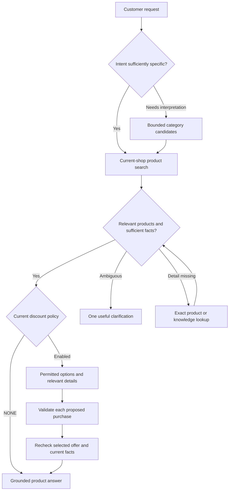

# CommerceAgent: category discovery, grounded product answers and applicable discounts

**Review revision:** 03, 4 November 2026

**Status:** architectural assessment and proposed direction; no implementation or task acceptance

**Snapshot:** `moda-interact-workspace(20261104-015544).zip`

**Architect brief:** `moda_architect(20261104-015552).toml`

**Snapshot SHA-256:** `4ac4c6d99ff697ad0b4655e2fabbfe9bdd06ad46871ff205652ba7bb409a79c3`

This review answers how a customer request such as “I want a hammer” should become a relevant, current-shop product answer with any supportable discount. Findings are grounded in the uploaded source. Proposed behavior is identified separately. The accompanying `source-baseline.json` records source hashes and the dependency versions inspected.

Revision 03 incorporates the user's clarified direction: the conversation taxonomy lives in PostgreSQL/pgvector; a repeatable environment setup creates its schema/data and publishes standard product-discovery capabilities for all authorized stores; Admin's existing taxonomy implementation stays separate and intact. Recommendation-time discount checks from revision 02 remain in scope. The user has applied none of the earlier patches, so this revision is one complete replacement against the original uploaded snapshot, with no earlier patch prerequisite.

## 1. Recommendation

Create a durable, global reference-taxonomy corpus in the existing PostgreSQL database using pgvector, and expose bounded category resolution through MCP. Use actual current-shop product reads to establish what the merchant sells, then check permitted discounts against the purchase being recommended. One taxonomy corpus per environment/source/language serves all stores; it does not contain merchant inventory or discount eligibility.

Provide one repeatable environment setup entrypoint. It should invoke the Database repository's version-controlled migration path, populate and activate a validated taxonomy generation through an MCP-owned importer, and extend Commerce's existing system-tool synchronization command to create/publish the standard discovery tools. Use the existing publication lifecycle rather than requiring manual Studio authoring. Make the category resolver and both product reads standard capabilities for every store authorized to use CommerceAgent, with no merchant opt-in. [S06, S36–S41]

Keep Admin's existing Redis source, scripts, index lifecycle, configuration UI and category-selection behavior unchanged. The new importer and runtime reader must not depend on Admin's Redis aliases, call the Admin application, or import its application files. Existing reference-embedding credential semantics can be consumed read-only without changing that implementation. [S01–S03, S17, S36]

Make discount checking part of product recommendations whenever current merchant policy permits it. Reuse ARCH-052's paginated options, on-demand condition facts and source-based validation, applied to exact product/variant identities and purchase context. Discount facts remain in the existing shop-scoped PostgreSQL catalogue. [S28–S32]

The snapshot supplies useful foundations, with specific changes still required:

- Database already installs pgvector for Merchant Knowledge, but it has no dedicated conversation reference-taxonomy corpus. Add separate global generation/category tables through a new forward migration. [S36]
- Commerce already has a script that creates/publishes its code-defined product tools. Extend it with category resolution and the required feature/behavior/response-contract changes. [S37]
- Current `product_search` provisioning and MCP eligibility still assume merchant opt-in. Convert this feature to the existing required, always-enabled model and supply its plan mappings; publication alone is insufficient. [S38–S41]
- MCP already reads products from the authenticated Shopify or WooCommerce shop. Correct the identified Shopify query/validator conflict before relying on product search. [S07, S08]
- The Shared runner supports multistep tool use, while Background still needs published Platform/Shop instruction composition and recommendation-time discount validation. [S09–S13, S28–S35]

This uses the existing PostgreSQL infrastructure and service boundaries. It requires focused schema, import, retrieval, publication and host changes; another product database, agent, conversation worker or generic migration framework is not justified.

## 2. Evidence boundaries

This is a static source review, with official provider documentation checked where API semantics matter. No live Shopify/WooCommerce shop, Redis index, PostgreSQL instance, embedding provider or production conversation was queried. The proposed PostgreSQL taxonomy schema and setup scripts are specified in this review; they are not implemented by its documentation patch. Application suites, installed-package compatibility, retrieval quality and latency were not measured.

The archive contains neither the downloaded taxonomy corpus nor the expected pinned Shopify Admin introspection artifact. Consequently, this review does not assert a verified category count, exact hammer taxonomy ID, populated deployment, or green provider execution. The intended taxonomy release is visible in the source manifest; deployed state is unknown. [S01, S26]

Task completion metadata is useful history, but inspected implementation is the authority for behavior in this snapshot. This review does not reopen accepted tasks or change their status. No developer branch, worktree, commit or push has been created by this assessment.

## 3. Keep the category concepts separate

| Concept | Meaning | Valid use in an answer |
|---|---|---|
| Global Shopify reference taxonomy | A versioned hierarchy of product concepts, proposed in PostgreSQL for conversations | Interpret intent and propose relevant product categories |
| Shopify product category | A provider product's assigned standard taxonomy node | Filter or explain that product's category, subject to provider semantics |
| WooCommerce product category | A native category term within one Woo shop | Filter that authenticated shop using a verified native ID |
| Moda Store Category | A broad merchant profile and prompt-template classification | Guide tone, domain context and prompt selection |
| Merchant product/variant result | Provider-backed identity, price, availability and other returned facts | Establish actual products and supported current facts |
| Merchant Knowledge passage | A tenant-owned retrieved reference passage | Answer supported policy/reference questions; it does not establish live stock or price |

`CommerceShopProfile` stores one `activeCategoryId`. `CommerceStoreCategoryTaxonomyMapping` maps reference categories to platform prompt categories and has **no `shopId`**. Those mappings are not a per-merchant inventory index. The Shopify onboarding suggestion samples product categories and chooses a weighted Store Category; a default suggestion is possible when matching evidence is absent. This is suitable for onboarding, but not for excluding products from a customer search. [S04, S05]

A merchant with a broad homeware profile might sell a hammer. Conversely, a hardware profile does not prove that a particular hammer is sold, available or suitable. Product results must resolve those questions.

## 4. What the snapshot actually does

### 4.1 Admin's taxonomy and existing PostgreSQL vectors are separate foundations

Admin's `src/data/shopify-taxonomy-manifest.json` pins Shopify release `2026-08` and the English `categories.en.txt.gz` asset. It is a manifest, rather than the full category dataset. Its synchronization script parses hierarchy records, embeds full paths and builds Redis Search indexes; `searchShopifyTaxonomy()` returns a bounded category list. These are current Admin facts, not the proposed conversation storage path. [S01–S03]

Admin stays unchanged in this work. Give the MCP importer its own source-controlled manifest and parser for the approved distribution. Preserve the provider's real category IDs and hierarchy; use a reviewed pinned version/source checksum. An optional local source file should contain the same approved distribution bytes, for environments where the download is staged separately. Do not reach into a sibling Admin checkout at build or runtime.

The Database migration for Merchant Knowledge already enables the `vector` extension. `MerchantKnowledgeChunk` stores an unconstrained-dimension `vector` with provenance and a dimension check, and MCP uses parameterized cosine-distance queries. Those conventions can inform the implementation. Merchant Knowledge's shop-owned sources, entitlement joins and revision lifecycle are not the destination for the global taxonomy. [S15, S36]

The new PostgreSQL corpus is independent of both Merchant Knowledge content and Admin's Redis corpus. This deliberate separation keeps Admin intact while giving the conversation path normal database persistence and a repeatable import process. Future consolidation is outside this revision.

### 4.2 The product tools exist, but have no category-search argument

Commerce's code-defined tools are:

| Tool | Operation | Current input |
|---|---|---|
| `commerce_search_products` | `products.search` | `query`, optional `maximumPrice`, `availableOnly`, `limit`, `cursor` |
| `commerce_get_product` | `products.get` | `productId`, nullable `variantId` |

Search returns at most twenty product records, a cursor and `truncated`. Category names and category IDs already appear in product outputs, but a typed category filter is absent from both the Shared input contract and MCP's allowed argument mappings. Adding a category instruction to the model alone would not add that capability. [S06, S07]

These tools perform provider reads. Shopify uses an Admin GraphQL product-variant search; Woo uses current-shop REST product and variation reads. The tool input does not select the shop, credentials or arbitrary provider URL. Keep that ownership boundary. [S07, S08, S14]

### 4.3 A concrete Shopify search blocker comes before taxonomy work

The fixed `SEARCH_DOCUMENT` declares `$first: Int!` and sends:

```graphql
productVariants(query: $query, first: $first, after: $after)
```

The real provider unconditionally calls `inspectShopifyReadQuery()`. That guard rejects a `first` argument unless its AST value is a literal integer from 1 through 20. A variable remains a GraphQL variable even when its runtime value is 20. The fixed standard search therefore conflicts with this guard before provider HTTP is attempted. [S07, S08]

This is a source-established composition defect, not a reproduced live incident. The existing core test stubs `adminGraphql`, while provider tests use a literal `first: 5`, so neither establishes that the actual fixed search document passes the real guard. [S27]

The proposed small correction is to use literal `first: 20` in this bounded fixed document and remove the unused `$first` declaration/variable. Keep the generic safety fence. Validation must exercise the actual search document through the actual guard.

Separately, provider query terms must be verified against the selected API operation. Shopify documents `category_id` for the **products** query in Admin API 2026-07; the current implementation queries **productVariants**. Do not assume the same filter vocabulary applies. A category-search branch may need a bounded products query followed by variant reads, with explicit pagination. The existing `variants.price` and `available_for_sale` search terms also need operation-specific confirmation. `availableForSale` itself is documented on the pinned Admin ProductVariant object, so this review does not classify that selected field as invalid. [W01, W02]

### 4.4 The live agent is not receiving all the authored shop guidance

The normal inbound Background host passes fixed recovery instructions, recovery state, a historical checkout total, first name, language, verified shop domain and messages. Its context contains neither the full taxonomy nor a merchant category inventory. The runner can acquire relevant facts through granted tools. [S09]

More significantly, the inbound host does not read the active Platform/Shop prompt revisions. Studio previews do resolve them and include their text in host instructions. Initial-outreach context has a separate prompt-loading path; that does not repair the normal inbound flow. [S10, S11]

The earlier ARCH-023 Commerce task explicitly deferred live Background adoption. Its historical proposal used reserved MCP prompts. Later ARCH-032 work removed trusted-instruction ownership from generic MCP discovery/execution. The correction should therefore be a bounded **Background host** read/composition of the authorised published instructions, using common Shared contracts where appropriate. Do not restore the old MCP prompt mechanism by copying that historical plan. [S11]

Even after this correction, merchant-authored instructions remain guidance. They cannot prove current stock, price, product compatibility or exhaustive catalogue membership.

### 4.5 Woo categories need their own live read support

The live Woo MCP read port currently permits product list/get and variation list/get. Its list request supports text search, not category filtering. Studio's authoring catalogue describes native category operations, but that metadata is not a registered standalone execution path. [S14]

Woo's REST API supports native category reads and category filtering. Its IDs belong to the shop's Woo taxonomy. A Shopify reference ID must never be substituted for a Woo category ID. [W03]

## 5. Recommended customer flow



The diagram shows the successful discovery paths. A failed authoritative lookup must remain distinguishable from no matches, and an unanswered factual detail must remain unknown or follow the existing referral policy.

For “I want a hammer”, the agent may search directly for a clear product term. Where classification helps, it can retrieve a few relevant taxonomy candidates, inspect the returned paths, then search this merchant's actual products. If the results include materially different tools, it can ask whether the customer means a hand hammer or a powered tool. These are illustrative interactions, not measured taxonomy outputs or claims about a real merchant's catalogue.

For “I need something to knock nails in”, semantic category lookup is more useful because the customer's language may not appear in product titles. The resolver proposes a category; the product tool establishes whether relevant products exist in this store. If category assignments are incomplete, bounded text/synonym search remains available.

A separate compulsory call asking whether the broad Moda Store Category permits the requested product adds no reliable inventory evidence. The product search can answer the merchant-relevance question directly.

Before recommending the resulting products, the agent checks permitted discounts using the same merchant policy as initial outreach. It evaluates alternatives separately and presents supported savings or conditions alongside suitable products. A discount can improve the ranking of relevant choices; it does not make an unsuitable product a useful recommendation. This requirement applies to product recommendations, without adding discount discovery to unrelated policy or factual questions.

## 6. Proposed MCP capability and contracts

These are proposed contract requirements, not frozen task definitions or claims about existing tools.

### 6.1 Add one bounded semantic category resolver

Proposed descriptive name: `commerce_resolve_product_categories`.

Example input:

```json
{
  "query": "hammer",
  "limit": 5
}
```

Reuse the existing query-length ceiling of 200 and category-result ceiling of ten unless evaluation justifies a change. The model supplies search intent; trusted request context supplies shop and environment.

The successful output should contain:

| Field | Purpose |
|---|---|
| Explicit outcome | Distinguish candidates, no candidates and classified optional unavailability |
| Taxonomy source and version | Identify the reference system whose IDs were returned |
| Category ID and full path | Let the model understand and select a real returned concept |
| Parent/ancestor information | Support interpretation of broad versus narrow categories |
| Rank or cosine distance | Describe retrieval ordering, with defined metric semantics |
| Bounded candidate list | Keep the tool useful within the existing turn budget |

Internal logs/reader state should also retain the pinned PostgreSQL taxonomy generation and embedding provenance. Avoid copying the full catalogue or operational metadata into every model prompt.

A nearest-neighbour search can return candidates even for an unrelated query. Nonempty output is not proof of a good semantic match. Use an explicit `CANDIDATES` meaning, allow rejection/clarification, and evaluate relevance before introducing a numerical cutoff. A cosine distance is a retrieval metric, not a calibrated confidence percentage; it says nothing about merchant stock. [W05]

### 6.2 Extend the existing product search contract

Add a typed category reference/filter to `commerce_search_products`, rather than requiring the model to invent provider query grammar. Specify:

- The category system and stable ID; include reference taxonomy version where applicable.
- Provider compatibility: global Shopify IDs and shop-local Woo IDs are different types of identity.
- Exact-node versus descendant behavior. Parent search must never silently mean “all descendants” without an implemented provider translation and a bound.
- Whether multiple selected categories mean OR. Prefer a small selected subset, rather than issuing one call for every candidate.
- Whether text is required in addition to a category. Permit a category-only search where supported; making the entire original natural-language sentence a mandatory AND filter can hide valid products.
- Explicit behavior when a category mapping is unavailable. Use a separate bounded text-search path; do not silently pretend that an ignored category filter was applied.
- Current result limits, pagination and truthful truncation/coverage semantics.

All category/filter semantics must be included in the signed cursor fingerprint, alongside the existing shop, query, price, availability, market, currency and expiry fields. A cursor from a different category or shop must not be reusable. [S07]

For Shopify, translate only verified taxonomy IDs through a supported pinned Admin query. Preserve product/variant identity and carry only verified price/currency context. If the provider does not directly support the chosen predicate, use a bounded implemented translation or report unsupported/partial coverage; never silently ignore it.

For Woo, add bounded native-category reads/filtering to the existing approved connection if native-category discovery is included. Such reads can sit inside the same discovery capability; a third mandatory model-visible round trip is not required merely to list every shop category. Keep global reference candidates and shop-native candidates explicitly distinguishable. No durable universal Shopify-to-Woo mapping is justified for the first increment. Where a native match is not verified, use product text search and report the limitation.

Category and product text search should complement one another. A product without a taxonomy assignment must remain discoverable by its actual title or other supported provider fields.

### 6.3 Keep detailed product answers factual

The current normalized product schema supplies compact identity, price, availability, category and URL facts. It has no description, SKU, specifications, variant option values, materials or compatibility fields. [S06]

That is enough to present some matching products, but it cannot support every follow-up question. If the customer asks about handle material, weight or accessory compatibility, extend the existing exact product read with a bounded selection of provider-backed details. Retrieve those details when needed instead of expanding every search result into a large document.

Detailed specifications are a conditional extension, not a prerequisite for the first category-discovery increment. The initial scope should state which product questions its returned facts can answer.

Price answers also need explicit currency/context handling. The published MCP product executor currently constructs its policy context without currency or market; Woo normalization therefore leaves currency null on that path. Shopify's shop currency does not establish a customer's market-specific price. Define a trusted source where currency/market context is required, preserve unknown values, and do not compare or present an amount as a customer-context price without evidence. [S07]

Use Merchant Knowledge for relevant merchant/reference material with source provenance. Preserve missing facts as unknown. A category path is not evidence that every product in that category has a particular material or use-case rating. Current price and stock still come from current product/variant evidence.

The runner's existing `evidenceIds` represent discount eligibility proofs, including a `QUALIFIES_FOR_KNOWN_RULES` outcome. Do not put taxonomy hits or similarity scores into that field. Product/category provenance should remain correctly typed tool-result data unless a separate general evidence contract is deliberately designed. [S13]

### 6.4 Check discounts as part of the recommendation

#### Reuse the canonical discount source and policy

Use `commerce_get_discount_options({limit, cursor})` for bounded discovery and `commerce_get_discount_details({offerId})` for relevant returned offers. Shared already defines these contracts and conditions covering provider identity/status, dates, product/variant/category/collection inclusions and exclusions, value/currency, subtotal and quantity requirements, customer/usage restrictions, sale exclusions, combinations and incomplete facts. MCP should map the existing shop-scoped `ShopifyDiscount.providerSnapshot` records and recheck current authorization on each request. Catalogue reads do not imply a new synchronous provider call for every discount. [S28–S31]

| Effective merchant mode | Recommendation behavior |
|---|---|
| `NONE` | Recommend from ordinary product facts; skip discount discovery and promotional claims |
| `FIXED` | Consider only the currently authorized merchant-selected discounts, including the effective Admin override |
| `AI_BEST_APPLICABLE` | Discover relevant offers from the current permitted catalogue independently of the selection checkboxes; obey provider status, dates and known conditions |

`ShopifyDiscount.isAvailable` means merchant selection, not provider availability. Keep the same meaning for Shopify and WooCommerce. A model-selected offer must originate in permitted tool observations; names, merchant prose and previous messages cannot authorize it. A prior initial-outreach offer is useful conversation history, but its earlier eligibility decision does not establish eligibility for a newly recommended purchase. [S28, S30, S32]

Use the existing bounded model/tool loop. Discover a useful page, inspect plausible offers and follow pagination when necessary within the turn budget. Reuse fresh observations within that turn. An unvisited page, `PARTIAL` facts or an exhausted budget does not prove that no discounts exist or that the selected offer is globally best. This is source-based selection, without an exhaustive eligibility pre-scan or a revived `commerce_evaluate_discount` provider-proof service. [S28, S29]

#### Evaluate a clearly identified proposed purchase

The host must bind the assessment to the current shop, provider, exact product and nullable variant identity, quantity, known provider category/collection IDs, sale status and trusted current price/currency. Represent whether it concerns the product on its own, a customer-requested addition to a known basket, or a specified replacement. Do not silently turn a recommendation into an addition or replacement. If the customer has not specified quantity, an explicitly hypothetical one-item quote is acceptable; a claim about their basket needs the actual relevant basket context.

Assess each alternative independently. Showing three possible hammers does not create a three-hammer basket or satisfy a quantity threshold. Category similarity cannot establish coupon coverage: compare the product's actual provider IDs with discount targeting and exclusions. Keep Shopify taxonomy and Woo shop-local category namespaces distinct. Woo simple products have a nullable `variantId`; the older proposal schema's required variant must not force a fabricated identity. [S06, S30, S32]

For subtotal rules, use complete, current pricing for the evaluated purchase and a known matching `subtotalRequirementCurrency`. Historical recovery totals, an unknown Woo currency or a different market's price cannot establish the threshold. Perform supported money comparisons with exact decimal/minor-unit arithmetic. Customer restrictions, usage uncertainty, unrepresented rules and unknown allocation semantics remain explicit limitations. [S07, S30, S32]

The existing pure evaluator distinguishes `SUPPORTED`, `NOT_APPLICABLE` and `UNVERIFIABLE`; retain those meanings. It currently treats minimum-quantity scope and unsupported discount kinds conservatively, and it does not supply general buy-X-get-Y evaluation. The narrower separate-product matcher rejects conditions it cannot establish. Reusing these helpers does not make those cases implemented. A conditional suggestion such as “this offer requires two qualifying items” needs sufficient source facts about the threshold and its scope; an isolated quantity number is insufficient. [S32]

| Established result | Permitted customer-facing claim |
|---|---|
| Source conditions support this exact purchase | Describe the supported promotion and how it is used; state a saving only when its calculation is also established |
| A known condition is not met | Explain the relevant condition or offer another suitable product; do not say the current purchase qualifies |
| Material conditions are unknown | State that applicability could not be confirmed; omit a guaranteed saving or discounted total |
| No applicable permitted offer was found | Give the factual product recommendation with scope-appropriate wording; do not claim catalogue-wide absence after incomplete discovery |

For example, if verified facts establish a £30 hammer and an applicable 10% product discount with no unresolved material conditions, a £3 merchandise saving and £27 merchandise price can be calculated. If the same offer requires a £50 qualifying subtotal, the single hammer does not qualify. Do not quote a final checkout total without the necessary shipping, tax, allocation and currency facts. These numbers are illustrative and are not claims about the uploaded merchant data.

Reuse known combination rules before presenting multiple offers together. The initial-outreach helper selects a mutually supported subset of at most three, otherwise a supported singleton; it does not calculate a guaranteed combined total. Two individually supported discounts do not establish stacking, and their percentages cannot simply be added. A current native sale can support a sale-price statement only where provider evidence establishes it and merchant mode permits it; it must not be presented as an invented coupon. [S28, S33]

#### Keep the validation in the existing host

Extract only the common pure comparisons that both flows need, while keeping initial-outreach and conversation lifecycle adapters separate. The current evaluator's price reconciliation is bound to `outreachAttemptId`, recovery generation and basket fingerprint. An inbound recommendation must instead use its real turn authority and proposed-purchase facts; do not fabricate an outreach attempt or invoke the initial-outreach agent as a second conversational agent. Shared remains the owner of cross-service structural contracts; narrowly reusable Background business checks can remain in Background. [S32, S34]

Use the existing final response's versioned `details` extension for a bounded identifier-based recommendation selection, subject to the published `detailsSchema`. Identify observed offer IDs, exact proposed lines/quantities and the intended type of claim. Background must validate those observations and conditions before admission, and ensure the promotional wording/amounts agree with the validated selection. For the promotional recommendation branch, Background should compose the customer message from validated selections and supported product facts in the current conversation language, then use the existing moderation/admission/delivery path. Do not forward independently authored model `replyText` for that branch. If a selection is removed or invalidated, rebuild the message without its associated promotional wording and amounts. This is a proposed contract and host adaptation, not behavior supplied by the current open-ended `details` field. Do not accept free-text discount claims with empty selection details as a way around validation. [S35]

Keep the old `evidenceIds` semantics intact while reconciling the chosen response path. Canonical options/details contain facts, whereas the existing evidence registry requires an evidence-shaped result with qualifying outcome, quantified savings/total, currency and freshness. Never manufacture such proof from an offer's `SUPPORTED` label or weaken its validator to admit source facts. A common condition check establishes only the claims justified by its inputs. [S13, S30, S35]

Before outbound admission, recheck selected offers, current merchant mode/selections, relevant source changes and the exact proposed product/variant quantities, prices and availability. Reuse the initial-outreach revalidation principle with current conversation turn/cancellation checks; do not carry its attempt-specific admission token into inbound conversations. If the selection or its supporting facts changed, recompute or suppress the promotional claim under the explicit failure policy. Re-reading stored provider snapshots establishes the current synchronized facts, not a universal provider guarantee of redemption. [S28, S34]

Checking and describing an offer are read/evaluation operations. Do not apply a code, create a discount, change quantities or mutate a basket merely because the agent recommended a product.

#### Close the observed integration gaps

The uploaded code does not yet establish this working conversation flow:

1. MCP reads merchant discount settings only for `INITIAL_RECOVERY_OUTREACH` and projects both built-ins only for that context and an enabled mode. Explicitly authorize the conversational purpose through the existing trusted request boundary; do not relabel an inbound request as initial outreach. [S31]
2. The built-in dispatcher validates arguments/selection and then unconditionally returns `ERROR/UNAVAILABLE`. The accepted MCP-002 record says complete, so reconcile that accepted implementation against the supplied snapshot before claiming the catalogue handlers work or creating duplicate tasks. This review does not infer the deployed behavior or reopen the accepted task. [S29, S31]
3. Background rejects a listed tool without a matching pinned descriptor and retained grant. Extend existing manifest/descriptor/grant handling coherently for code-defined built-ins with a stable versioned identity and current permission checks. Preserve their built-in nature without manual Studio authoring, fabricated release identities or a grant bypass. Existing grants require an explicit pre-production rollout decision. [S09, S21, S31]
4. The inbound host supplies historical recovery context, without current discount policy or a priced proposed purchase. Add the trusted context, live instruction, selection validation and revalidation described above. Preview must exercise the same canonical fact-based behavior; its older discount evaluator is not evidence that this path already works. [S09, S24, S35]

## 7. Durable PostgreSQL taxonomy and repeatable environment setup

### 7.1 Use a small, separate global schema

Database owns a new forward migration under `moda-interact-database/prisma/migrations/` and the corresponding Prisma declarations. Do not edit an applied migration, introduce script-owned ad hoc DDL, or place reference categories in `MerchantKnowledgeChunk`. Reuse the installed `vector` extension, verifying that the target database supports the accepted pgvector version. The normal migration runner creates the new tables and indexes in each environment. [S36]

Two tables are sufficient for the initial design; these names and fields are proposed, not present in the snapshot:

| Proposed table | Required responsibilities |
|---|---|
| `commerce.ReferenceTaxonomyGeneration` | Generation ID; environment; source; taxonomy version and language; pinned source URL/checksum; embedding provider/model/dimensions/index version and embedding-text format version; expected category count; completion/creation timestamps; active marker |
| `commerce.ReferenceTaxonomyCategory` | Composite generation/category identity; original category ID; name/full path; nullable parent within the same generation; level/ancestor metadata needed by the resolver; vector and dimension metadata |

Use ordinary logged PostgreSQL tables. No `shopId` is needed on public taxonomy rows, and no per-store copy is created. Keep environment in the generation identity even when environments normally have separate databases. A unique import identity should cover the environment, source/version/language/checksum, embedding provenance and the documented full-path embedding-text format, so repeating the same import can reuse it.

Require a composite category primary key `(generationId, categoryId)` and a same-generation parent foreign key. Insert categories in parent-before-child order across bounded statements so a valid hierarchy satisfies that immediate foreign key. Reject malformed hierarchy, duplicate identities, cycles and missing parents during preparation. A partial unique index on `(environment, source, language)` where the generation is active prevents two active generations for the same corpus. An active generation must have a completed import; verify the exact expected category count and all embeddings before activation.

Use the existing `vector` storage convention without hard-coding a dimension shared by every environment. Store the configured dimension and enforce `vector_dims(embedding)` equality. Tie that dimension to its generation with a composite foreign key/unique key if it is repeated on category rows, so differently dimensioned vectors cannot enter the same generation without requiring a trigger. The importer also rejects non-finite and zero-length/zero-norm vectors. The final implementation contract must freeze exact field types, constraints and indexes before migration work starts. [S36]

Start with exact cosine-distance search over the selected generation, returning at most ten results with a deterministic category-ID tie-break. This limits returned rows; it does not bound the number of vectors scored, so measure database work and latency. B-tree indexes support generation/category/parent lookup. pgvector supports exact search without an approximate nearest-neighbor index; add HNSW only if measured latency/volume justifies it, with explicit model/dimension scoping and recall tests. Do not invent a latency or corpus-size claim from this snapshot. [W05]

PostgreSQL persistence gives this corpus the database's transaction and WAL behavior. Include the tables in the existing backup/restore policy and verify restoration with the extension installed. Reproducible import is useful recovery tooling, while configured backups/PITR remain the durability mechanism for preserving the stored vectors. No live backup configuration was inspected. [W05, W06]

### 7.2 Provide one operator entrypoint with owned implementation stages

Proposed parent entrypoint: `scripts/setup-commerce-product-discovery.mjs`. Keep it a thin orchestrator, with service-local implementations rather than direct cross-service imports:

| Stage | Owner and command surface | Result |
|---|---|---|
| Schema and core-feature preparation | Database: existing `npm run migrate:deploy` with new forward migration(s) | pgvector taxonomy tables plus targeted required-feature/plan preparation |
| Taxonomy import and activation | MCP: proposed `scripts/sync-reference-taxonomy.mjs`, exposed as `npm run taxonomy:sync` | Complete validated generation available for MCP reads |
| Standard capability publication | Commerce: extend existing `npm run commerce:sync-tools` | Resolver/search/exact-product tools, approved behavior and response-contract updates published through the lifecycle |

The proposed operator command is:

```bash
node scripts/setup-commerce-product-discovery.mjs --environment=test --dry-run
node scripts/setup-commerce-product-discovery.mjs --environment=test --apply
```

These two setup commands describe the intended implementation; they do not exist in the uploaded snapshot or this documentation patch. Existing `migrate:deploy` and `commerce:sync-tools` are actual package scripts. Preserve the established explicit production-apply confirmation in the publication CLI and pass the selected environment consistently. [S37, S42]

The script must work with configured local, test, development, staging and production targets. Inputs are deployment configuration: the target database, matching environment, installed/pinned application packages and Database revision, approved taxonomy manifest, supported reference-embedding configuration/credential, and the existing authorized publication actor. It must not guess a developer path, install database binaries, invent credentials, create an administrator or silently target another environment. Report missing prerequisites with the original safe diagnostic.

A dry run performs no migrations, writes, publication or billable embedding calls. It reports required migrations, source/configuration identity, existing generation, expected import/publication actions and prerequisite gaps. On a fresh database it must distinguish schema not yet applied from an unexpected query failure; it can plan schema-dependent stages without pretending their runtime validation has passed.

An apply proceeds in these ordered stages:

1. Validate the explicit environment and configured database target. Inventory the current `product_search` capabilities before converting the feature: unexpected manually authored/custom members must not be enabled globally by accident. Check runtime/Shared contract compatibility and planned migration scope.
2. Invoke the normal migration path from the pinned Database revision. That command applies its outstanding migrations, not an isolated hand-written taxonomy schema; list the pending scope first and stop on unexpected migration drift. Do not run the broad database seed as provisioning, since it rewrites unrelated seeded plan mappings. [S39, S42]
3. Read the approved distribution from its pinned manifest or a matching staged local file. Verify its recorded checksum/version, category IDs and complete hierarchy before embedding. The current archive does not supply the full distribution or a verified content checksum; those are implementation prerequisites, not invented values. [S01]
4. Resolve the environment's reference embedding configuration and compute the import fingerprint. If an identical complete generation is already active and valid, return an import no-op before any provider call. Otherwise prepare the candidate vectors in bounded batches, with explicit input/memory limits. Do not hold a database transaction open during downloads or embedding-provider calls; the first increment needs no import-job table or background queue.
5. Verify that every category has the correct vector, dimensions and provenance, and check the exact expected count. Preserve provider error diagnostics if candidate preparation fails; no active database state changes. An interrupted preparation can be rerun from its approved source, while completed identical imports are reused without unnecessary embedding calls.
6. Insert and activate the complete generation in a bounded database transaction: take a transaction-scoped advisory lock for the corpus, recheck the observed active-generation baseline, and read/lock the existing embedding-configuration row (for example, `SELECT ... FOR SHARE`). Compare its model tuple with the prepared candidate and hold that row lock through commit, so an Admin configuration update cannot slip between the check and activation. Insert the generation/categories in bounded parent-before-child statements, verify count/constraints and a search smoke check, then switch the active marker and commit. Serialize first activation as well as replacement. An identical concurrent winner is a no-op; a different winner or changed embedding tuple is a conflict. Do not silently reactivate an older inactive generation merely because its fingerprint exists; a deliberate rollback needs an explicit operator procedure. A failed transaction leaves the prior generation intact.
7. Run the extended Commerce system-tool sync and publish only its approved changes. Use immutable revisions and compare-and-set release activation. If publication fails after taxonomy activation, report partial completion and retain the valid generation; rerun safely completes the remaining stage. These stages are deliberately not one transaction spanning remote embedding and publication.
8. Emit a bounded receipt with environment, source/checksum, generation ID, category count, embedding provenance, migration result, every standard tool action and active release ID. A successful receipt requires all requested stages to have completed; include original sanitized errors for failures.

Run provisioning explicitly during environment preparation/deployment, not at application startup, on every customer question, or whenever a new merchant connects. The shared corpus and baseline feature policy make it available to later stores without a new per-store import/publication step.

### 7.3 Pin a generation and the correct embedding purpose

The importer and resolver use `REFERENCE_TAXONOMY`. MCP's existing Merchant Knowledge embedding runtime hard-codes `MERCHANT_KNOWLEDGE` both in the configuration lookup and authenticated credential data; it must not be reused unchanged. Reuse narrow credential/embedding mechanics through a purpose-aware adapter, preserving the existing Shared crypto contract and reading the existing environment configuration without changing Admin's implementation. [S17, S36]

At runtime, resolve the active PostgreSQL generation and matching configured embedding provenance before embedding the query. Pin that generation ID for the entire lookup and query only its rows. The SQL must restrict the candidate relation before calculating distance, so vectors from other generations/dimensions cannot enter the operation. Use parameterized values, not model-supplied SQL or identifiers.

The PostgreSQL and Admin Redis corpora are independent, but initially share the environment's existing `REFERENCE_TAXONOMY` model/credential setting. The importer never writes that setting or rebuilds Admin's corpus. A configuration change that makes the active generation incompatible must produce an explicit configuration/readiness failure until a matching generation is available; equal dimensions alone do not establish model compatibility. Recheck relevant configuration identity after query embedding if it changed during the call. A credential rotation with unchanged embedding provenance does not by itself require re-embedding the corpus.

Keep completed generations immutable. Activation does not delete the previous generation, and the first increment has no automatic completed-generation garbage collector; this avoids breaking in-flight readers and retains a simple rollback path. Rows from other generations are excluded by the pinned-generation query. Any later cleanup must explicitly respect in-flight read retention. A failed import must never clear or overwrite the currently active corpus.

No Redis fallback is proposed for the conversation path. Empty candidates, missing setup, invalid data and temporary retrieval failure have different meanings. Setup/readiness must detect absent schema, missing active corpus and incompatible model/dimensions before the new capability is advertised as ready.

### 7.4 Optional taxonomy failure must have a precise meaning

In the uploaded Shared runner source, a terminal tool `ERROR` forces a store referral; a later successful product lookup does not clear that requirement. The new resolver cannot simply emit ordinary `UNAVAILABLE` and assume the agent may then answer normally. Consumer package versions must be checked when implementing this behavior. [S12, S23]

A narrow proposed solution is a normal, validated tool result whose **data** discriminates `CANDIDATES`, `NO_CANDIDATES` and classified optional `UNAVAILABLE`. A classified temporary embedding/PostgreSQL retrieval outage can then be logged and surfaced as unavailable category suggestions while the agent attempts an independently authorised product search.

The resolver descriptor and published Feature Behaviour must explicitly tell the model that `UNAVAILABLE` concerns category suggestions, establishes nothing about product existence, and still permits an answer supported by an independently successful authorised product read. This narrow instruction must fit the host's existing grounding/referral guidance. No general relaxation of terminal tool-error handling is proposed.

This is an explicit degradation policy, not a catch-all conversion of failures into success. Tenant/authorisation failures, stale turns, cancellation, malformed responses, unexpected programming errors and incompatible contracts retain the existing error path. A taxonomy outage must not become an empty successful search or a statement that the merchant lacks a product. If the authoritative product lookup also fails, preserve the existing referral behavior.

### 7.5 Make optional discount failure explicit

Proposed behavior: when a classified temporary discount retrieval failure occurs, an independently supported product recommendation may still be given without an unverified promotional claim. State that discounts could not be confirmed when relevant; do not convert failure to an empty discount catalogue. A successful read with no applicable offer, incomplete discovery, unverifiable conditions and unavailable retrieval are different outcomes.

This needs an intentional capability output-contract and published behavior change, preserving the runner's terminal-error semantics. The current options/details schemas have no optional-unavailable data branch, and a terminal tool `ERROR` forces referral. Publish a narrow, validated data outcome for the classified optional lookup failures and corresponding instructions, while preserving the generic result envelope and existing hard errors. A real terminal `ERROR` still requires referral, and a later successful call must not clear it. Do not assume the initial-outreach `INITIAL_NO_OFFER` fallback automatically applies to conversation turns. Policy/authorization changes, stale turns, malformed data and unexpected errors retain their existing guarded path. A failure to revalidate a selected promotional claim never permits sending that stale claim. [S12, S28, S30]

## 8. Information ownership and security

| Owner | Focused responsibility |
|---|---|
| Database | New forward migration(s), taxonomy models/constraints/indexes, targeted core `product_search` policy and plan mappings, canonical seed alignment |
| Shared | Published browser-safe wire contracts, existing selection semantics and reusable credential/vector validation primitives; Node-only exports where needed |
| MCP | Approved conversation taxonomy manifest/parser/importer, read-only PostgreSQL resolver, current-shop provider/category/product reads, current permitted discount facts |
| Commerce | Source-controlled standard tool definitions, automatic lifecycle publication, feature behavior/response-contract publication, inspection and Local Preview/Live Test parity |
| Background | Published Platform/Shop instruction composition, existing model/tool loop, proposed-purchase discount validation/revalidation, conversation admission/delivery |
| Parent deployment tooling | Thin environment setup wrapper invoking the owned migration/import/publication commands and reporting their results |
| System Test | Fresh/upgrade setup, rerun/failure/restart/restore and integrated store/conversation behavior after publication/deployment |

Admin remains outside the implementation touchpoints: its Redis taxonomy scripts, indexes, runtime reader and UI stay intact. Generic existing Admin plan controls already support system-required features, so their behavior can consume the corrected feature data without an Admin code change. There is no Gateway Redis wiring task for this design. Verify existing PostgreSQL and embedding access for MCP and the operator scripts. [S40, S41]

Keep database connections, Prisma queries, credentials and service-specific logging in the owning services. Do not import Admin files into MCP or import implementation files across sibling application repositories. A shared helper is justified only when it is actually reusable, not merely to move one service's SQL into another package.

Taxonomy output and provider catalogue text are untrusted reference data. Neither may override instructions or grant tools. Model arguments cannot choose a merchant, credential, provider hostname, schema/table, generation, embedding configuration or arbitrary query language. Global reference-category reads expose public taxonomy only; product, native Woo category, discount and customer reads remain scoped to the authenticated current shop.

The setup identity has migration/import/publication permissions; the customer-facing taxonomy lookup is read-only and performs no DDL, import or publication. Use existing deployment/database roles without inventing a parallel authorization system. The current MCP service uses its private caller boundary and internal shop-context assertion; this review preserves that boundary rather than certifying private networking as cryptographic authentication. [S22]

## 9. Logging and observability

At the changed importer, PostgreSQL, embedding, publication and host boundaries, use `@modainteract/moda-interact-shared/logging`. Preserve the original error object/message and bounded relevant provider/Prisma response details. Internal reason codes supplement that cause. The existing Commerce sync CLI already retains original Prisma diagnostics, including its known interactive-transaction detail; keep that behavior. [S37, S43]

Do not copy broad catch-to-unavailable patterns from the existing Merchant Knowledge retrieval as the new taxonomy policy. That implementation has catches that erase cause; the new reader must classify optional temporary failures deliberately and preserve the original safe diagnostics. The existing direct Woo reader and final Background wrapper also have cause-preservation gaps at relevant product/host touchpoints. Admin error handling is not changed by this scope. [S18, S19, S36]

Record environment, operation correlation, taxonomy generation/source checksum, embedding provenance, import counts/stage, publication action/release and lookup outcome as appropriate. Distinguish no candidates, partial discovery, incompatible/missing setup, classified temporary unavailability and terminal errors. For discounts, distinguish unmet conditions, unverifiable conditions and retrieval failure.

Preserve existing redaction: do not log database URLs containing credentials, decrypted keys, authorization headers, complete customer messages or unrestricted provider bodies. Test the actual shared logger sink so the original safe message survives end to end. CLI failures return nonzero with an actionable bounded summary; they do not continue to publish as though import succeeded.

Reuse existing framework HTTP, provider and model telemetry. Add only missing domain measurements, such as import counts, lookup latency and scored corpus size, where these cannot already be obtained. No competing generic logger or metrics framework is needed.

## 10. Standard capabilities, publication and deployment

### Make the whole discovery path standard for authorized stores

The standard set contains all three capabilities:

| Capability | Execution ownership |
|---|---|
| `commerce_resolve_product_categories` | MCP PostgreSQL reference-taxonomy lookup |
| `commerce_search_products` | MCP current-shop provider search |
| `commerce_get_product` | MCP exact current-shop product/variant read |

Reuse the existing `product_search` feature identity and its published product-tool identities. Convert that feature to `ALWAYS_ENABLED`, `systemRequired: true`, active, and include it in every merchant catalogue and operational billing plan. This covers existing and future Free/paid stores that satisfy ordinary Commerce admission. The same conversion pattern exists for `ai_conversations`: feature update, targeted plan-mapping upserts and removal of obsolete opt-in preferences. Align the canonical seed with the new required policy so a later legitimate seed does not restore opt-in; do not run the broad seed during setup. [S38, S39]

Inventory every capability attached to `product_search` before conversion. The intended globally available set is the canonical resolver/search/exact-read capability set; unexpected custom members require explicit reconciliation before the feature policy changes. Do not silently grant unrelated tools just because they share that feature row.

MCP's current resolver requires a true preference for every tool, and its feature projection lacks activation mode. Adopt the already-defined Shared rule: active feature, enabled plan mapping, and either `ALWAYS_ENABLED` or an enabled merchant preference. Update the typed projection and exclusion diagnostics, plus Commerce inspection/preview parity. Keep active-shop/platform, subscription/plan, published-tool, provider connection and conversation-grant checks. Missing or false opt-in rows do not disable a core always-enabled capability. Do not remove entitlement checks for unrelated optional features. [S20, S38, S40]

Admin's generic required-feature plan builder and controls already include system-required features, and Shopify/Woo plan materialization copies catalogue mappings. Provision the existing mappings through the targeted new Database migration and verify future-plan behavior through these existing paths. No Admin application code or taxonomy workflow changes are proposed. [S41]

### Extend the existing system-tool publication script

The existing `commerce:sync-tools` command creates/publishes code-defined product tools with an authorized actor, explicit environment, immutable revisions, ownership checks, idempotent operation IDs and compare-and-set release activation. It returns unchanged when the intended state is already active. Extend that command; do not create a second registry or require manual Studio authoring. [S37]

Add the category descriptor and registered execution operation, adopt the changed product contracts with new definition versions, and change the synchronizer's current opt-in-only feature assertion. Extend its typed two-tool action set and CLI prerequisite checks. Its receipt currently truncates actions to two; report every standard capability after adding the resolver. A registered authoring descriptor alone is not proof that MCP executes the operation. [S06, S37]

Provision the standard Feature Behaviour and the approved recommendation `details` response-contract extension as part of the same controlled publication work. The current additive successor preserves the old feature snapshot and response contract; appending the resolver cannot silently supply newly required guidance. The implementation must publish the intended owned behavior/contract changes explicitly, with their hashes/versions, while preserving all unrelated release members, pinned revisions, behavior and response-contract fields. [S35, S37, S44]

Do not use a broad “publish latest everything” rebuild: `createRelease` chooses current latest tool revisions and feature prompts. Retain the synchronizer's conflict checks, or supply exact-pin successor replacement semantics when needed. Same-name manually owned tools, changed content at an existing definition version, unrelated snapshot drift or a concurrent pointer change must produce a clear conflict. No automatic startup publication is introduced. [S37, S44]

The user-facing outcome matches discounts: system-provided capabilities without per-store authoring. Their implementation mechanisms remain clear: discount options/details are MCP built-ins; category/product tools use the existing scripted versioned publication path. Do not republish the discount built-ins as manually authored tools. Their conversational authorization and selected-offer validation remain the separate integration described in section 6.4. [S28, S31]

### Deploy compatible readers before publishing the new capability

MCP already has database configuration. Verify the target PostgreSQL extension/version, new schema/constraints, completed active generation, embedding credential access and installed contract versions. The setup cannot install a managed provider's extension binaries or replace an absent runtime deployment; it reports those prerequisites explicitly. No additional Redis environment group is required for conversation taxonomy. [S22, S36, S42]

Snapshot package metadata differs:

| Repository | Shared package declaration |
|---|---|
| Shared source | `3.1.0` |
| Background | `3.0.0` |
| Admin | `3.0.0` — remains unchanged in this scope |
| MCP | `2.8.1` |
| Commerce | `2.7.2` |

Publish accepted Shared changes first, then adopt the verified package and Database revision in affected MCP/Commerce/Background consumers. Deploy compatible runtime handlers and host validation before running the setup's publication stage. Select versions from real publication evidence; sibling source is not the package installed in a service. [S23]

Existing conversations retain a release/capability/revision grant. Even an additive successor can fail the present exact manifest/grant comparison. Use a documented pre-production transition for retained test conversations, coordinated with active turns: establish fresh conversations/grants or an explicitly reviewed reset/regeneration path. The setup must not silently rewrite grants, widen permissions or clear them during tool publication. There is no need for speculative legacy adapters. [S09, S21, S38]

Local Preview needs explicit parity: current local providers register legacy `shopify.searchProducts`, whereas system tools use `products.search`/`products.get`; the new category lookup and canonical discount facts also need the chosen preview path. Test the real published MCP execution independently of authoring metadata. [S24]

### Keep import and runtime work bounded

Category import runs during setup, with bounded provider batches and input/memory limits. During a turn the resolver embeds only the query, searches one pinned generation and returns a small candidate list. Exact vector search still scores the matching corpus; measure latency and expected concurrency before introducing ANN. Changing the taxonomy store does not justify increasing the model/tool budget automatically.

The uploaded Shared source defaults to 12 model steps and 10 remote calls; Background supplies its LIVE deadline/output budget. Category lookup is available by default, but it need not run for a clear product name that can be searched directly. Product pages, discount discovery/details and selected-offer revalidation share the turn budget. Leave capacity to validate the final recommendation, and report limited findings when exploration ends. [S12, S23]

A future reference-query cache would need source/generation/embedding provenance and would remain optional. No Redis cache is needed for the initial conversation taxonomy design. Product prices/stock and discount conditions retain their own current-shop context and freshness requirements.

## 11. Proposed execution order by touchpoint

This is sequencing guidance, not executable task definitions. No architecture ID has been allocated and no task is marked Ready or Complete by this report. The setup command and migration/table names above are proposed implementation contracts.

1. **Reconcile working source reads.** Correct/test the Shopify search-document/provider-guard composition, verify pinned provider category-filter behavior, and reconcile the accepted ARCH-052 discount catalogue/details implementation with the observed MCP stub.
2. **Freeze the coherent contracts and Database design.** Define category identity/outcomes, search filters, optional product details, PostgreSQL generation/category fields and exact migration constraints, core-feature mapping, conversational discount authorization, recommendation details and optional-lookup behavior. Keep schemas structural and business policy in the owning service.
3. **Implement/publish the prerequisites.** Database supplies new forward schema/feature migrations and fresh/upgrade proofs; Shared publishes accepted wire/helper changes through its separate publication gate. Update only the affected consumers to verified revisions/packages.
4. **Implement MCP import and retrieval.** Add the pinned source manifest/parser, reference-purpose adapter, repeatable importer and parameterized PostgreSQL resolver; connect provider search and canonical discount facts. Add correct always-enabled selection/diagnostics. Admin stays untouched.
5. **Extend Commerce provisioning and host grounding.** Commerce's existing sync creates/publishes all three standard capabilities plus approved behavior/response changes, preserving unrelated pins; inspection and preview gain parity. Background loads published instructions and validates/rechecks proposed-purchase promotions through the existing loop.
6. **Wire and run the thin environment setup.** After compatible runtime deployment, use the parent wrapper to invoke migrations, import and controlled publication. Verify a fresh target, rerun, interrupted stage, publication conflict, restored database and retained-grant transition. Do not make application startup perform these writes.
7. **Validate integrated shop behavior.** Test new/existing Free/paid shops, Shopify/Woo provider access, no preference rows, product/category relevance, supported discount claims, failure semantics and supported languages. System-test work follows all implementation/publication/deployment prerequisites.

ARCH-052 remains the dynamic-discount/initial-outreach initiative. Reuse its product tools, canonical discount facts and narrow checks for this separately scoped conversation requirement, without repurposing its ID or reopening accepted tasks. Preserve ARCH-055 API and ARCH-056 Background work. The review patch changes only its two new review documents; no implementation, architecture index or `docs/decisions/**/_index.md` is modified.

## 12. Focused acceptance scenarios

| Scenario | Required observation |
|---|---|
| Fresh and upgraded PostgreSQL environment | New forward migration creates valid vector tables/constraints; prior applied migrations are unchanged |
| Repeated complete setup with identical inputs | Taxonomy import and publication converge to no-op; no duplicate generation/tool or repeated embedding cost |
| Failed embedding or activation transaction | Prior active generation remains usable; failure exits nonzero with the original safe cause |
| Concurrent setup, same versus different generation | Same completed input converges; a different concurrent winner produces conflict instead of overwrite |
| Embedding settings change during preparation | Candidate is not activated against an incompatible current model tuple |
| Incorrect source checksum, hierarchy or vector dimensions | Import fails before activation; invalid records cannot become the active corpus |
| PostgreSQL restart and backup/restore | Completed taxonomy and active-generation identity survive; restored queries work with the required extension |
| Explicit environment differs from deployment target | Setup stops before mutation; it never selects a different environment implicitly |
| Tool publication fails after successful taxonomy activation | Receipt reports partial completion; rerun reuses taxonomy and finishes publication safely |
| Unrelated tool revision or feature behavior drifts | Sync preserves unrelated immutable pins/snapshots or stops with a conflict; it does not publish all latest state |
| Unexpected capability attached to product_search | Provisioning stops for explicit reconciliation before enabling that membership for all stores |
| Existing/new Free/paid store with absent or false preference | Required resolver/search/exact-read tools are eligible under ALWAYS_ENABLED when ordinary shop/plan/provider admission holds |
| Existing and future catalogue/operational plans | Core product_search mapping is present; no per-shop provisioning job is needed |
| New bootstrap and conversational lookup | Neither invokes Admin scripts nor changes its Redis corpus, UI, mappings or settings |
| Actual fixed Shopify search through actual provider guard | Request passes local validation after the scoped fix; invalid/unbounded documents remain rejected |
| “I want a hammer” | Agent can discover relevant products using available authorised tools and answer from returned facts |
| Description instead of product noun | Category lookup can assist “something to knock nails in”, without assuming a measured ranking in advance |
| Broad or incorrect Store Category | Relevant current-shop product remains discoverable |
| Product has no standard category | Text/product lookup still finds it |
| Ambiguous product word | Model performs a bounded useful search or asks one relevant clarification |
| No good reference candidate | Agent does not equate reference taxonomy absence with merchant product absence |
| Category filter produces no products | Outcome is distinguished from provider failure and incomplete search; broaden carefully or report limited findings |
| Truncated products/descendants | Agent does not claim exhaustive absence or that it has inspected every matching product |
| Two Woo shops reuse numeric category IDs | Current-shop isolation is preserved; cross-shop results never appear |
| Shopify reference ID supplied as Woo-native ID | Rejected or explicitly unsupported before provider I/O; no guessed mapping |
| Cursor reused after filter/category change | Rejected; supported pagination remains deterministic |
| PostgreSQL generation activation during query embedding | Read uses its pinned, retained complete generation; a newer activation does not mix vectors |
| Same dimensions but changed embedding model | Provenance mismatch prevents a semantically invalid vector query |
| Classified temporary embedding/PostgreSQL lookup outage | Original safe error is logged; typed category degradation permits an independently successful product search only under the agreed policy |
| Authorisation revoked or turn stale | Existing hard failure/cancellation behavior remains intact |
| Product detail missing | Agent does not invent material, weight, compatibility, price or stock |
| Relevant product with a supported promotion | Recommendation checks permitted offers, validates exact product/variant and purchase facts, and states only supported terms |
| Merchant mode NONE | No discount discovery or promotional claim; ordinary product recommendation remains possible |
| FIXED selection changes; AI includes an unselected offer | FIXED respects the current selected set/override; AI catalogue access remains independent of checkboxes |
| Discount title resembles a taxonomy candidate | Title/similarity alone never establishes eligibility; actual same-shop provider identities and exclusions govern |
| Two shops reuse a coupon/category ID | Discount details and product targeting remain scoped to the authenticated shop and provider |
| Three displayed alternatives or changed quantity/variant | Alternatives are assessed separately; changed purchase facts invalidate the earlier assessment |
| Minimum spend, unknown quantity scope or mismatched currency | Known unmet conditions are distinguished from unverifiable conditions; no invented qualification or money comparison |
| Individually applicable but incompatible offers | No stacking claim; a supported singleton or supported compatible subset is chosen |
| Partial/empty/failed discount discovery | Outcomes remain distinct; incomplete or unavailable lookup never becomes “no discounts exist” |
| Product result succeeds but optional discount lookup fails | Product-only recommendation is possible only under the explicit validated degradation policy; original safe error reaches logs |
| Offer expires, is deselected, or source/price changes before admission | Selected claim is recomputed or suppressed; stale promotional text is not sent |
| Canonical facts passed through the conversation response | Versioned selection details are validated; no manufactured legacy evidence ID, unsupported savings or free-text bypass |
| Recommendation has a code or hypothetical basket change | No code application, discount creation or basket mutation occurs without the appropriate user action |
| Catalogue text contains instructions | Text remains reference data and cannot change permissions/instructions |
| New standard capability release published | New/retained conversation grants and pinned descriptors follow the explicit rollout policy; no silent grant expansion |
| Live versus Studio guidance | Platform/Shop Instructions have the intended host precedence and authorised revisions |
| Supported customer languages | Actual configured embedding/model path is evaluated; English corpus plus translated UI is not treated as proof of multilingual retrieval quality |
| Error reaches logger sink | Original safe message/response detail survives, while credentials and sensitive payloads remain redacted |

Use disposable PostgreSQL 17 plus pgvector for the new fresh/upgrade/import/restart/restore proofs. MCP's current integration compose fixture is pg16, so add an explicit isolated pg17 fixture rather than reporting that the existing one meets this contract. [S42]

Use scripted-model integration tests for deterministic orchestration, tenant boundaries and failure behavior. Use a separate small, explicitly scored semantic evaluation for synonyms, ambiguity and supported languages. Passing scripted tests does not measure real-model relevance.

## 13. Evidence register

Paths are relative to the uploaded parent workspace. Line references identify this snapshot and are not claims about later source revisions.

| Ref | Source evidence |
|---|---|
| S01 | `moda-interact-admin/src/data/shopify-taxonomy-manifest.json:1–5`; `moda-interact-admin/scripts/sync-shopify-taxonomy.mjs:50–81` |
| S02 | `moda-interact-admin/scripts/shopify-taxonomy-distribution.mjs:1–91`; `scripts/shopify-taxonomy-redis-sync.mjs:98–176`; `scripts/sync-shopify-taxonomy.mjs:285–311,370–508` in the same Admin repository |
| S03 | `moda-interact-admin/src/lib/admin/shopify-taxonomy.ts:17–57,333–365,385–501,505–619` |
| S04 | `moda-interact-database/prisma/schema.prisma:3819–3849,3970–3989,4118–4137` |
| S05 | `moda-interact/app/services/store-profile/shopify-taxonomy-suggestion.server.ts:3–11,32–120`; `store-category-selection.server.ts:59–106` in the same directory |
| S06 | `moda-interact-commerce/src/commerce/bootstrap/system-product-tools.ts:5–83`; `moda-interact-shared/src/commerce/schemas.ts:232–254,434–446,471–480` |
| S07 | `moda-interact-mcp/src/execution/policy/shopify-core-executor.ts:49–54,105–119,139–169`; `shopify-core.ts:53–90,110–197,244–396` in the same directory |
| S08 | `moda-interact-mcp/src/connections/resolver.ts:70–133`; `connections/shopify/provider.ts:290–318`; `connections/shopify/document.ts:12–62`, all beneath `src/` |
| S09 | `moda-interact-background/src/agents/commerce.agent.ts:21–61`; `src/commerce/host.ts:104–137,193–244,284–345`; `src/commerce/recovery-instructions.ts:1–6` |
| S10 | `moda-interact-background/src/commerce/model-resolution.ts:38–40,96–98`; `moda-interact-commerce/src/commerce/agent-configuration/effective-configuration.ts:136–178`; `src/commerce/preview/service.ts:520–523` in Commerce |
| S11 | `docs/decisions/commerce/ARCH-023/COMMERCE-003-resolve-platform-shop-instructions.md:47–57,551–557`; `docs/decisions/mcp/ARCH-032/MCP-013-shop-scoped-capability-resolution-and-structured-logging.md:41–58`; `moda-interact-background/src/services/recovery-offers/initial-outreach-agent-context.service.ts:178–184` |
| S12 | `moda-interact-shared/src/commerce/runner/preflight.ts:92–115`; `runner/graph/graph.ts:35–53`; `runner/tool-execution.ts:79–160`; `runner/final-response.ts:24–35`; `schemas.ts:412–431`, all beneath `src/commerce/` |
| S13 | `moda-interact-background/src/commerce/evidence.ts:58–77,116–135`; `moda-interact-shared/src/commerce/runner/final-response.ts:30–35` |
| S14 | `moda-interact-mcp/src/connections/ports.ts:16–20`; `connections/resolver.ts:28–59`; `connections/woocommerce/direct-product-reader.ts:85–112,162–229`; `runtime/service-ports.ts:30–60`, all beneath MCP `src/`; `moda-interact-commerce/src/commerce/woocommerce/read-operation-catalogue.ts:136,237–239` |
| S15 | `moda-interact-mcp/src/execution/merchant-knowledge/contracts.ts:7–30`; `retrieval.ts:45–61,94–144` in the same directory; `moda-interact-database/prisma/schema.prisma:4269–4287` |
| S16 | `moda-interact-admin/src/lib/admin/shopify-taxonomy-index-management.ts:397–425,427–468,505–524` |
| S17 | `moda-interact-mcp/src/execution/merchant-knowledge/embedding-runtime.ts:18,68–80,138–148`; `moda-interact-admin/src/lib/admin/shopify-taxonomy-embedding.ts:139–199` |
| S18 | `moda-interact-admin/src/lib/admin/shopify-taxonomy-embedding.ts:208–256`; `shopify-taxonomy.ts:353–365` in the same directory; `moda-interact-mcp/src/connections/woocommerce/direct-product-reader.ts:181–225`; `connections/shopify/provider.ts:128–157,225–242` beneath MCP `src/` |
| S19 | `moda-interact-background/src/commerce/host-diagnostics.ts:124–161`; `mcp-client.ts:37–46,97–182,343–352`; `host.ts:449–458`; `production-model.ts:131–210,319–330`, all in the same directory; `moda-interact-shared/src/logging/redaction.ts:61–65,101–102` |
| S20 | `moda-interact-commerce/src/commerce/bootstrap/system-commerce-tool-sync.ts:101–121`; `moda-interact-mcp/src/capabilities/resolve.ts:49–93` |
| S21 | `moda-interact-background/src/commerce/grants.ts:31–44,76–103`; `tests/integration/commerce/host-suites/authority.ts:50–65`; `tests/integration/commerce/host-suites/grants.ts:120–170` in Background |
| S22 | `moda-interact-gateway/render.test.yaml:313–333`; `moda-interact-gateway/docs/mcp-private-deployment.md` |
| S23 | `package.json` in `moda-interact-shared`, `moda-interact-background`, `moda-interact-admin`, `moda-interact-mcp` and `moda-interact-commerce` |
| S24 | `moda-interact-commerce/src/commerce/products/index.ts:261–270`; `src/commerce/preview/local-policy-providers.ts:394–404`; `src/commerce/execution/policy-operation-authoring.ts:7–16` |
| S25 | `docs/architecture/ARCH-023-merchant-knowledge.md:1237–1265`; `docs/architecture/ARCH-032-standalone-commerce-mcp-extraction.md` |
| S26 | `moda-interact-commerce/lib/discovery/admin-schema.ts:2`; `moda-interact-mcp/scripts/install-shopify-admin-schema.mjs:5–24`; exact archive inventory |
| S27 | `moda-interact-mcp/tests/unit/execution/policy/shopify-core.test.ts:37–53`; `moda-interact-mcp/tests/unit/connections/shopify/provider.test.ts:10–11` |
| S28 | `docs/architecture/ARCH-052-checkout-personalised-initial-whatsapp-outreach.md:14–31,40–72` — canonical policy, read-only catalogue facts, built-ins, source-based selection and pre-production scope |
| S29 | `docs/decisions/mcp/ARCH-052/MCP-002-execute-published-discount-options-and-proof.md:12–16,39–60,114–134` — accepted status versus required catalogue/details implementation |
| S30 | `moda-interact-shared/src/commerce/schemas.ts:177–200,255–342,447–455,481–490` — proposal identity limits, canonical options/details/conditions and distinct legacy evidence output |
| S31 | `moda-interact-mcp/src/capabilities/prisma-reader.ts:44–78`; `src/execution/discount-tools.ts:27–85`; `src/mcp/registration.ts:40–67`; `src/runtime/service-ports.ts:65–71` — outreach-only policy/projection and unavailable built-in dispatch |
| S32 | `moda-interact-background/src/agents/initial-outreach-offer.eligibility.ts:20–125,134–157,170–293`; `initial-outreach-offer-product-target.ts:6–47`; `initial-outreach-offer.graph.ts:338–367,505–587`; `initial-outreach-offer.instructions.ts:14–27` in the same directory |
| S33 | `moda-interact-background/src/agents/initial-outreach-offer.combinations.ts:27–85,95–139` — supported combination/subset checks, without a combined-money guarantee |
| S34 | `moda-interact-background/src/services/recovery-offers/initial-outreach-agent-context.service.ts:218–229,252–268`; `current-outreach-offer-revalidation.service.ts:205–228,252–284,329–359,393–428`; `current-discount-source-fence.ts`; `recovery-outreach-mcp-selector.service.ts:15–20,119–163` in the same directory |
| S35 | `moda-interact-shared/src/commerce/response.ts:56–74,114–124`; `moda-interact-background/src/commerce/host.ts:284–305,325–345,375–390`; `moda-interact-database/prisma/schema.prisma:3586–3604` — response details, existing host/grant checks and persisted grant structure |
| S36 | `moda-interact-database/prisma/migrations/20260929160000_arch023_merchant_knowledge_schema/migration.sql:2,230–256`; `prisma/migrations/20261005093000_arch023_embedding_configuration/migration.sql:3–59`; `prisma/schema.prisma:3746–3767,4269–4287,4358–4363`; `moda-interact-mcp/src/execution/merchant-knowledge/retrieval.ts:94–120` — existing pgvector/configuration conventions |
| S37 | `moda-interact-commerce/package.json:72`; `scripts/sync-system-commerce-tools.mjs:13–32`; `src/commerce/bootstrap/system-commerce-tool-sync.cli.ts:34–71,79–105,108–134,147–205`; `src/commerce/bootstrap/system-commerce-tool-sync.ts:101–170,208–283,289–461` — existing explicit system-tool bootstrap/publication |
| S38 | `moda-interact-database/prisma/schema.prisma:865–895`; `moda-interact-shared/src/commerce/selection.ts:9–50,87–105` — activation modes and retained-grant identity |
| S39 | `moda-interact-database/prisma/migrations/20261005143000_ai_conversations_required/migration.sql:16–62,64–116`; `prisma/seed.mjs:118–149` — targeted core-feature conversion precedent and broad-seed overwrite behavior |
| S40 | `moda-interact-mcp/src/capabilities/records.ts:18–21`; `resolve.ts:77–80,112–120`; `prisma-reader.ts:27–32` in the same directory; `moda-interact-commerce/src/commerce/integration/backend.ts:250–275` — current unconditional preference handling and inspection parity |
| S41 | `moda-interact-admin/src/lib/admin/merchant-knowledge-plan-policy.ts:99–111`; `merchant/pricing-plan-feature-controls.ts:56–67`; `merchant/merchant-pricing-plan-feature-persistence.ts:31–54` below the same Admin lib directory; `moda-interact/app/services/billing/billing-plan-resolution.service.ts:142–149`; `moda-interact-api/src/woocommerce/billing/initial-free-activation.service.ts:220–227` — existing generic required-plan behavior, without Admin code changes |
| S42 | `moda-interact-database/package.json` (`migrate:deploy`); `moda-interact-mcp/package.json` (no taxonomy import script yet); `moda-interact-mcp/scripts/install-shopify-admin-schema.mjs:5–28`; `moda-interact-mcp/tests/integration/compose.yaml:5`; `moda-interact-gateway/render.test.yaml:313–333` — actual environment/script prerequisites |
| S43 | `docs/observability/shared-logging.md`; `moda-interact-commerce/src/commerce/bootstrap/system-commerce-tool-sync.cli.ts:79–93,195–205` — shared logger and original safe Prisma diagnostic preservation |
| S44 | `moda-interact-commerce/src/commerce/publication/lifecycle.ts:245–321`; `docs/decisions/commerce/ARCH-052/COMMERCE-006-bootstrap-product-search-and-get-product-tools.md:38–45,61` — latest-state release construction versus exact additive successor and explicit provisioning policy |

### Official references checked on 4 November 2026

- **W01:** [Shopify Admin API 2026-07: products](https://shopify.dev/docs/api/admin-graphql/2026-07/queries/products) — documented product-category filtering and product query surface.
- **W02:** [Shopify Admin API 2026-07: ProductVariant](https://shopify.dev/docs/api/admin-graphql/2026-07/objects/ProductVariant) — documented variant fields and embedded query reference. Use operation-specific filters; the category filter shown on another connection is not evidence of root variant-search support.
- **W03:** [WooCommerce REST API v3](https://woocommerce.github.io/woocommerce-rest-api-docs/) — native product categories and product category filtering.
- **W04:** [Redis vector search concepts](https://redis.io/docs/latest/develop/ai/search-and-query/vectors/) — historical Admin implementation reference only; not a proposed conversation dependency.
- **W05:** [pgvector official project documentation](https://github.com/pgvector/pgvector) — exact/approximate search, cosine distance, variable-dimension storage/indexing and WAL support.
- **W06:** [PostgreSQL 17: continuous archiving and point-in-time recovery](https://www.postgresql.org/docs/17/continuous-archiving.html) — backup/WAL recovery requirements.

## 14. Review outcome

The revised direction follows the user's clarified requirements: PostgreSQL/pgvector owns the conversation reference taxonomy; one environment setup workflow creates the schema, imports a complete generation and publishes the standard resolver/product tools; Admin's existing taxonomy implementation stays intact. The agent then grounds recommendations in current merchant products and checks permitted discounts against the exact proposed purchase.

Revision 03 fully supersedes the unapplied revision 01/02 review patches. Its full patch adds only this review and its source baseline to the original uploaded snapshot. It specifies the intended scripts and service changes; it is not an implemented setup command, task acceptance, deployment claim or substitute for the required migration and integrated validation.
